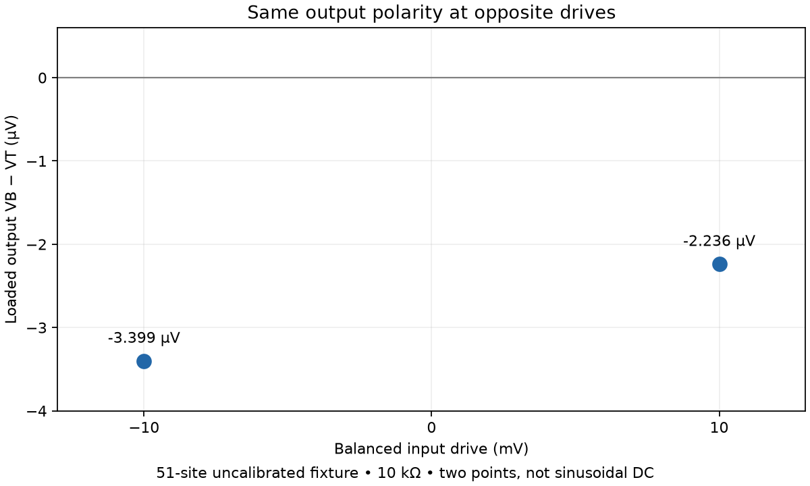

# Ballistic Device Lab

An open simulation project exploring **graphene shapes that turn an alternating electrical input into a DC output**. Software proposes etched obstacles, calculates electron transport and compares designs under the same test conditions.

The intended application is a sensitive, zero-bias signal detector. No candidate has yet demonstrated an advantage over a fabricated or commercial detector.

[Current work](#current-work) · [Historical results](#historical-results) · [Physics and limits](#physics-and-limits) · [Run-and-review guide](#run-and-review)

## Current work

**Fresh search rounds are authorized, but have not started.** We are connecting self-consistent quantum charge and Poisson electrostatics to the geometry evaluator. The original fixed-potential campaign remains stopped at checkpoint 433; its published results end at matched round 430.

| Workstream | State | Evidence |
| --- | --- | --- |
| New charge/Poisson model | Loaded operating points completed on one small fixture | [Completed +10 mV](results/physics-reference/loaded-feedback-complete/README.md), [−10 mV](results/physics-reference/loaded-feedback-reverse/README.md), [+5 mV](results/physics-reference/loaded-feedback-half/README.md) |
| Half-amplitude comparison | Both signs complete; raw even response closely follows amplitude squared; offset unresolved | [Matched ±5/±10 mV evidence](results/physics-reference/loaded-feedback-reverse-half/README.md) |
| Geometry integration | Geometry-capable fixture added; empty-control equivalence and obstacle removal tests pass | [Fixture tests](tests/test_geometry_feedback_fixture.py) |
| Fresh optimization | Not started; no new-model shape rankings yet | [Next campaign](#next-campaign) |

The completed +10 and −10 mV outputs are **−2.236 and −3.399 µV** into 10 kΩ. Their two-point even component is −2.818 µV. These are instantaneous operating points on an uncalibrated 51-site fixture; they do not establish a sinusoidal DC average or better geometry.



### Next campaign

1. Measure zero-drive output under the same assumptions as the completed ±5 and ±10 mV pairs. Report any offset before interpreting amplitude scaling.
2. Connect the geometry fixture to loaded evaluation, check phase/numerical convergence and model sensitivity, then benchmark D00, the synthetic triangle and retained leaders under identical conditions.
3. Start a small campaign from round zero with a frozen model, explicit objective, controls and fresh exploration. Publish new geometry images only from those new results.

Exploratory searches can use documented assumptions; predictive device claims need calibration. The old campaign's checkpoints, controls and rankings will remain separate. Neuromorphic experiments additionally require dynamics and energy accounting; static rectification does not demonstrate memory or neuron-like behavior.

## Historical results

**These shapes and scores come from the stopped fixed-potential search.** The gallery is deliberately frozen; it is not a picture of newly optimized self-consistent devices.


Each square is a graphene region with four contacts. Filled polygons are **etched-out regions**, and the remaining white area conducts. Orange segments are contacts. The drive is applied left-to-right; the output load connects top and bottom.

The historical test used a 14.76 nm-wide device, 10 mV peak drive, 10 kΩ load and 300 K reservoirs with fixed internal potential. Three search methods each evaluated 8,640 candidates, including the same 40 starting designs, across 430 matched rounds.

| Method | Best converged design | DC magnitude (µV) | DC power (pW) |
| --- | --- | ---: | ---: |
| Synthetic control | D00 | 11.205 | 0.01256 |
| Top-score selection | elite-r0-profile-g411-1 | 27.150 | 0.07371 |
| Diversity archive | diversity-r0-profile-g73-1 | 28.331 | 0.08026 |
| Random search | random-r0-profile-g293-0 | 22.319 | 0.04981 |

Equal candidate counts are **not equal CPU budgets**. These differences do not establish a superior search algorithm. The nominal diversity winner exceeded D00 in only **13 of 27** tested conditions; its median power ratio was **0.445×**. A nominal winner is not necessarily robust.

D00 and triangle-control are synthetic controls, not replicas of published devices. Numerical convergence verifies the calculation within its model, not the missing physics.

[Full round report and charts](results/continuous-dc/round-000430/README.md) · [Robustness cases](results/continuous-dc/round-000430/robustness) · [Independent scoring audit](results/2026-10-22-dc-audit/README.md) · [Local mutations](local_lab/README.md) · [Atomic-edge study](edge_lab/README.md)

### How shapes are explored

Elite selection mutates strong parents; diversity selection mutates representatives of different geometry neighborhoods; random search samples without previous scores. All retain fresh exploration where specified by their protocol. Available families are triangles, bevels, free profiles, islands and radial polygons—the search cannot invent outside its representation.

Shape mutation creates a new candidate. Numerical refinement evaluates the same candidate on denser energy and phase grids. The historical objective was nominal DC load power; detector qualification is a separate step.

[Search implementation](ballistic_lab/search/dc_space.py) · [Diversity selection](ballistic_lab/search/diversity.py) · [Historical progress chart](results/continuous-dc/round-000430/progress.png)

## Physics and limits

| Component | Established here | Still unresolved |
| --- | --- | --- |
| Quantum transport and load | Coherent graphene lattice, ideal leads, terminal conservation and load accounting | Real contacts, phonons and finite-frequency response |
| Charge/Poisson feedback | Small equilibrium and finite-bias fixtures; loaded operating points | Integration and qualification across searched designs |
| Charge deposition | Finite Gaussian mapping and analytic checks; two-grid comparison | Physical charge-width calibration and full convergence |
| Bound-state occupation | Explicit reference-reservoir rule; eight regression tests including 12 temperature/filling cases | Whether that closure describes the physical device |
| Noise | Preliminary equilibrium device/load audit | Driven, amplifier and low-frequency excess noise |
| Fabrication robustness | Selected contact and atomic-vacancy studies | Fabrication distributions and yield |

The detector goal is **≤0.35 pW/√Hz noise-equivalent power**, ten times below the chosen conventional reference's typical value. The preliminary audit of historical design g15 reports **1.239 pW/√Hz** under ideal electrical conditions. This is not a matched commercial-device measurement, and no design is qualified. Bandwidth, dynamic range, coupling and operating conditions must also match.

[Physics assumptions and experiments](physics_layers/FINITE_BIAS.md) · [Qualification requirements](docs/DEVICE-ROLE.md) · [Noise audit](results/physics-reference/detector-audit/README.md) · [Conventional comparator](references/conventional-detectors/README.md)

### Published-device comparisons

| Reference | Available evidence | Missing comparison |
| --- | --- | --- |
| [Auton et al., 2016](references/auton-2016/README.md) | Scale-calibrated contour reconstruction and source image | Matched contacts, materials and electrical response |
| [Shi et al., 2026](references/shi-2026/README.md) | Device image and benchmark record | Reconstruction and reconciled operating conditions |

[Figure provenance](docs/assets/literature/README.md) · [Matched comparison requirements](docs/PAPER-COMPARISON.md)

## Run and review

Use the repository root and the environments specified in [requirements.txt](requirements.txt), [requirements-gpu.txt](requirements-gpu.txt) and [environment-quantum.yml](environment-quantum.yml). Quantum calculations require Kwant; earlier GPU ray studies use optional CUDA.

```sh
# Run tests in an environment with the required dependencies.
python -m unittest discover -s tests

# Render completed historical snapshots; this does not start a search.
python -m ballistic_lab.reporting.dc_continuous
```

The historical worker is intentionally stopped. Preserve its STOP sentinel and do not launch overlapping workers. New experiments use distinct run directories and source manifests. Configure BLAS for one thread per worker and follow the [start/stop contracts](docs/ARCHITECTURE.md#continuous-search-worker).

For review, check the model, controls, convergence gates and objective against each claim. Pending and failed attempts remain evidence, not accepted scores. Immutable historical report duplicates share storage through hard links; unique scientific records are retained.

- [Architecture and operating contracts](docs/ARCHITECTURE.md)
- [Physics roadmap](docs/PHYSICS-ROADMAP.md)
- [Evidence index, including earlier GPU studies](docs/EVIDENCE-INDEX.md)
- [Archived experiment narrative and detailed dashboards](docs/EXPERIMENT-RECORD.md)

## License

[MIT](LICENSE). External figures and publications retain their stated licenses.
