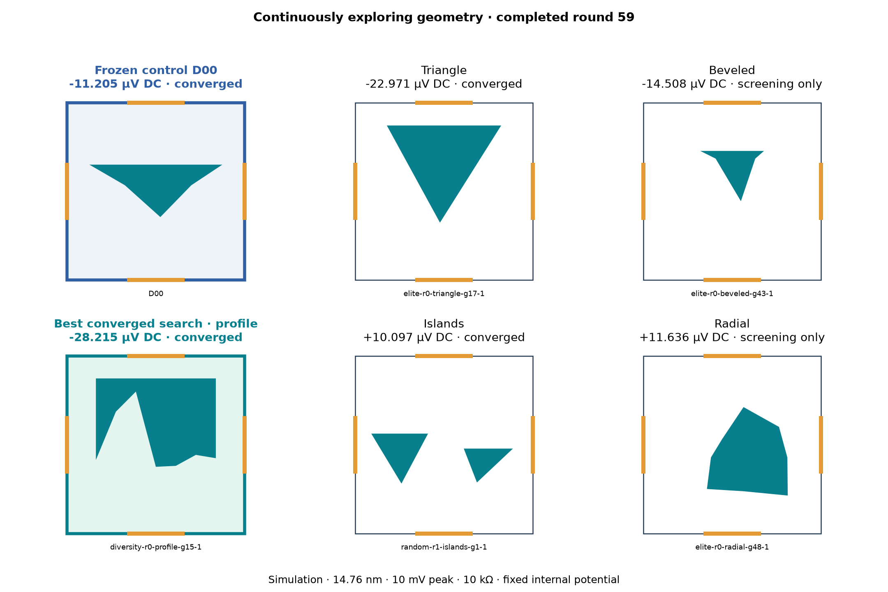
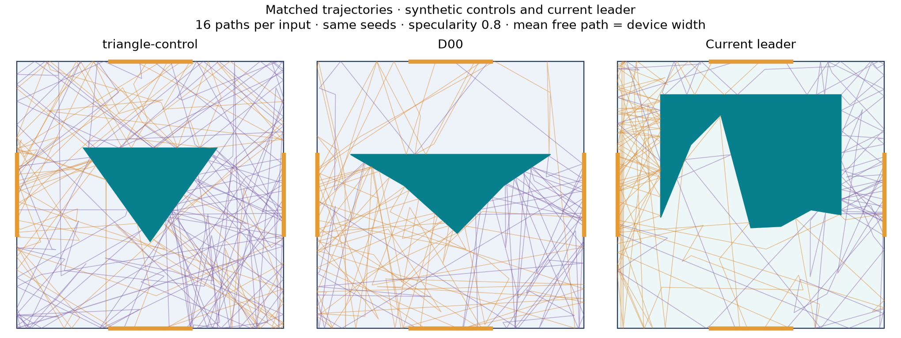
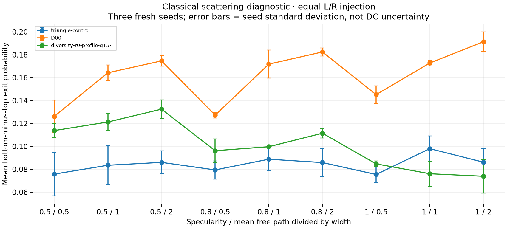
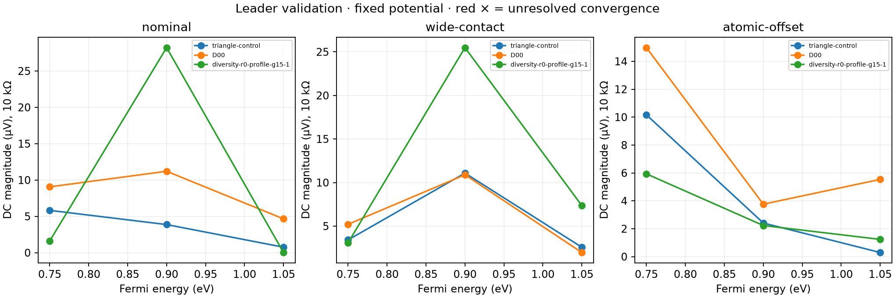
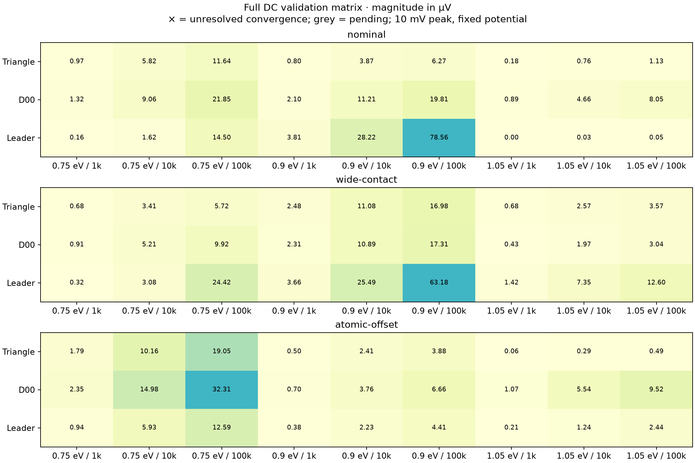
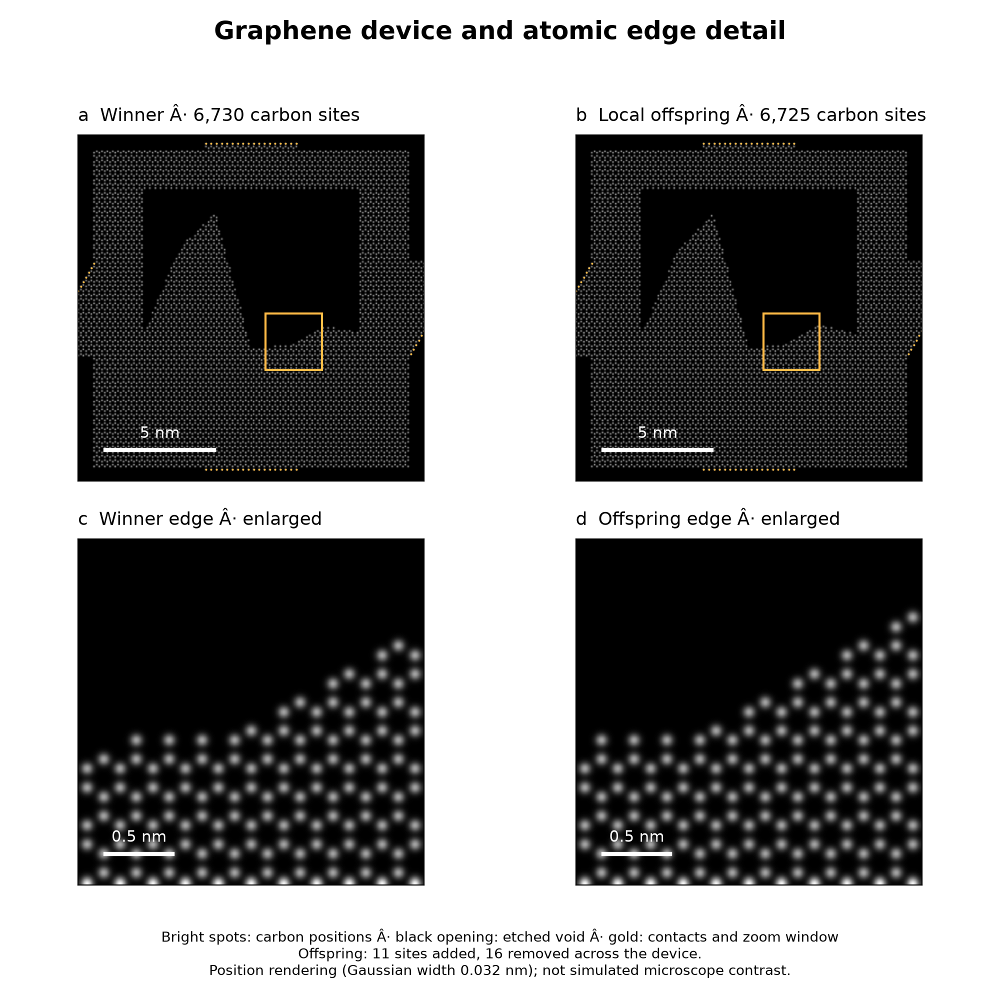
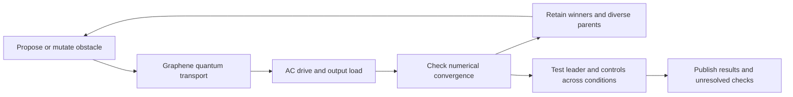
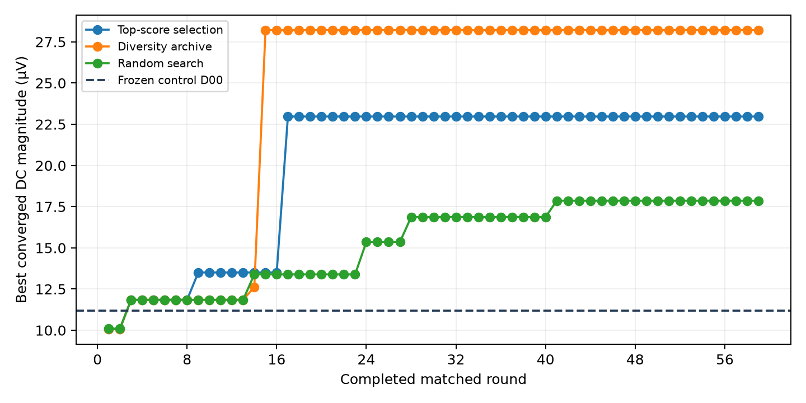

# Ballistic Device Lab

**Searching for better graphene ballistic rectifiers using an evolutionary geometry search.** This is an open simulation project: software proposes shapes, calculates electron transport, and keeps candidates that perform well under a stated electrical test.

A rectifier converts an alternating signal into a DC output. Our immediate goal is a sensitive, zero-bias signal detector. The search currently maximizes simulated DC power into a load; detector sensitivity is a separate qualification step. We have not yet demonstrated an advantage over a fabricated or commercial device.

## What the pictures show

Each square represents a tiny graphene region with four electrical contacts. **The filled polygon is an etched-out obstacle: graphene is removed there.** The remaining white region conducts. Orange segments are contacts. An AC voltage is applied between left and right; we calculate the average voltage across a resistor connecting top and bottom. The search changes the obstacle geometry while keeping the nominal device dimensions and drive fixed.

“Ballistic” describes the transport model: electrons cross the device without bulk scattering. The quantum solver also accounts for wave interference. An unusual outline can change the output, but its appearance alone does not tell us why it works.

The nominal test uses a **14.76 nm-wide device, 10 mV peak input, a 10 kΩ load and 300 K reservoir occupations**. The internal potential is currently held fixed. That last assumption is an important limitation being addressed by the physics work below.

## Direct DC search

**Continuous search: 59 completed matched rounds.** Three methods explore the same five geometry families: top-score selection, a diversity archive, and random search. Each has evaluated 1220 candidates, including the same 40 starting designs.*



**An evolving experiment:** the worker continuously proposes, solves and refines geometries. This gallery regenerates from completed rounds, showing the control plus a leading candidate in each family. Blue highlights the frozen control; teal highlights the best converged search candidate, which always occupies its family's panel. Other families show their strongest screening result. Labels distinguish converged results from screening-only estimates; the table below includes converged method winners only.

Last published: **2026-10-22 23:34 UTC**, through matched round **59**. The 15-minute check-in publishes completed rounds while simulation continues independently.

| Method | Best converged design | DC magnitude (µV) | DC power (pW) |
| --- | --- | ---: | ---: |
| Frozen control D00 | D00 | 11.205 | 0.01256 |
| Top-score selection | elite-r0-triangle-g17-1 | 22.971 | 0.05277 |
| Diversity archive | diversity-r0-profile-g15-1 | 28.215 | 0.07961 |
| Random search | random-r0-triangle-g41-0 | 17.860 | 0.03190 |

\* Fixed-potential simulations at 10 mV peak into 10 kΩ. Candidate counts include shared starting designs and matching proposals. Equal candidate budgets are not equal CPU budgets. Differences this small do not establish a better search method. D00 is our synthetic control. Winners are selected automatically after numerical convergence checks; incomplete rounds do not update this table.

[Completed-round data and progress](results/continuous-dc/round-000059/README.md) · [Wider search archive](results/2026-10-22-dc-wide/README.md) · [Independent scoring audit](results/2026-10-22-dc-audit/README.md)

### What useful function are we testing?

**First target: a zero-DC-bias electrical signal detector.** Rectification turns an alternating input into a measurable DC signal. Power recovery is tracked separately.

| Design | Terminal input (nW) | Loaded voltage response (V/W) | Useful DC (pW) | DC efficiency (%) |
| --- | ---: | ---: | ---: | ---: |
| D00 | 5.430 | 2064 | 0.01256 | 0.000231 |
| diversity-r0-profile-g15-1 | 3.222 | 8757 | 0.07961 | 0.002471 |

These are finite-amplitude, quasistatic electrical-terminal values at 10 mV peak, 10 kΩ, 300 K and 0.9 eV in the frozen-potential model. Responsivity is |mean output voltage| / mean terminal input power; efficiency is mean(output voltage)² / (load resistance × mean input power). They are not optical responsivities, small-signal derivatives or measured performance.

**Decision gates:** detector usefulness requires output-noise density, noise-equivalent input power, usable dynamic range and frequency response. Power-converter usefulness requires efficiency and delivered power across excitation and load. Neither application is qualified yet. The present search still optimizes nominal DC load power; this report does not silently change its objective. [Application qualification plan](docs/DEVICE-ROLE.md).


**Leader versus D00:** higher computed DC power in **10/27** matched, numerically converged cases so far, out of 27 planned conditions. This counts the computed ordering, not statistical significance or physical validation.

<details>
<summary>Validation dashboard: robustness, trajectories, edge damage and numerical checks</summary>

### Current leader: broader checks

Each new converged leader enters a separate one-CPU validation queue with D00 and the synthetic triangle. Identical geometries are tested once. Search continues independently; these checks do not change its objective. Pending and unresolved results stay visible.

| Design | Completed contact/edge conditions | Converged DC cases | Ray scattering cases |
| --- | ---: | ---: | ---: |
| triangle-control | 3/3 | 27/27 | 27/27 |
| D00 | 3/3 | 27/27 | 27/27 |
| diversity-r0-profile-g15-1 | 3/3 | 27/27 | 27/27 |

**Leader versus D00:** higher computed DC power in **10/27** matched, numerically converged cases so far, out of 27 planned conditions. This counts the computed ordering, not statistical significance or physical validation.

### Peak performance and robustness

| Tested design | Matched cases | Higher power than D00 | Median power / D00 | Worst power / D00 |
| --- | ---: | ---: | ---: | ---: |
| triangle-control | 27/27 | 5 | 0.411× | 0.00267× |
| D00 | 27/27 | 0 | 1× | 1× |
| diversity-r0-profile-g15-1 | 27/27 | 10 | 0.35× | 2.65e-05× |
| elite-r0-profile-g9-1 | 27/27 | 16 | 1.21× | 0.11× |
| random-r0-beveled-g3-0 | 27/27 | 11 | 0.494× | 0.00343× |
| random-r1-islands-g1-1 | 27/27 | 6 | 0.156× | 9.51e-05× |

Each ratio compares DC load power at the same energy, load and contact condition. Below 1× means less power than D00. Only pairs passing both numerical convergence gates enter; partial coverage is not comparable to complete coverage. These are equally weighted descriptive summaries, not probabilities of success, efficiency or a new search objective. Historical tested leaders remain visible. [All supporting cases](results/continuous-dc/round-000059/robustness).




Orange paths enter from the left; purple paths enter from the right; gold segments are contacts. Trajectory paths are a classical diagnostic, not a quantum current map or DC-efficiency measurement. Neither control is a reproduced paper device.





<details>
<summary>All 27 DC conditions per design: loads, energies and contact cuts</summary>



</details>

Full matrix: three Fermi energies × three loads × three contact/atomic-cut conditions, with energy and phase refinement. Ray checks cover three specularities × three mean free paths × three seeds. [Completed case data](results/continuous-dc/round-000059/validation) retains all loads, raw seed results and convergence flags. Phonons, self-consistent electrostatics and finite-frequency response remain unimplemented.

### Automated falsification checks

| Design | Fresh spectrum/DC replay | Terminal exchange |
| --- | --- | --- |
| D00 | Pass | Pass |
| diversity-r0-profile-g15-1 | Pass | Pass |
| triangle-control | Pass | Pass |

Fresh replay rebuilds the lattice and recomputes every energy on the accepted grid,
independently of the search spectrum cache. Terminal exchange checks readout sign
conventions; it is **not** a physical mirror-geometry test. These numerical passes
do not validate missing physics. Exact atomic reflection, controlled edge ensembles,
self-consistent graphene electrostatics, realistic scattering/contacts, frequency
response and matched paper-device comparison remain **unresolved**.
[Completed receipts and fresh spectra](results/continuous-dc/round-000059/falsification).


### Atomic-edge sensitivity

One- and three-atom edge-vacancy pilot; three fixed seeds per damage level. Intact baselines use the same convergence gates. Unresolved cases remain visible.

| Design | Missing atoms | Completed / planned | Converged | DC magnitude range (µV) |
| --- | ---: | ---: | ---: | ---: |
| D00 | 0 | 1 / 1 | 1 | 11.205–11.205 |
| D00 | 1 | 2 / 3 | 2 | 10.586–11.331 |
| D00 | 3 | 0 / 3 | 0 | Pending / unresolved |
| diversity-r0-profile-g15-1 | 0 | 1 / 1 | 1 | 28.216–28.216 |
| diversity-r0-profile-g15-1 | 1 | 2 / 3 | 2 | 28.363–28.385 |
| diversity-r0-profile-g15-1 | 3 | 0 / 3 | 0 | Pending / unresolved |
| triangle-control | 0 | 1 / 1 | 1 | 3.871–3.871 |
| triangle-control | 1 | 3 / 3 | 3 | 3.452–4.557 |
| triangle-control | 3 | 0 / 3 | 0 | Pending / unresolved |

Small pilot, not a fabrication-yield estimate. See [model and restart contract](edge_lab/README.md). Self-consistent electrostatics remains pending.
### Winner-neighborhood experiment

Separate budget: **24/24 offspring evaluated**, 4 numerically converged so far. Parent: `diversity-r0-profile-g15-1`. These evaluations do not enter the three-method comparison.



Actual carbon positions from the transport builder, shown as bright spots. The highlighted window compares the frozen parent with its best converged local offspring; this is an ideal lattice rendering, not a microscope image. [Coordinates and connectivity](results/continuous-dc/round-000059/winner-local/atomic-lattice.json).

| Local experiment | Converged DC power (pW) |
| --- | ---: |
| Parent | 0.07961 |
| Best converged offspring: local-s0.01-4 | 0.07632 |

[Frozen plan and completed rows](results/continuous-dc/round-000059/winner-local) · [Protocol](local_lab/README.md).


### Independent numerical check

| Independent score check | Difference (nV) | Result |
| --- | ---: | --- |
| D00 | 0.1241 | Pass |
| diversity-r0-profile-g15-1 | 0.4037 | Pass |

[Audit receipts and exact input spectra](results/continuous-dc/round-000059/evidence). This cross-check uses pair currents, Gaussian quadrature and a separate load solver; it shares the same fixed-potential transport model.


</details>

<details>
<summary>Earlier six-design gallery</summary>


Frozen wider-search snapshot, retained for comparison with the evolving gallery above.

</details>

## Current findings and targets

**First goal: a zero-bias signal detector with at least 10× lower noise-equivalent power (NEP) than a conventional comparator, while retaining useful bandwidth, dynamic range and fabrication tolerance.** Lower NEP means detecting a weaker signal at the same noise bandwidth.

| Requirement | Target | Current evidence |
| --- | --- | --- |
| Sensitivity | **≤0.35 pW/√Hz**, 10× below the WR10 Schottky reference's typical 3.5 pW/√Hz | **1.239 pW/√Hz** in the preliminary equilibrium audit; about 3.5× above our target* |
| Carrier-frequency coverage | Evaluate the **75–110 GHz** reference band with a matched input-power definition | Quasistatic transport only; frequency response unresolved |
| Readout bandwidth and dynamic range | Match the selected comparator's characterized operating envelope | Acceptance values pending matched characterization; neither is established by DC response |
| Robustness | Meet the detector requirements across a frozen operating and fabrication envelope, including held-out cases | Contact, operating-point and edge checks are underway; nominal power superiority does not persist across all conditions |
| Physical credibility | Self-consistent graphene charge/electrostatics, contact and scattering models, frequency response and complete noise budget | Partial physics layers implemented; production charge feedback and remaining models still open |

\* The audit concerns **diversity-r0-profile-g15-1**, at 300 K with a 10 kΩ load and ideal electrical inputs. It includes equilibrium device/load thermal noise, but does not yet include the full detector system. The commercial specification and this estimate are not matched measurements. [Audit and assumptions](results/physics-reference/detector-audit/README.md) · [Conventional reference specifications](references/conventional-detectors/README.md).

The sensitivity threshold is our engineering goal; a qualifying comparison also requires frozen temperature, input reference plane, bandwidth, load and readout conditions. **No candidate is qualified yet.** The running search still ranks nominal DC power. Application-based selection will enter a separately versioned campaign after the required physics gates pass. Efficient power conversion remains a separate objective, assessed by delivered DC power and efficiency. [Qualification pipeline](docs/DEVICE-ROLE.md).

## How the search works



Three methods start with the same population and receive the same number of proposals:

| Method | How it chooses the next shapes |
| --- | --- |
| Elite | Mutates high-scoring parents and adds fresh random shapes |
| Diversity | Mutates representatives of different geometry neighborhoods and adds fresh random shapes |
| Random | Samples without using previous scores |

Five parameterized shape families are available: triangles, bevels, free profiles, islands and radial polygons. This is evolutionary mutation and selection; it cannot invent shapes outside those representations. The comparison uses equal candidate counts, not equal CPU time. The quantum calculations run on CPUs; earlier ray-screening studies use the GPU.

Two different operations have previously been called “refinement”:

- **Shape refinement** changes parameters and creates a new candidate. The original remains in the archive.
- **Numerical refinement** recalculates the same shape with denser energy and phase grids. It checks the score, not the shape's optimality.

A winner is the strongest **numerically converged candidate at the nominal operating point**. It can lose when carrier energy, contacts or load change. The validation dashboard reports those comparisons. Validation currently runs separately from selection; it does not yet make the optimizer robust to those changes.

### Giving the winner more local mutations

A separate bounded experiment evaluates **24 mutations around a frozen winner**: eight each at 0.5%, 1% and 2% of each parameter's allowed range. The parent and four strongest screened offspring receive numerical refinement. Small geometric changes can leave the atomic lattice unchanged, so parameter distance is not necessarily a physical change.

This experiment has its own checkpoints and source manifest. Its extra evaluations are **not added to the matched three-method scores or candidate counts**. Results and completion status are published separately. [Local experiment contract](local_lab/README.md).



Flat stretches mean no better converged candidate has been found. They do not establish a local or global optimum. [Search implementation](ballistic_lab/search/dc_space.py) · [Diversity selection](ballistic_lab/search/diversity.py).

## Physics: what works and what is missing

| Layer | Status | What the evidence establishes |
| --- | --- | --- |
| Graphene quantum transport | Used by search | Coherent nearest-neighbor lattice model with ideal leads; conservation and reference checks |
| Driven terminals and load | Used by search | Reservoir bias and circuit solution; DC output separated from AC ripple |
| Numerical convergence | Used by search | Energy-grid and phase refinement before promotion |
| Contact/load/energy sweeps | Separate validation | Tests whether a nominal advantage survives changed conditions |
| Atomic edge vacancies | Separate pilot | Selected one- and three-atom removal cases; not a fabrication-yield estimate |
| Electrostatics | Building blocks tested | 3D Poisson and prescribed sheet charge; actual graphene charge feedback remains open |
| Noise | Partial audit | Equilibrium device/load thermal noise; driven, amplifier and low-frequency excess noise remain open |
| Real contacts, phonons and frequency response | Open | Required before predicting a practical RF detector |
| Published-device reproduction | Open | Geometry reference exists; matched electrical response has not been reproduced |

**Next physics milestone:** close the graphene charge–potential–transport loop, then test a published reference device under matching conditions. A solver passing its own analytic checks is a prerequisite, not proof that the device model is complete.

The search/validation architecture is intended to be reusable. Future neuromorphic or photonic objectives would need their own material, dynamical and circuit models and acceptance tests; those devices are not implemented here.

[Physics roadmap](docs/PHYSICS-ROADMAP.md) · [Implemented extension layers](physics_layers/README.md) · [Electrostatics verification plots](results/physics-reference/electrostatics-3d/README.md) · [Architecture and operating contracts](docs/ARCHITECTURE.md).

## Published references and comparisons


Auton et al.'s fabricated graphene rectifier is visible in panel (a), with an AFM inset. Figure 1 is reproduced unchanged from [Nature Communications 7, 11670 (2016)](https://doi.org/10.1038/ncomms11670), under [CC BY 4.0](https://creativecommons.org/licenses/by/4.0/). [Image provenance](docs/assets/literature/README.md).

| Reference | What we have | What remains |
| --- | --- | --- |
| [Auton et al., 2016](references/auton-2016/README.md) | Scale-calibrated contour reconstruction with documented uncertainty | Contacts, material/operating conditions and matched electrical reproduction |
| [Shi et al., 2026](references/shi-2026/README.md) | Device image and benchmark record for a 3 THz detector | Reconstruction and reconciliation of reported performance conditions |
| [Conventional Schottky detectors](references/conventional-detectors/README.md) | Manufacturer specifications used to set detector targets | Matched input coupling, bandwidth, noise, load and temperature |

**D00 and triangle-control are synthetic controls, not replicas of either paper.** Better performance against them is an internal comparison. Responsivity (V/W), noise-equivalent power (W/√Hz) and conversion efficiency are different quantities and cannot substitute for one another. [Matched comparison requirements](docs/PAPER-COMPARISON.md).

## Reproduce and review

Use the repository root with the Python environments described in `requirements.txt`, `requirements-gpu.txt` and `environment-quantum.yml`. Kwant is required for quantum calculations; CUDA is optional for the earlier ray studies.

```sh
python -m unittest discover -s tests
# In the Kwant environment, one continuous worker only:
python -m ballistic_lab.pipeline.dc_continuous
# In a separate process, render completed results:
python -m ballistic_lab.reporting.dc_continuous
```

The continuous worker checkpoints progress and holds an exclusive lock. Create `runs/dc-continuous/STOP` to stop after the current stage. Source hashes guard resume compatibility. Configure BLAS for one thread per worker. [Full start/stop and validation-worker contracts](docs/ARCHITECTURE.md#continuous-search-worker).

For an independent review, start with the latest completed-round report linked above, the [transport and circuit contracts](docs/ARCHITECTURE.md), and the [qualification requirements](docs/DEVICE-ROLE.md). Ask whether the model, convergence thresholds, controls and objective justify the claimed result. The open physics gaps are part of that review.

Earlier GPU search, trajectory objectives and lattice studies remain in the [evidence index](docs/EVIDENCE-INDEX.md). They use different objectives and should not be combined into one improvement percentage.

## License

[MIT](LICENSE). External figures and publications retain their stated licenses.
