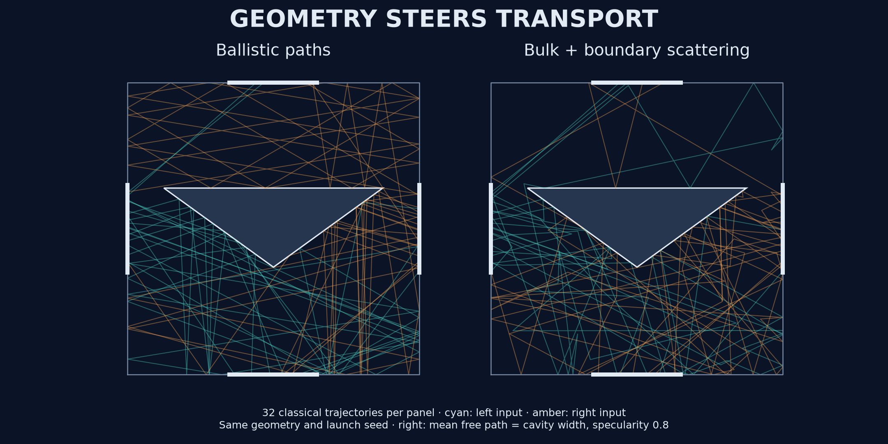
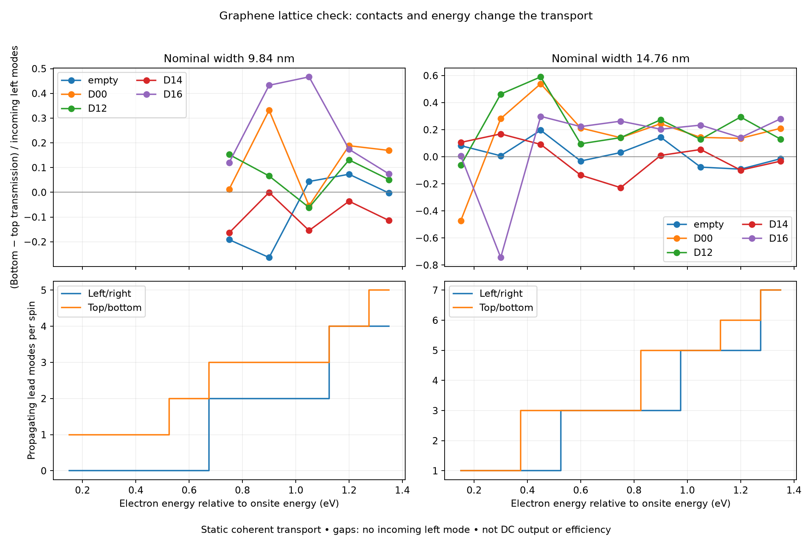
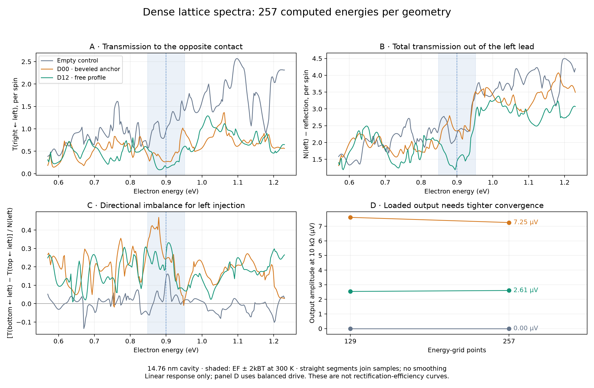
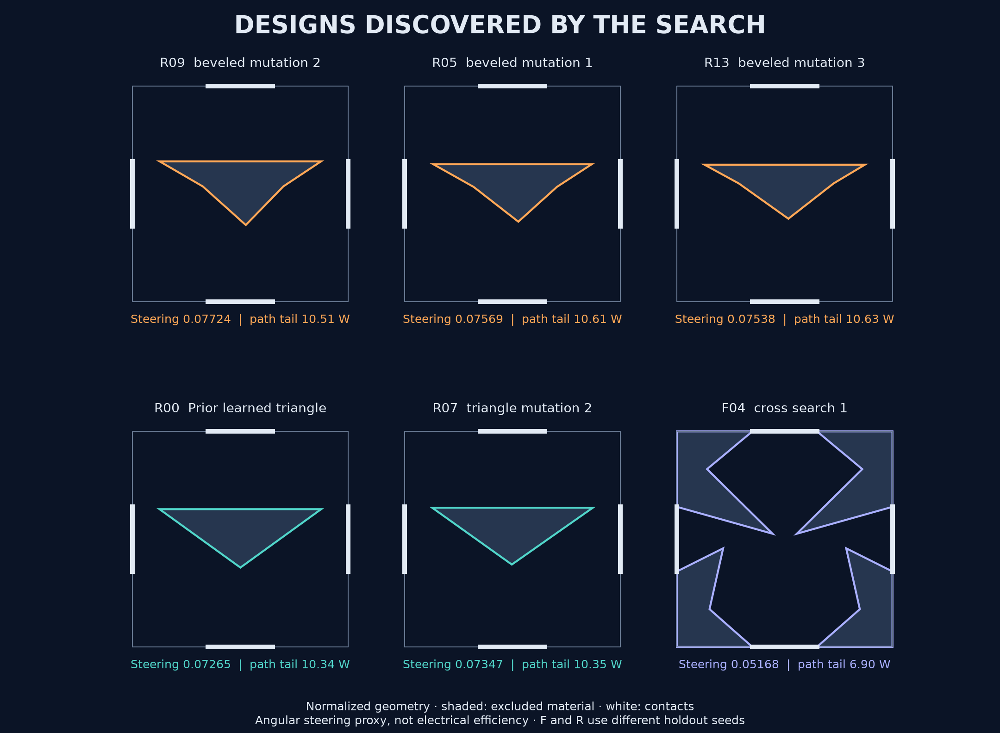
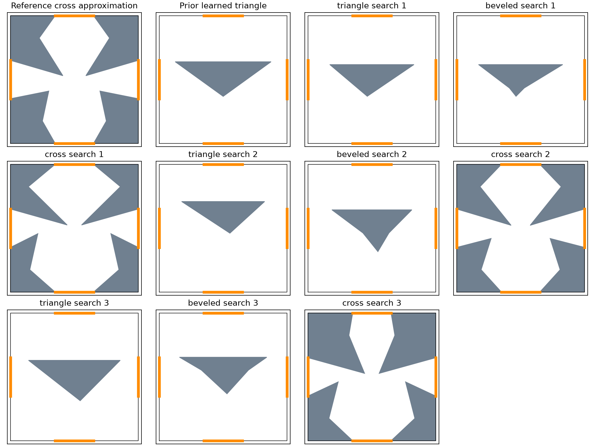
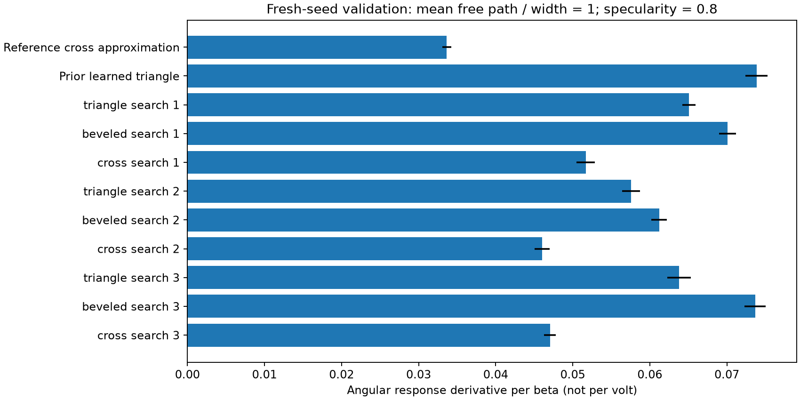
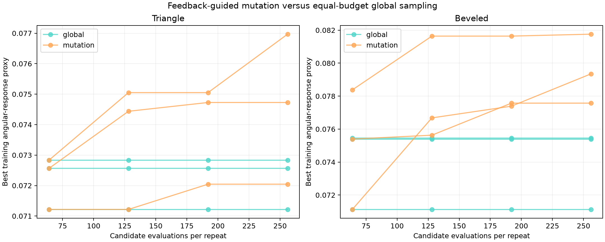
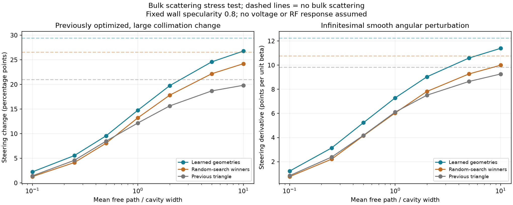

# Ballistic Device Lab: Searching for Better Graphene Rectifiers

**We are investigating whether optimized nanoscale geometry can improve graphene ballistic rectifiers—devices that turn an alternating electrical signal into a DC output using asymmetric electron transport.** In a ballistic device, carriers can cross the active region before bulk scattering randomizes their motion, making the shape of channels and boundaries important. Published devices already demonstrate rectification and terahertz detection; our question is whether systematic geometry search can find better candidates.

Our implementation combines a **classical trajectory model and geometry search**, with CPU and CUDA backends, and an optional **Kwant graphene lattice transport stage**. We have found improved angular steering relative to our own simple control and random-search baseline. We have **not yet demonstrated electrical rectification or matched or beaten a published device**. Electrical conversion efficiency remains unknown.

The reusable framework supports this specific investigation: screen many inexpensive candidates, challenge the survivors with scattering and fabrication variation, then spend detailed graphene lattice simulation on a small, diverse shortlist.



These are actual classical ray paths from the CPU solver, in normalized geometry. The shaded obstacle is excluded material. They illustrate transport, not measured current or a quantum wavefunction.

## Why ballistic rectifiers matter

### Quantum transport checkpoint

The [lattice checkpoint](results/2026-10-22-lattice/README.md) evaluates an empty
control and four frozen designs at nominal widths of **9.84 and 14.76 nm**.
Clean-ribbon transmission, current conservation, reciprocity, and a uniform
energy-offset check pass. The simulations expose contact-mode cutoffs and strong
energy dependence: a shape's ray score cannot predict its quantum performance.
These are static, coherent calculations; self-consistent voltage and loaded
rectification remain open gates.



The upper plots show directional transmission from the left contact, not
rectification or efficiency. The lower plots show how many electron channels
the leads support. Lines connect sparse samples; thresholds are not resolved.

### Device motivation

The [linear terminal/load checkpoint](results/2026-10-22-linear-load/README.md)
adds currents, voltages, reservoir temperature and resistor loading. Its tests
distinguish AC resistor heating from useful DC output. Candidate output voltages
remain provisional because their energy-grid convergence is not yet sufficient;
the pipeline records that failure instead of promoting a misleading winner.



The dense spectra expose resonances hidden by the nine-point checkpoint.
They also show why shape-only rankings need additional tests: the profile's ray
advantage does not translate into the largest linear loaded output at the one
Fermi energy and contact configuration tested. That output is AC, not rectified DC.

A rectifier can turn a rapidly oscillating signal into a readable DC output. Graphene ballistic rectifiers use asymmetric carrier transport without a conventional p–n or Schottky junction barrier. Their planar geometry makes them interesting candidates for compact high-frequency detectors and receiver circuits; [experimental detection at 3 THz](https://onlinelibrary.wiley.com/doi/full/10.1002/smsc.202500654) provides a concrete reason to investigate them.

Efficient power conversion is also an attractive target: less dissipated power means less heat to remove. But a sensitive detector and a useful power rectifier have different requirements. For power conversion, we must establish current capacity, contact losses, voltage handling, and useful output under load. A nanoscale rectifier alone does not supply a complete converter's voltage transformation, isolation, regulation, and filtering. Widespread consumer use is a possibility to investigate, not an established outcome of this project.

## Where published research stands—and where we stand

These are selected experimental reference points, not an exhaustive ranking of the field. Low-frequency electrical measurements and antenna-coupled THz measurements have different input-power definitions and must not be ranked directly.

| Work | Demonstrated result | Conditions and comparison limits |
| --- | --- | --- |
| [Auton et al., 2016](https://www.nature.com/articles/ncomms11670) ([accepted manuscript](https://pure.manchester.ac.uk/ws/portalfiles/portal/33718005/CLEAN_Main_Text_Graphene_ballistic.pdf)) | Room-temperature graphene rectification; intrinsic voltage responsivity up to **23,000 V/W** and noise-equivalent power down to **0.64 pW/√Hz** | Low-frequency electrical excitation. Substrate parasitics limited measurements to 3 MHz; these sensitivity values are not a demonstrated THz result. |
| [Shi et al., 2026](https://onlinelibrary.wiley.com/doi/full/10.1002/smsc.202500654) | Antenna-coupled graphene ballistic detection at **3 THz** | Figure 3 reports sample B's maximum responsivity changing from **77 V/W at 4 K** to **6 V/W at 300 K**. The abstract separately lists 100 V/W and 20 pW/√Hz at room temperature; this apparent discrepancy needs clarification before using those headline values as a matched benchmark. |
| **This project** | Checked classical simulations, learned geometry search, finite-scattering screening, and frozen candidates | No measured device; no predicted V/W, noise-equivalent power, electrical bandwidth, or AC-to-DC power efficiency yet. Current gains are within our geometry proxy model. |

### What about efficiency?

Power-conversion efficiency is **η = useful DC power delivered to a load / AC input power**, with the input boundary specified. Detector responsivity is **DC output voltage / input power**, measured in V/W. A large output voltage into a high-impedance measurement does not by itself establish efficient power delivery.

The reference results above therefore do not give us a comparable percentage-efficiency leaderboard. Neither does our simulation: a score of 0.072 is an angular-response derivative, **not 7.2% efficiency**. To compare power efficiency, we need nonlinear voltage/current transport, a load, input coupling, and consistent power accounting. To compare detector performance, we additionally need noise and frequency response.

**Our current contribution is a reproducible candidate-discovery pipeline.** The next scientific milestone is to reproduce a published geometry's transport behavior, then evaluate our shortlist under the same physical assumptions. A state-of-the-art claim comes only after that comparison supports it.

## Why this project exists

Geometry can influence how carriers reach different terminals. We want to test whether systematic search finds useful structures beyond familiar hand-designed layouts, and eventually compare them with published devices under matched conditions. Negative results are useful: an honest ceiling can save a much more expensive simulation or experiment.

## Pipeline

| Stage | Status | Question |
| --- | --- | --- |
| Classical trajectory simulation | Implemented, CPU/GPU checked | Does the geometry steer carriers? |
| Surrogate-assisted search against random search | Implemented | Does learning improve selection at equal simulation budget? |
| Finite mean free path and small angular perturbations | Implemented | Does the response survive bulk scattering? |
| Shape perturbations and diverse shortlist | Implemented, illustrative tolerances | Which candidates deserve more detailed modeling? |
| Graphene lattice transport and edge disorder | Planned | Does the effect survive realistic electronic structure? |
| Self-consistent nonlinear transport | Planned | Does applied voltage produce useful rectification? |
| Matched literature and circuit benchmarks | Planned | Is it competitive in electrical performance, bandwidth, and noise? |

Search methods include ExtraTrees surrogate proposals, local mutation, and evolutionary population search with recombination and global exploration. Each is compared with an equal-budget random control. None is reinforcement learning. RANSAC may help fit measured curves later; it is not the geometry optimizer.

## What we have found

### Explore the designs


**What happens when we stop prescribing a triangle?** A 98,304-candidate search explored free boundary profiles, asymmetric radial polygons, and separate islands alongside beveled controls. It produced shield-like obstacles, staggered islands, and both single-tip and double-tip profiles. Population search beat equal-budget random sampling in every family and repeat on the nominal holdout test.

The strongest free-profile candidate scored **0.08011**, versus **0.07644** for the fixed bevel anchor—a **4.8% improvement in angular steering**. It also exceeded that anchor's mean score in all nine tested scattering conditions. Its small lead over the independently optimized bevels is not a clear separation: the paired seed differences change sign. One profile run settled into a weaker double-tip shape, illustrating why we keep multiple repeats and publish failures.

The broader search still often converges toward a wide upper face and a downward tip. That is evidence about this objective and these boundary conditions, not a universal design law. Several runs plateaued as their budget grew; the next useful challenge is higher-fidelity transport rather than assuming more proxy optimization will produce better electrical devices.

[Browse all expanded-family finalists and download their geometry](results/2026-10-22-discovery/README.md) · [Read the search protocol and physics limits](docs/DISCOVERY.md)



The [design collection](designs/README.md) publishes **17 distinct frozen geometries** across triangles, beveled obstacles, and asymmetric cross-junctions, with all **25 evaluation records** retained. The beveled refinements lead the steering score; cross layouts offer shorter long-path tails. Both are useful directions for the next physics stage.

Browse the shapes, compare their scores and tradeoffs, or [download their parameters and polygon vertices](designs/catalog.json). These are simulation candidates selected within the stated model, not fabricated devices or demonstrated electrical-efficiency winners.

### Geometry families

We screened **2,304 candidates** across triangles, beveled obstacles, and asymmetric cross-junctions with equal budgets. Beveled shapes improved on the newly searched triangles in all three repeats, but **did not clearly beat our previously learned triangle**. The cross candidates had shorter long-path tails, so we retain a varied shortlist for the lattice stage.



White is the conducting region, gray is excluded/etched material, and orange marks the identical contacts. The reference cross is a **literature-inspired topology approximation**, not an exact fabricated-device reconstruction.



Bars show the angular-response proxy; error bars are standard deviations across four fresh simulation seeds, not experimental error bars or confidence intervals. [Read the benchmark, numerical fix, limitations, and next simulation gate](docs/TOPOLOGY-BENCHMARK.md).

### Feedback-guided refinement

Equal-budget local mutation and global sampling each evaluated 256 candidates per family per repeat, with three repeats and identical inherited anchors. All three beveled mutation finalists improved on their anchor under fresh-seed evaluation: their mean score was **0.07611 versus 0.07305**, about **4.2% higher**, at mean free path/cavity width = 1 and specularity = 0.8. Triangle mutations were inconsistent. This is a gain in the geometry proxy, not a power-efficiency gain.



Each line is one repeat's best training score. Training progress alone is insufficient; all selected candidates were frozen before evaluation with four fresh seeds and three bulk-scattering conditions. [Protocol, complete results, and limitations](docs/REFINEMENT.md).

### Surrogate-assisted search

Saved evidence is in [results/2026-10-22](results/2026-10-22/). These are computational results within the stated model.

- Across three equal-budget searches, the original learned geometries averaged a 0.3541 angular steering change, versus 0.3129 for random search and 0.2266 for the simple triangle control. This uses a large imposed change in incoming angular distribution.
- Finite bulk scattering weakens the effect. At mean free path equal to the cavity width, the original learned group retains roughly half its large-perturbation response.
- A subsequent search directly targeted the infinitesimal angular response under finite scattering. On fresh seeds, its selected candidate scored **0.07213**, the random-search candidate **0.06253**, and the simple triangle **0.06013** at mean free path/cavity width = 1.
- The previously learned candidate scored **0.07276** in that same test. The new search did not establish improvement over our existing best geometry. It supports retaining a shortlist rather than declaring a new winner.

The last comparison is one search repeat, with four validation seeds and 65,536 rays per input port per seed. Scores are derivatives per dimensionless angular perturbation, **not per volt**. Neither these numbers nor the earlier scores establish superiority over published rectifiers.



## Model and limits

The cavity is a square of side 2 in normalized units, with four centered absorbing contacts of width 0.6. A triangular obstacle has four parameters: width, height, vertical offset, and tip skew. Boundaries mix specular and cosine-distributed diffuse reflections. Optional bulk scattering uses exponentially distributed flight lengths followed by isotropic elastic scattering.

For the small-perturbation score, $s=\sin\theta$ follows

$$
p_\beta(s)=\frac{1+\beta(1-2s^2)}{2(1+\beta/3)},\qquad -1\le s\le1.
$$

With $q=+1$ for a bottom exit, $-1$ for a top exit, and zero otherwise, the score is

$$
S=\left.\frac{\partial\langle q\rangle_\beta}{\partial\beta}\right|_{\beta=0}
=\left\langle q\left(\frac23-2s^2\right)\right\rangle_0.
$$

We average this estimator over left and right injection. This provides a controlled geometry diagnostic without assuming an electrical voltage-to-angle law. The electrical target is a separate quantity:

$$
\eta=\frac{P_{\mathrm{DC,load}}}{P_{\mathrm{AC,input}}}.
$$

There is no calibrated carrier density, atomic lattice, self-consistent electrostatic potential, quantum interference, frequency response, or temperature-dependent material model yet. Static linear transmission alone does not establish DC rectification. No equilibrium thermal-noise power harvesting is claimed. Shape tolerances are illustrative, not a fabrication specification. Surrogate uncertainty is a search heuristic, not a calibrated confidence interval.

### Physics beyond the trajectory screen

[Kwant](https://kwant-project.org/doc/latest/tutorial/graphene) is our selected starting point for a graphene tight-binding transport backend: lattice sites, contacts, scattering matrices, and energy-dependent transmission. [Tkwant](https://tkwant.kwant-project.org/doc/stable/) is a candidate for time-dependent transport after the static model is validated. These are **planned integrations**, not capabilities of the current solver. [Physics gates and library choices](docs/PHYSICS-ROADMAP.md) define the checks required before an electrical-performance claim.

The design loop is **propose → simulate → challenge → update**. Global sampling, feedback-guided mutation, and surrogate-assisted search are implemented. A future learned generator can propose candidates through the same physics evaluation; neither resemblance to good designs nor a surrogate prediction counts as validation. We compare search methods with equal budgets and keep holdout results out of their feedback.

## Run

Use Python 3.12 or newer in a virtual environment:

```sh
python -m venv .venv
# Activate .venv using your shell's activation command.
python -m pip install -r requirements.txt
python -m unittest discover -s tests
python simulate.py
```

GPU stages require a compatible NVIDIA GPU/driver and CuPy. The development machine used an RTX 5090 and `cupy-cuda13x[ctk]==14.2.0`; [CuPy's installation guide](https://docs.cupy.dev/en/stable/install.html) describes platform requirements. `requirements-gpu.txt` records the development environment, rather than a universal hardware requirement.

```sh
python -m pip install "cupy-cuda13x[ctk]==14.2.0"
python validate_gpu.py
python learn_search.py
python final_checks.py
python rf_screen.py
python robust_search.py
```

Run in that order: later stages consume earlier results. Outputs go to `runs/latest/`; set `BALLISTIC_OUTPUT_DIR` to a fresh directory for a new experiment. The learning search refuses to overwrite an existing learning log. Historical reports in the results snapshot retain their original prototype commands; use the commands above for this repository. GPU pool allocation is capped at 512 MiB; CUDA context/driver overhead is additional.

The refinement experiment runs independently from its committed anchor snapshot:

```sh
python validate_families.py
python -m ballistic_lab.experiments.refinement
python -m ballistic_lab.reporting.showcase runs/latest
```

Use the configured output directory in the last command if `BALLISTIC_OUTPUT_DIR` is set.

## Comparing against published work

The next benchmark must reconstruct published geometries and reproduce their transport trends before using the model to rank new designs. Keep dimensions, contacts, carrier density, mean free path, edge assumptions, bias, and temperature matched. Optimize controls with the same budget. Freeze candidates before evaluation, report uncertainty, and include failures.

Useful starting references:

- [Song, 1999: Formalism of nonlinear transport in mesoscopic conductors](https://journals.aps.org/prb/abstract/10.1103/PhysRevB.59.9806): nonlinear transport and geometry-dependent ballistic rectification.
- [Auton et al., 2016: Graphene ballistic nano-rectifier with very high responsivity](https://www.nature.com/articles/ncomms11670): an experimental graphene baseline.
- [Shi et al., 2026: Nanoscale Graphene-Based Ballistic Rectifiers for Detection of High Terahertz Frequency Optical Signals](https://onlinelibrary.wiley.com/doi/full/10.1002/smsc.202500654): a high-frequency detection benchmark to examine separately from low-frequency results.

Responsivity (V/W), noise-equivalent power (W/sqrt(Hz)), bandwidth, impedance, and conversion efficiency are different metrics. A geometry score cannot be substituted for any of them. We have not completed an exhaustive state-of-the-art survey or established novelty.

## Code organization and validation

The implementation is split into geometry, transport, metrics, search, validation, reporting, and experiment modules under `ballistic_lab/`. Immutable dataclass configurations and result records define interfaces; `@geometry_family` and `@validation_check` register explicit extensions. Root scripts remain short compatibility entry points. [Architecture and validation contracts](docs/ARCHITECTURE.md).

The topology search refuses to run with missing or stale source-validation receipts. CPU tests and formatting/lint checks run in CI; GPU validation additionally checks CPU agreement, reciprocity, symmetry, mixed topology batching, a grazing-boundary regression, and tolerance sensitivity. Refactoring preserved the complete recorded search output exactly.

## License

[MIT](LICENSE). External publications remain under their respective licenses; this repository links to them rather than redistributing their text.
