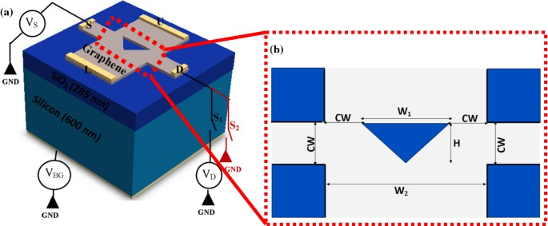
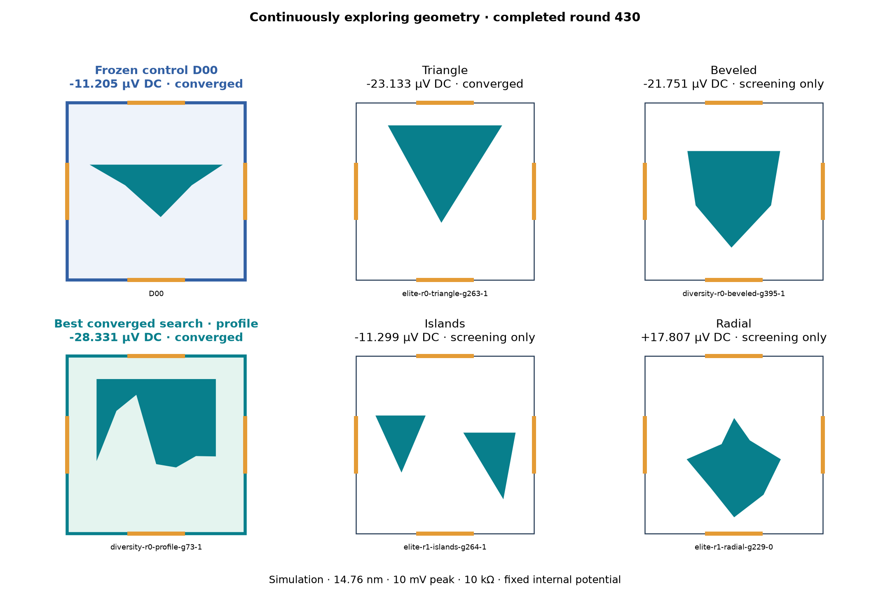
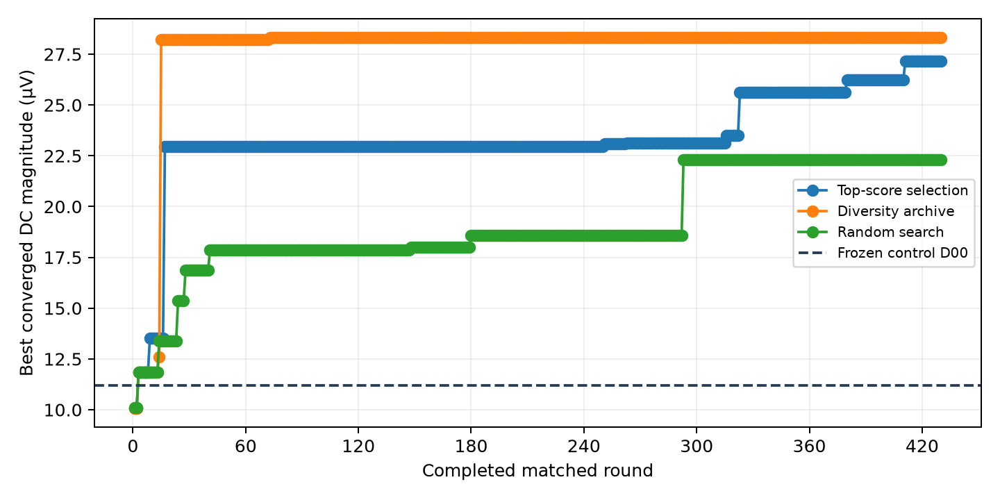
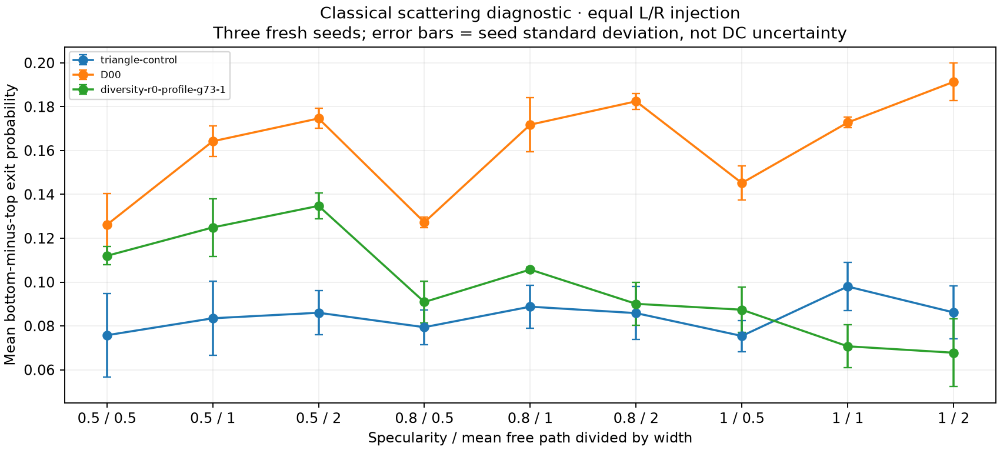
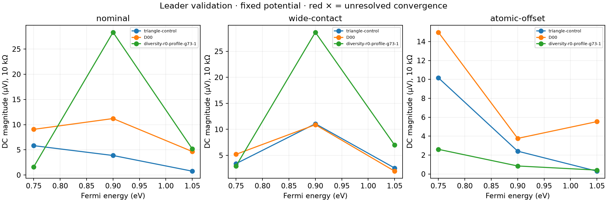
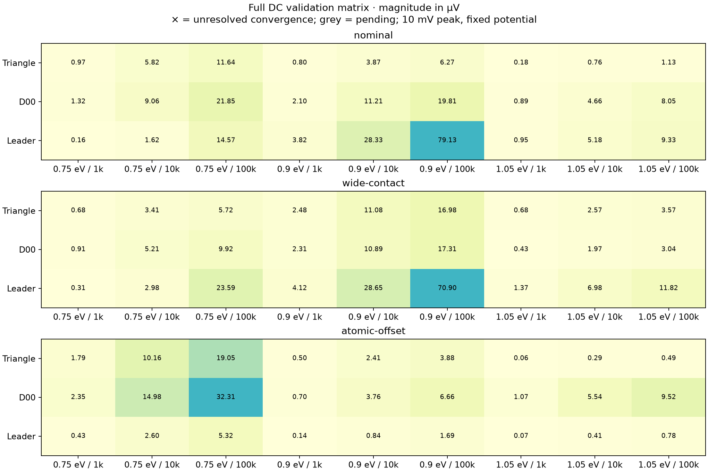
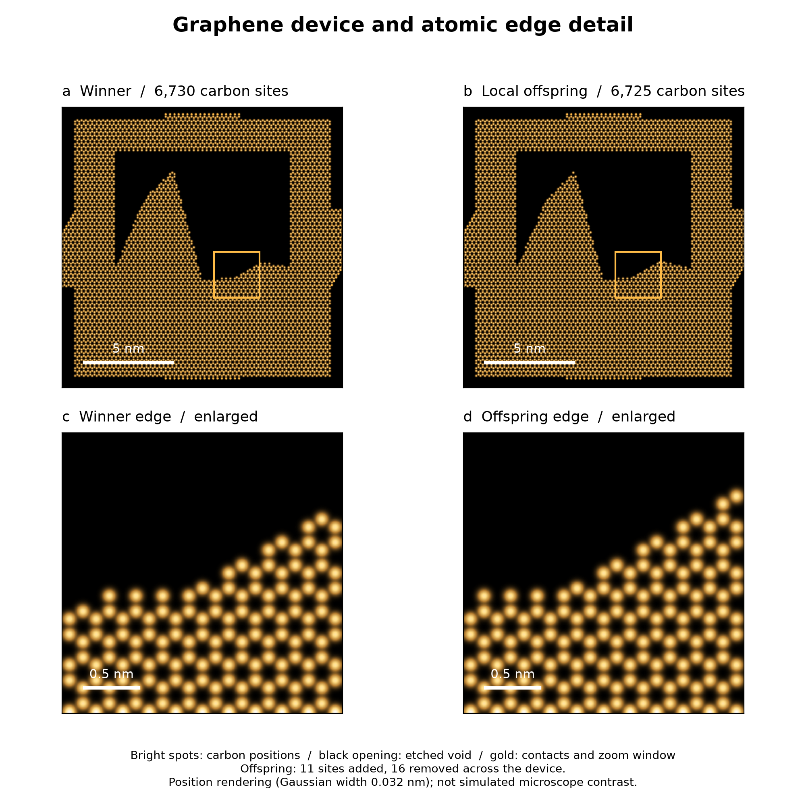
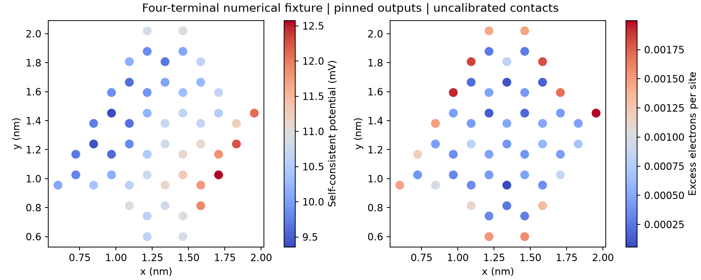

# Evolutionary Device Lab

<!-- activity:start -->
**Workers waiting · Updated 2026-10-29 08:15 UTC**

Atomic-edge sensitivity · [Data snapshot](results/live/evidence.json) · Published every 5 minutes while the publisher runs.
<!-- activity:end -->

### Evolve the geometry. Discover the electrical function.

**What if the useful circuit is a shape we would never think to draw?** This project uses evolutionary algorithms to search for electrical device geometries, simulate their behavior and retain the strongest qualified designs. The ambition is to make geometry itself part of the electrical function: exploring how boundaries and pathways can shape ballistic transport, diffraction and interference.

The search proposes, mutates and compares shapes against controls, with numerical checks before a candidate earns its place. Saved results drive the diagrams and campaign summaries automatically, so each run—and each fork—can tell its own story. The reusable harness is being developed toward other electrical targets, including [neuromorphic components](docs/NEUROMORPHIC-ARCHITECTURE.md).

**Current experiment: a graphene ballistic rectifier.** Can an evolved shape turn an alternating electrical input into more DC output? Below, the search reshapes a device at the scale of individual carbon atoms. These are simulation results; a promising shape still needs physical validation.

The experimental starting point is Shi et al., [*Nanoscale Graphene-Based Ballistic Rectifiers for Detection of High Terahertz Frequency Optical Signals* (2026)](https://doi.org/10.1002/smsc.202500654), alongside Auton et al., [*Graphene ballistic nano-rectifier with very high responsivity* (2016)](https://doi.org/10.1038/ncomms11670). Our current search uses a smaller synthetic benchmark; it does not yet reproduce those devices or establish an improvement over their measurements. [Published-device comparison](docs/PAPER-COMPARISON.md).



**From a physical stack to a shape we can evolve.** Literature schematic from Prakash et al., [*Thermoelectric rectification in a graphene-based triangular ballistic rectifier* (2021)](https://doi.org/10.1007/s10825-021-01794-5). Left: graphene, contacts and underlying layers. Right: the patterned device region. This is the paper's layout, not our simulated stack or an evolved result. [Image credit](docs/assets/literature/README.md#prakash-et-al-2021-schematic).

<!-- atomic-hero:start -->


**Same material. Same drive. Evolving geometry.** This image follows the strongest qualified champion in the configured campaign, including its retained benchmark. Bright dots are simulated carbon sites; black openings are etched voids. Scores and lattice geometry come from saved records.
<!-- atomic-hero:end -->

[Explore the shapes](#letting-shapes-compete) · [Follow the electrons](#following-the-electrons) · [Look inside the physics](#the-charge-changes-the-device) · [Run the code](#reproduce-and-explore)

<a id="current-discovery"></a>
<!-- discovery:start -->
**One benchmark. A fresh population. A champion to beat.**


Champion descendants: **25% of proposals**. Completed generation: **143**. Only energy- and phase-converged designs enter the comparison. The retained benchmark is preserved; improved qualified winners become parents for subsequent generations. [Model and search methodology](docs/FRESH_DISCOVERY.md).

**5 shape-separated qualified parents / 5 available niches** feed the 25% descendant allocation. Parent slots rotate evenly; position and size changes alone do not earn another slot. Empty niches stay empty until a sufficiently different design passes convergence.

**Close geometric relative.** Current best versus retained champion: **11.6% of device area changed**; **38.0% of etched union changed**. Best score does not imply a new shape family.

Latest proposal batch: **20 shapes**, including **5 champion descendants**. Completed matched snapshots: **144** (generation labels start at zero).

**Shapes being explored now** — one recorded proposal per family, not selected for score.


**Distinct champions → evolved descendants.** Each row pairs a qualified parent with its unranked proposals.


[Machine-readable selection and run evidence](results/live/evidence.json) · [Run your own campaign](docs/FRESH_DISCOVERY.md).
<!-- discovery:end -->

## Letting shapes compete

The active campaign reserves a configurable share for champion descendants while retaining fresh exploration. [Methodology and reproducible configuration](docs/FRESH_DISCOVERY.md).

<details>
<summary>Archived matched three-strategy study and its figures</summary>

A triangle is only the beginning. The search explores bevels, free profiles, islands and radial polygons, testing how each changes the output across a four-contact graphene device. Input runs left to right; the load connects top to bottom.



*Colored polygons are removed material; white space conducts. Orange marks the contacts. Screening-only candidates remain visibly distinct from numerically converged results.*

Three strategies start with the same population: mutate the strongest designs, preserve different kinds of shapes, or sample randomly. Each candidate passes through transport, load solving and numerical refinement before it can become a converged winner.




**430 matched rounds · 8,640 candidates per strategy · five shape families.** Published snapshots keep the figures, candidate identities and evidence together. Equal candidate counts do not imply equal CPU time or prove one algorithm superior.

<details>
<summary><strong>Compare the converged results</strong></summary>

| Selection method | DC magnitude (µV) | DC load power (pW) |
| --- | ---: | ---: |
| Synthetic control D00 | 11.205 | 0.01256 |
| Top-score selection | 27.150 | 0.07371 |
| Diversity archive | 28.331 | 0.08026 |
| Random search | 22.319 | 0.04981 |

Matched conditions: 14.76 nm device width, 10 mV peak sinusoidal drive, 10 kΩ load, 300 K and fixed internal potential. DC power excludes ripple heating. D00 and triangle-control are synthetic references.

[Full results and candidate identities](results/continuous-dc/round-000430/README.md) · [Independent scoring audit](results/2026-10-22-dc-audit/README.md)

</details>

<!-- evolution:start -->
**Champion to beat: 28.331 µV DC.** Archived three-arm study -- completed generation: **432**. The champion survives restarts; records from different source manifests remain separate.


The strip selects new attempts by screening score within each family, not by visual preference. Parent links come from recorded mutation origins; fresh samples have no parent. [Selection evidence](results/live/evidence.json) · [Champion ledger](results/live/champions.json).
<!-- evolution:end -->

</details>

## Following the electrons

Reference-study diagnostics below describe the archived champion, not the current campaign leader.

The geometry gives electrons different routes through the device. Trajectory diagrams make that routing visible; the quantum calculation determines the electrical score.


*Classical trajectories illustrate steering under matched injection. They are a separate diagnostic, not quantum paths or a direct measurement of rectification.*

A strong score at one operating point is only part of the story. The nominal winner beats D00 in **13 of 27** tested conditions; its median power ratio is **0.445×**. Changing contacts or operating conditions can reverse the ranking.

<details>
<summary><strong>Explore scattering, contacts and atomic edges</strong></summary>

### Scattering changes the routes



### Contacts and energy change the ranking





### Small edge changes make distinct devices



[Robustness evidence](results/continuous-dc/round-000430/robustness) · [Local mutations](local_lab/README.md) · [Atomic-vacancy experiments](edge_lab/README.md)

</details>

## The charge changes the device

<!-- feedback-gallery:start -->
<details>
<summary>Completed charge-feedback checks — saved reference results</summary>

These fixtures are completed checks, not the active evolutionary population. See the [current campaign and evolving designs](#current-discovery) above.


These small fixtures test the physics implementation; their current scores are separate from the main loaded-power competition. This image changes only when new charge-feedback geometry results are saved. [Run evidence](results/live/evidence.json).

</details>
<!-- feedback-gallery:end -->

Geometry is only one part of the physics. Electrons redistribute charge, charge changes the electrostatic potential, and that potential changes transport. A separate self-consistent graphene–Poisson experiment resolves that feedback at individual lattice sites.



*Potential and excess charge on a 51-site numerical fixture with pinned outputs. This experiment is distinct from the fixed-potential geometry rankings above.*

With a load connected, the calculation solves for the output at each applied drive. The plot and table below are generated from completed records in this checkout. These operating points remain separate from the geometry-search score; numerical convergence and zero-drive sensitivity remain unresolved.

<details>
<summary><strong>Inspect the loaded response and model assumptions</strong></summary>

<!-- loaded-points:start -->
| Drive (mV) | Output (µV) | Evidence |
| ---: | ---: | --- |
| -10 | -3.399095 | `loaded-feedback-pilot-poles-131072-cached-reverse` |
| -5 | -0.995176 | `loaded-feedback-pilot-poles-131072-cached-reverse-half-seconds-5400` |
| 0 | 0.000000 | `loaded-feedback-pilot-poles-131072-cached-zero-seconds-5400` |
| 5 | -0.413685 | `loaded-feedback-pilot-poles-131072-cached-half` |
| 10 | -2.236322 | `loaded-feedback-pilot-poles-131072-cached` |

Individual operating points; source manifests and accounting are retained in the [data snapshot](results/live/evidence.json).
<!-- loaded-points:end -->


These are individual operating points, not a sinusoidal DC average. The fixture uses surrogate contacts, a chosen Gaussian charge width and an explicit bound-state occupation rule. Numerical checks verify calculations within these assumptions; they do not establish fabricated-device performance or literature novelty.

[Matched amplitude comparison](results/physics-reference/loaded-feedback-reverse-half/README.md) · [Charge and feedback experiments](physics_layers/FINITE_BIAS.md) · [Model qualification](docs/DEVICE-ROLE.md)

</details>

## Reproduce and explore

The repository includes geometry generation, coherent quantum transport, circuit solving, charge/Poisson experiments and reproducible reports. Quantum calculations use **Kwant**; optional GPU trajectory studies use **CUDA**.

```sh
# In an environment with the repository dependencies installed:
python -m unittest discover -s tests

# Render completed search snapshots:
python -m ballistic_lab.reporting.dc_continuous
```

[Run your own continuously published fork](docs/PUBLICATION.md) · [Python dependencies](requirements.txt) · [Quantum environment](environment-quantum.yml) · [GPU dependencies](requirements-gpu.txt) · [Worker and source-manifest contracts](docs/ARCHITECTURE.md)

| Explore | Read |
| --- | --- |
| Experiments and diagrams | [Evidence index](docs/EVIDENCE-INDEX.md) · [Detailed experiment record](docs/EXPERIMENT-RECORD.md) |
| Detector sensitivity | [Noise audit](results/physics-reference/detector-audit/README.md) · [Conventional reference](references/conventional-detectors/README.md) |
| Published devices | [Auton et al.](references/auton-2016/README.md) · [Shi et al.](references/shi-2026/README.md) · [Matched comparison criteria](docs/PAPER-COMPARISON.md) |

**Research software.** The application is sensitive signal detection; no design is qualified against a fabricated or commercial detector. Real contacts, driven noise, fabrication yield and finite-frequency response require separate evidence.

## Future experiments

**Electrical devices for machine learning.** The broader aim is to reuse this harness to search for components that store weights, multiply and accumulate signals, or implement useful nonlinear responses. Neuromorphic ideas include a charge-storage node coupled to a ballistic channel, with explicit memory and time-dependent behavior.

Each experiment supplies its own device physics, electrical objective and acceptance tests; the harness supplies proposal, selection, retained champions and reproducible reporting. These ML and neuromorphic experiments are planned extensions, not demonstrated capabilities of the rectifier model.

[Component targets and reusable architecture](docs/NEUROMORPHIC-ARCHITECTURE.md) — weight cells, multiplication, integration and nonlinear elements.

[MIT license](LICENSE). External figures retain their stated licenses.

