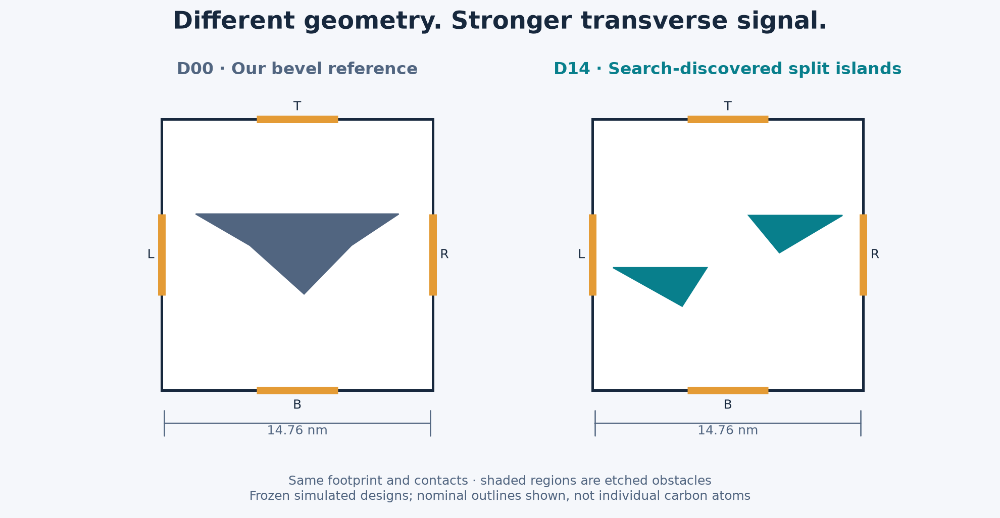
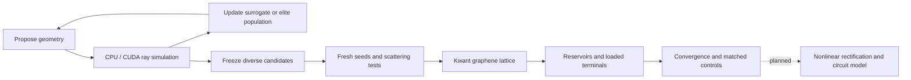

# Ballistic Device Lab: Searching for Better Graphene Rectifiers

**Can nanoscale geometry make a better graphene ballistic rectifier?** We are building a simulation and design-search pipeline to find out. These devices use asymmetric electron transport to convert an alternating electrical signal into DC. Their geometry matters because electrons can cross the active region before scattering randomizes their motion.

The pipeline now connects **GPU trajectory search → frozen geometry candidates → graphene quantum transport → loaded terminal response**. Search has found shapes beyond triangles, and the quantum stage has changed which candidates look interesting. The next major step is self-consistent nonlinear transport: the stage that can test rectification and useful DC power.

## A shape worth testing further



**The split-island candidate produces a larger transverse signal at all three nominal operating points.** Both designs went through the same graphene transport and loaded-terminal pipeline.

| Simulated operating point | Our bevel reference D00 | Split islands D14 |
| --- | ---: | ---: |
| Fermi energy 0.75 eV | +6.34 µV | -108.45 µV |
| Fermi energy 0.90 eV | +7.18 µV | -87.81 µV |
| Fermi energy 1.05 eV | +9.27 µV | -64.78 µV |
| Output convergence at these points | Passed | Passed |

\* Signed bottom-minus-top output under a 1 mV drive, 10 kΩ load, 300 K reservoir occupations and identical 14.76 nm footprint/contacts. Linear signal transfer, not DC rectification. D00 uses 4097 energy samples; D14 uses 1025; both meet the stated two-refinement tolerance. These are our simulated designs, not a reconstruction of a published device. [Source data](designs/quantum-comparison.json) · [Full operating-condition matrix](results/2026-10-22-coverage/README.md) · [Refinement checks](results/2026-10-22-convergence/README.md).

The next comparison will put a sourced published layout through the same pipeline; refinement of that layout will be reported separately from its original baseline.

## Current findings — October 22, 2026

| Study | Coverage | Finding |
| --- | --- | --- |
| Geometry discovery | 98,304 evaluations; four families; three repeats | Population search beat equal-budget random search in all 12 family/repeat comparisons.* |
| Best free profile | D12 versus frozen bevel D00 | Angular steering score 0.08011 versus 0.07644: **+4.8%**; higher mean in all nine scattering conditions.* |
| Quantum transport | Five shapes, two physical widths | Contact modes and electron energy strongly affect transport; ray rankings do not carry over automatically. |
| Matched quantum coverage | 15 atomic devices; 15,375 energy/device solves; 180 loaded outputs | Original study: **145/180** outputs passed both refinement checks.** |
| Integration follow-up | Seven devices; 21,504 additional solves | **31/35 flagged outputs resolved**; latest combined status **176/180**.‡ |
| Split-island candidate D14 | Three energies × three contact/atomic-cut conditions × four loads | **36/36 converged**; largest absolute transverse voltage in all nine conditions at 10 kΩ.† |
| Rectification and efficiency | Nonlinear stage pending | DC output, V/W, bandwidth, noise and conversion efficiency are not yet established. |

\* Angular steering is a dimensionless geometry diagnostic, not electrical efficiency. D12 is not clearly separated from independently optimized bevels.

\** Each output must change by no more than 1 nV + 1% on **both** 257→513 and 513→1025 energy-grid refinements. This is a numerical stability check, not a confidence interval.

‡ Follow-up uses 1025→2049→4097 grids for seven devices; eight original devices retain their 257→513→1025 checks. [Follow-up results](results/2026-10-22-convergence/README.md).

† Linear response to a 1 mV differential drive, 300 K reservoir occupations, 14.76 nm device width. This measures transverse signal transfer; symmetric AC has zero mean output in this model. Thermal occupations do not include phonon scattering.


Signed output voltage in microvolts. Crosses mark the original study’s unresolved grid convergence; the linked follow-up resolves most of them. The empty-device control also responds to an alternative atomic cut, making matched controls essential. [Full results, spectra, convergence matrix and protocol](results/2026-10-22-coverage/README.md).

### Beyond the triangle


The search explores beveled obstacles, free boundary profiles, separate islands and asymmetric radial polygons. D12 leads the frozen bevel in the ray proxy; D14's split islands lead transverse signal magnitude in the quantum coverage study. These objectives measure different behavior, which is why we retain a diverse shortlist.

[Expanded design catalog and search data](results/2026-10-22-discovery/README.md) · [Earlier 17-design collection](designs/README.md) · [Search methods](docs/DISCOVERY.md)

## Methods and pipeline



| Layer | Implemented method | Validation / evidence |
| --- | --- | --- |
| Geometry | Registered polygon families; immutable device specifications | Bounds, shape validity, frozen vertices and device fingerprints |
| Trajectories | Elastic ray transport, mixed specular/diffuse boundaries, exponential bulk free paths; CPU and CUDA | CPU/GPU agreement, particle conservation, reciprocity, symmetry, grazing-boundary regression |
| Search | ExtraTrees surrogate proposals, local mutation, elite recombination and global sampling | Equal evaluation budgets, independent repeats, frozen finalists and fresh-seed holdouts |
| Lattice | Kwant honeycomb nearest-neighbor tight binding; four leads; explicit physical dimensions | Hermiticity, unitarity, current conservation, reciprocity, clean-ribbon transmission, energy-offset invariance |
| Reservoirs / load | Finite-temperature Landauer conductance; four-terminal resistor-load solution | Analytic network checks, gauge invariance, terminal current and power balance |
| Coverage | Energy, contact width, atomic alignment and load matrix | Nested energy grids; per-output acceptance; all failures retained |
| Quasistatic circuit | Current-provider interface, nonlinear load roots and sinusoidal cycle averaging | Analytic resistor/diode-bridge checks; DC power separated from ripple heating |

Kwant uses a **CPU sparse solver**. The RTX 5090 accelerates the trajectory search. The quantum stage currently models coherent, elastic transport with ideal leads; edge disorder, electrostatic feedback and finite-frequency circuit effects remain separate work items.

### How the search improves

1. **Generate and simulate.** Each candidate receives a score from the transport solver. Parameters, seeds and scores are retained.
2. **Use the feedback.** The surrogate ranks promising proposals from accumulated simulations. Population search instead recombines the best 16 candidates and mutates their parameters, retaining 25% fresh global samples per batch.
3. **Keep an honest comparison.** Random search gets the same simulation budget. Multiple repeats reveal dependence on initialization.
4. **Freeze and challenge.** Selected geometries face fresh seeds, scattering variation and higher-fidelity transport. Holdout results are excluded from the search that selected them.
5. **Choose the next objective.** Quantum results inform the next study, including which geometry families to retain and which electrical observable needs modeling.

**The implemented feedback loop improves proposals within a run.** It does not yet retrain on quantum outputs or automatically improve the physics model. Cross-stage learning is a planned extension: attach validated electrical targets to candidate records, train against those targets, then evaluate a newly frozen holdout. Reinforcement learning and GANs are optional future proposal methods; neither is currently implemented. RANSAC is useful for robust curve fitting, not the optimizer used here.


Training curves show how proposals improve. Fresh-seed results determine whether those gains survive evaluation. [Refinement methods and results](docs/REFINEMENT.md).

### What makes the next round worthwhile?

Search has beaten random selection under equal budgets, and quantum transport
has identified a different promising family. The next decision is whether a
candidate improves **loaded DC output or detector performance** against matched
controls by more than numerical and disorder uncertainty. If that advantage
vanishes, redirect the search objective or geometry family. Further proxy gains
alone are not the success criterion.

## What remains to complete

| Status | Work item | Completion criterion |
| --- | --- | --- |
| Done | Classical transport and search | Checked CPU/GPU backends and equal-budget search evidence |
| Done | Coherent graphene lattice | Ribbon, conservation, reciprocity and gauge checks |
| Done | Linear reservoirs and loads | Checked terminal equations and power accounting |
| Done | First matched quantum coverage | All 15 frozen devices reported, including unresolved outputs |
| Partial | Output integration convergence | 31/35 flags resolved; four small D00 outputs need further quadrature/window checks |
| Open | Edge disorder, orientation and size scaling | Matched ensembles with uncertainty and stability of candidate comparisons |
| Open | Self-consistent nonlinear electrostatics / transport | Bias-dependent potential, gauge invariance, charge/current conservation and mesh convergence |
| Partial | Loaded AC-to-DC response | Circuit solver and cycle accounting tested against analytic networks; nonlinear graphene provider still required |
| Open | Contacts, dynamics, noise and thermal limits | Application-specific circuit, frequency and loss models with validation |
| Open | Matched published-device benchmark | Reproduce reference trends before comparing searched designs |
| Open | Quantum-informed search feedback | Validated electrical labels, equal-budget baseline and untouched holdout |

These are engineering milestones with explicit checks. A stage is completed when its evidence passes, not when an API exists. [Detailed physics gates](docs/PHYSICS-ROADMAP.md) · [Software interfaces](docs/ARCHITECTURE.md).

## Why ballistic rectifiers matter

Graphene ballistic rectifiers offer a planar route to high-frequency detection and signal conversion without a conventional p–n junction barrier. Published terahertz detection motivates the investigation. Power conversion adds requirements for useful output under load, contact losses, current capacity and voltage handling; those requirements guide the later circuit stages.

### Published research and our position

Selected experimental reference points, not a complete ranking:

| Work | Demonstrated result | Conditions and comparison limits |
| --- | --- | --- |
| [Auton et al., 2016](https://www.nature.com/articles/ncomms11670) ([accepted manuscript](https://pure.manchester.ac.uk/ws/portalfiles/portal/33718005/CLEAN_Main_Text_Graphene_ballistic.pdf)) | Room-temperature graphene rectification; intrinsic voltage responsivity up to **23,000 V/W** and noise-equivalent power down to **0.64 pW/√Hz** | Low-frequency electrical excitation. Substrate parasitics limited measurements to 3 MHz; these sensitivity values are not a demonstrated THz result. |
| [Shi et al., 2026](https://onlinelibrary.wiley.com/doi/full/10.1002/smsc.202500654) | Antenna-coupled graphene ballistic detection at **3 THz** | Figure 3 reports sample B's maximum responsivity changing from **77 V/W at 4 K** to **6 V/W at 300 K**. The abstract separately lists 100 V/W and 20 pW/√Hz at room temperature; this apparent discrepancy needs clarification before using those headline values as a matched benchmark. |
| **This project** | Geometry discovery, coherent quantum transport and matched loaded-response coverage | Simulation-only; electrical rectification and matched device benchmarking are next-stage targets. |

Responsivity (V/W) measures voltage sensitivity; efficiency measures useful DC power divided by AC input power. These are different targets. Our current contribution is the reproducible geometry-search and transport pipeline; a matched electrical comparison is an open milestone.

## Comparison with conventional rectifiers

| Use case | Conventional baseline | What our candidate must demonstrate |
| --- | --- | --- |
| Power conversion | MOSFET synchronous rectification reduces diode conduction loss.* | Useful DC efficiency at matched voltage, current, load and frequency, including control/contact losses |
| Weak RF / THz signals | Commercial zero-bias Schottky detectors already cover millimeter-wave and THz bands.** | Matched responsivity, noise, input coupling, dynamic range and response bandwidth |
| Geometry discovery | Optimized conventional and published ballistic layouts | Improvement under the same physical model and operating conditions |

\* [TI's synchronous-rectification overview](https://www.ti.com/product-category/power-management/synchronous-rectification.html). Illustrative conduction-only arithmetic: at 1 A, a 0.4 V diode dissipates 0.4 W; a 10 mΩ MOSFET dissipates 0.01 W. Gate drive, switching and other converter losses must be added. These are assumed values, not a product comparison.

\** [VDI's detector specifications](https://vadiodes.com/detectors-zbd/) list the standard WR1.0ZBD (750–1100 GHz) at typical 750 V/W and 27.1 pW/√Hz. The listed RF band is the carrier-frequency range, not the output modulation bandwidth; typical responsivity assumes optimal RF input power. These packaged-detector values cannot be ranked against low-frequency intrinsic graphene figures without matching conditions.

**The reported +4.8% compares our profile against our frozen bevel in the angular proxy. It is not an improvement over a paper or a conventional electrical rectifier.**

## Model definitions

In the trajectory screen, the square has normalized side length 2 and four contacts of width 0.6. The boundary model mixes specular and diffuse reflection; optional bulk scattering randomizes direction after exponentially distributed flight lengths. For injection angle θ, let s = sin θ and q = +1 for a bottom exit, −1 for a top exit, and zero otherwise:

$$
p_\beta(s)=\frac{1+\beta(1-2s^2)}{2(1+\beta/3)},\qquad
S=\left.\frac{\partial\langle q\rangle_\beta}{\partial\beta}\right|_0
=\left\langle q\left(\frac23-2s^2\right)\right\rangle_0.
$$

S is averaged over left/right injection. Its input perturbation is dimensionless; no voltage-to-angle conversion is assumed. The separate electrical target is

$$
\eta=\frac{P_{\mathrm{DC,load}}}{\langle P_{\mathrm{AC,input}}\rangle}.
$$

Quantum transport uses an explicit carbon lattice, energy-dependent scattering matrices and thermal reservoir occupations. Its present linear conductance model cannot produce a mean DC response to a symmetric AC drive. [Hamiltonian and terminal-model details](docs/ARCHITECTURE.md).

## Evidence archive

| Study | Report |
| --- | --- |
| Initial surrogate search and scattering | [Original results](results/2026-10-22/) |
| Geometry-family comparison | [Topology benchmark](docs/TOPOLOGY-BENCHMARK.md) |
| Local feedback-guided refinement | [Refinement](docs/REFINEMENT.md) |
| Broader geometry discovery | [98,304-evaluation study](results/2026-10-22-discovery/README.md) |
| First lattice verification | [Two-width checkpoint](results/2026-10-22-lattice/README.md) |
| First loaded terminal calculation | [Linear-load checkpoint](results/2026-10-22-linear-load/README.md) |
| Integration follow-up | [4097-point refinement](results/2026-10-22-convergence/README.md) |
| Matched quantum matrix | [Coverage results](results/2026-10-22-coverage/README.md) |

## Run

Use Python 3.12 or newer in a virtual environment:

```sh
python -m venv .venv
# Activate .venv using your shell's activation command.
python -m pip install -r requirements.txt
python -m unittest discover -s tests
python simulate.py
```

GPU stages require a compatible NVIDIA GPU/driver and CuPy. The development machine used an RTX 5090 and `cupy-cuda13x[ctk]==14.2.0`; [CuPy's installation guide](https://docs.cupy.dev/en/stable/install.html) describes platform requirements. `requirements-gpu.txt` records the development environment, rather than a universal hardware requirement.

```sh
python -m pip install "cupy-cuda13x[ctk]==14.2.0"
python validate_gpu.py
python learn_search.py
python final_checks.py
python rf_screen.py
python robust_search.py
```

Run in that order: later stages consume earlier results. Outputs go to `runs/latest/`; set `BALLISTIC_OUTPUT_DIR` to a fresh directory for a new experiment. The learning search refuses to overwrite an existing learning log. Historical reports in the results snapshot retain their original prototype commands; use the commands above for this repository. GPU pool allocation is capped at 512 MiB; CUDA context/driver overhead is additional.

The refinement experiment runs independently from its committed anchor snapshot:

```sh
python validate_families.py
python -m ballistic_lab.experiments.refinement
python -m ballistic_lab.reporting.showcase runs/latest
```

Use the configured output directory in the last command if `BALLISTIC_OUTPUT_DIR` is set.

The optional quantum environment is specified in `environment-quantum.yml`. Run `python -m ballistic_lab.experiments.coverage` from the repository root to reproduce the frozen study in `runs/coverage`; existing manifests reject changes to source or plan. Use a fresh checkout/output for an independent reproduction. Render its published figures with `python -m ballistic_lab.reporting.coverage` after placing results in the published snapshot directory.

## Code organization and validation

`ballistic_lab/` separates geometry, transport, metrics, search, pipeline contracts, validation, reporting and experiment modules. Immutable dataclasses carry configurations/results; `@geometry_family` and `@validation_check` register extensions. Root scripts are compatibility entry points. Source fingerprints bind validation receipts and frozen runs to their implementation.

CPU tests and formatting/lint checks run in CI. Optional Kwant tests run in the quantum environment; CUDA checks run on compatible local hardware. [Architecture and validation contracts](docs/ARCHITECTURE.md).

## License

[MIT](LICENSE). External publications remain under their respective licenses.
