# Ballistic Device Lab: Searching for Better Graphene Rectifiers

**A continuously running search for better graphene rectifier geometries.** New candidates are simulated and refined in the background; completed rounds refresh the comparison tables and shape gallery through the reporting pipeline.

**Can nanoscale geometry make a better graphene ballistic rectifier?** We are building a simulation and design-search pipeline to find out. These devices use asymmetric electron transport to convert an alternating electrical signal into DC. Their geometry matters because electrons can cross the active region before scattering randomizes their motion.

The pipeline connects **geometry search → graphene quantum transport → loaded AC-to-DC response → convergence checks**. A continuous CPU search now compares top-score selection, diversity-preserving selection and random sampling directly on simulated DC power. Earlier GPU trajectory studies provide a cheaper geometry screen. The next major physics step is self-consistent nonlinear transport to test whether promising results survive charge-induced changes to the device potential.

### The fabricated device behind the literature reference

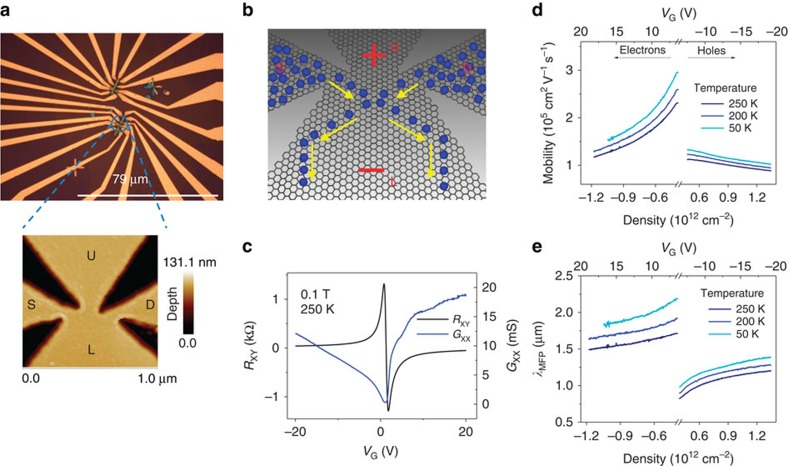

**The actual device is in panel (a), at left:** an optical image with an AFM inset of the active junction. Panel (b) illustrates the carrier paths. Figure 1 reproduced unchanged from **Auton et al., “Graphene ballistic nano-rectifier with very high responsivity,” Nature Communications 7, 11670 (2016)**, [doi:10.1038/ncomms11670](https://doi.org/10.1038/ncomms11670), under [CC BY 4.0](https://creativecommons.org/licenses/by/4.0/). [Image provenance and license](docs/assets/literature/README.md).

This paper informed our earlier asymmetric-cross reference. **D00 and triangle-control below are our synthetic controls**, not digitizations of this device. [Geometry provenance and differences](docs/TOPOLOGY-BENCHMARK.md#what-was-reconstructed-from-literature).

A [scale-calibrated manual AFM reconstruction](references/auton-2016/README.md) now preserves the photographed junction contour as a separate reference, with pixel coordinates and boundary uncertainty documented. Electrical benchmarking of that reference remains pending.

## Direct DC search

**Continuous search: 14 completed matched rounds.** Three methods explore the same five geometry families: top-score selection, a diversity archive, and random search. Each has evaluated 320 candidates, including the same 40 starting designs.*

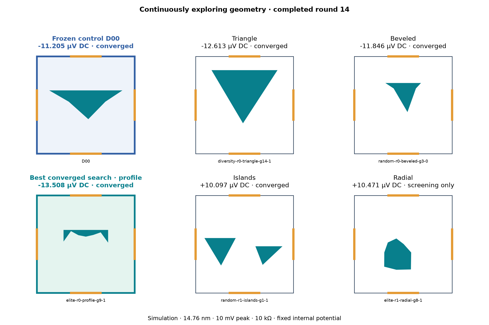

**An evolving experiment:** the worker continuously proposes, solves and refines geometries. This gallery regenerates from completed rounds, showing the control plus a leading candidate in each family. Blue highlights the frozen control; teal highlights the best converged search candidate, which always occupies its family's panel. Other families show their strongest screening result. Labels distinguish converged results from screening-only estimates; the table below includes converged method winners only.

Last published: **2026-10-22 20:36 UTC**, through matched round **14**. The 15-minute check-in publishes completed rounds while simulation continues independently.

| Method | Best converged design | DC magnitude (µV) | DC power (pW) |
| --- | --- | ---: | ---: |
| Frozen control D00 | D00 | 11.205 | 0.01256 |
| Top-score selection | elite-r0-profile-g9-1 | 13.508 | 0.01825 |
| Diversity archive | diversity-r0-triangle-g14-1 | 12.613 | 0.01591 |
| Random search | random-r0-profile-g14-1 | 13.389 | 0.01793 |

\* Fixed-potential simulations at 10 mV peak into 10 kΩ. Candidate counts include shared starting designs and matching proposals. Equal candidate budgets are not equal CPU budgets. Differences this small do not establish a better search method. D00 is our synthetic control. Winners are selected automatically after numerical convergence checks; incomplete rounds do not update this table.

[Completed-round data and progress](results/continuous-dc/round-000014/README.md) · [Wider search archive](results/2026-10-22-dc-wide/README.md) · [Independent scoring audit](results/2026-10-22-dc-audit/README.md)

### Current leader: broader checks

Each new converged leader enters a separate one-CPU validation queue with D00 and the synthetic triangle. Identical geometries are tested once. Search continues independently; these checks do not change its objective. Pending and unresolved results stay visible.

| Design | Completed contact/edge conditions | Converged DC cases | Ray scattering cases |
| --- | ---: | ---: | ---: |
| triangle-control | 3/3 | 27/27 | 27/27 |
| D00 | 3/3 | 27/27 | 27/27 |
| elite-r0-profile-g9-1 | 3/3 | 27/27 | 27/27 |

**Leader versus D00:** higher computed DC power in **16/27** matched, numerically converged cases so far, out of 27 planned conditions. This counts the computed ordering, not statistical significance or physical validation.

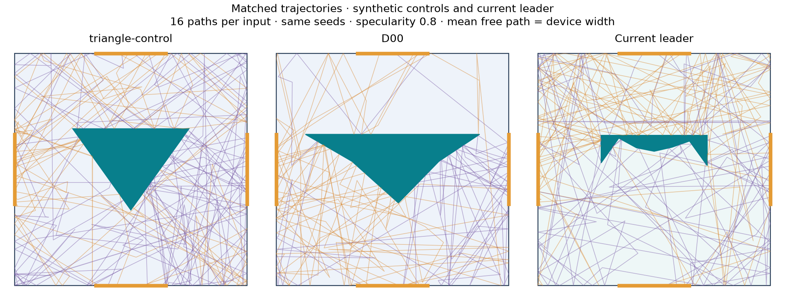

Orange paths enter from the left; purple paths enter from the right; gold segments are contacts. Trajectory paths are a classical diagnostic, not a quantum current map or DC-efficiency measurement. Neither control is a reproduced paper device.

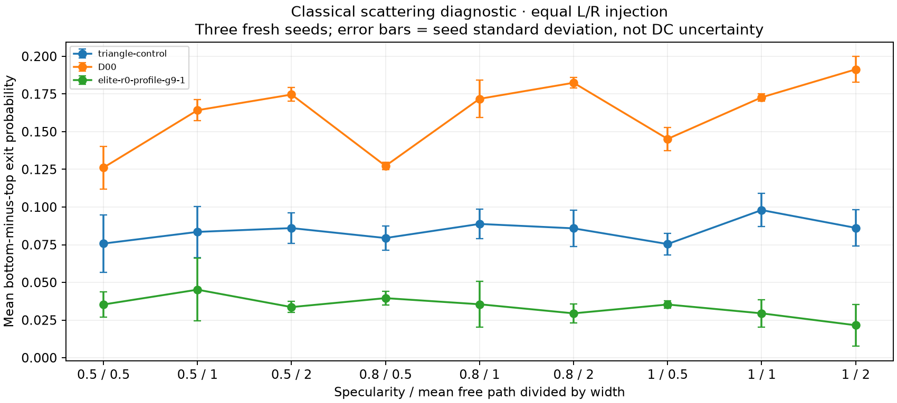

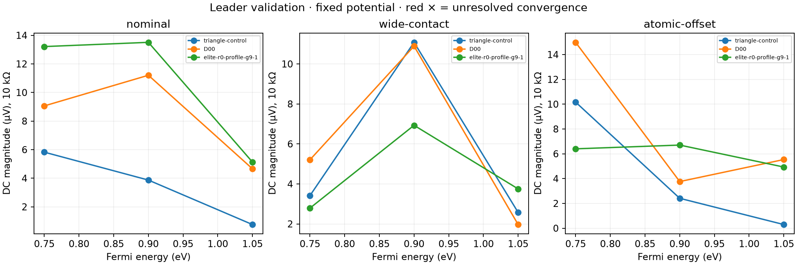

<details>
<summary>All 27 DC conditions per design: loads, energies and contact cuts</summary>

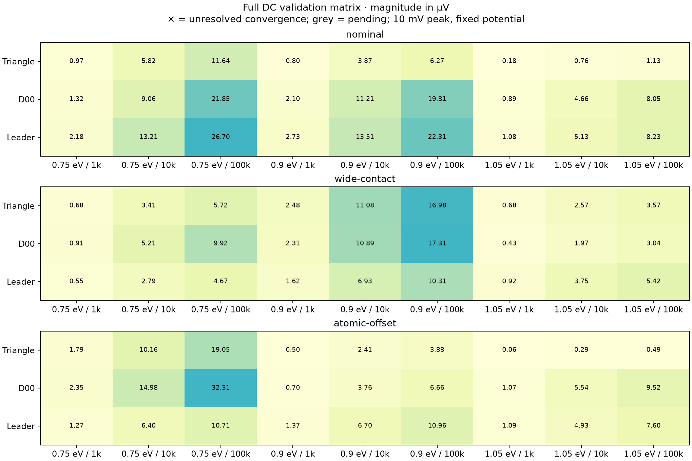

</details>

Full matrix: three Fermi energies × three loads × three contact/atomic-cut conditions, with energy and phase refinement. Ray checks cover three specularities × three mean free paths × three seeds. [Completed case data](results/continuous-dc/round-000014/validation) retains all loads, raw seed results and convergence flags. Phonons, self-consistent electrostatics and finite-frequency response remain unimplemented.


### Independent numerical check

| Independent score check | Difference (nV) | Result |
| --- | ---: | --- |
| D00 | 0.1241 | Pass |
| elite-r0-profile-g9-1 | 0.7375 | Pass |

[Audit receipts and exact input spectra](results/continuous-dc/round-000014/evidence). This cross-check uses pair currents, Gaussian quadrature and a separate load solver; it shares the same fixed-potential transport model.


<details>
<summary>Earlier six-design gallery</summary>

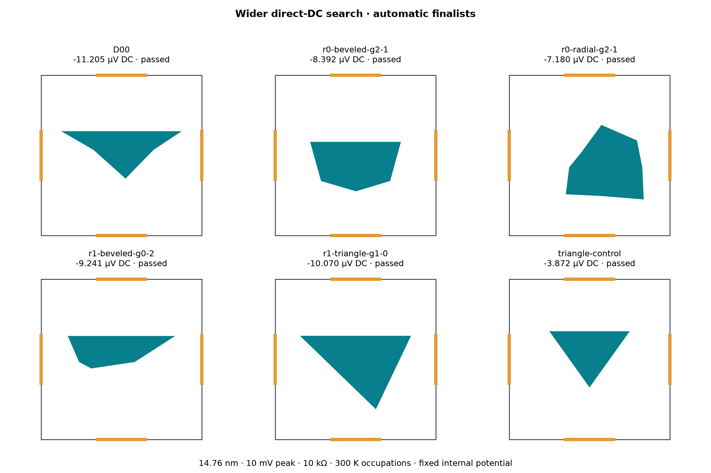

Frozen wider-search snapshot, retained for comparison with the evolving gallery above.

</details>

## Current findings — October 22, 2026, 20:36 UTC

<details>
<summary>Archived studies: earlier candidates and fixed experimental snapshots</summary>

| Study | Coverage | Finding |
| --- | --- | --- |
| Geometry discovery | 98,304 evaluations; four families; three repeats | Population search beat equal-budget random search in all 12 family/repeat comparisons.* |
| Best free profile | D12 versus frozen bevel D00 | Angular steering score 0.08011 versus 0.07644: **+4.8%**; higher mean in all nine scattering conditions.* |
| Quantum transport | Five shapes, two physical widths | Contact modes and electron energy strongly affect transport; ray rankings do not carry over automatically. |
| Matched quantum coverage | 15 atomic devices; 15,375 energy/device solves; 180 loaded outputs | Original study: **145/180** outputs passed both refinement checks.** |
| Integration follow-up | Seven devices; 21,504 additional solves | **31/35 flagged outputs resolved**; latest combined status **176/180**.‡ |
| Split-island candidate D14 | Three energies × three contact/atomic-cut conditions × four loads | **36/36 converged**; largest absolute transverse voltage in all nine conditions at 10 kΩ.† |
| Finite-bias DC baseline | Three shapes × three drive amplitudes; energy and phase refinement | Fixed-potential model favors D00 over D14; self-consistent device efficiency remains open. [Results](results/2026-10-22-finite-bias/README.md) |

\* Angular steering is a dimensionless geometry diagnostic, not electrical efficiency. D12 is not clearly separated from independently optimized bevels.

\** Each output must change by no more than 1 nV + 1% on **both** 257→513 and 513→1025 energy-grid refinements. This is a numerical stability check, not a confidence interval.

‡ Follow-up uses 1025→2049→4097 grids for seven devices; eight original devices retain their 257→513→1025 checks. [Follow-up results](results/2026-10-22-convergence/README.md).

† Linear response to a 1 mV differential drive, 300 K reservoir occupations, 14.76 nm device width. This measures transverse signal transfer; symmetric AC has zero mean output in this model. Thermal occupations do not include phonon scattering.

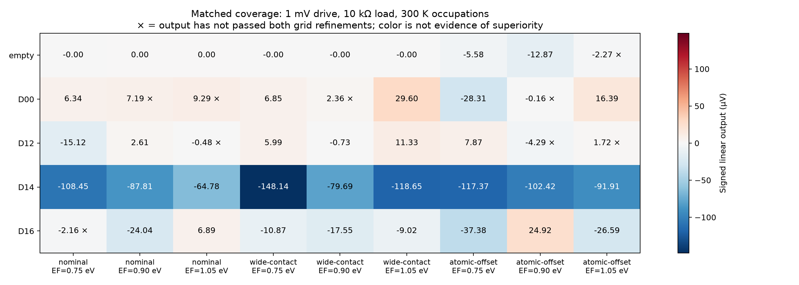

Signed output voltage in microvolts. Crosses mark the original study’s unresolved grid convergence; the linked follow-up resolves most of them. The empty-device control also responds to an alternative atomic cut, making matched controls essential. [Full results, spectra, convergence matrix and protocol](results/2026-10-22-coverage/README.md).

### Beyond the triangle

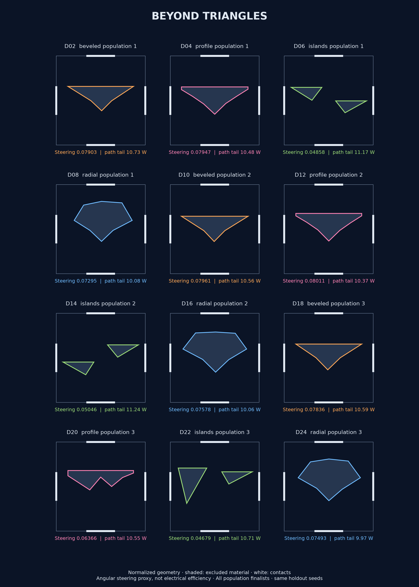

The search explores beveled obstacles, free boundary profiles, separate islands and asymmetric radial polygons. D12 leads the frozen bevel in the ray proxy; D14's split islands lead transverse signal magnitude in the quantum coverage study. These objectives measure different behavior, which is why we retain a diverse shortlist.

[Expanded design catalog and search data](results/2026-10-22-discovery/README.md) · [Earlier 17-design collection](designs/README.md) · [Search methods](docs/DISCOVERY.md)

</details>

## Methods and pipeline

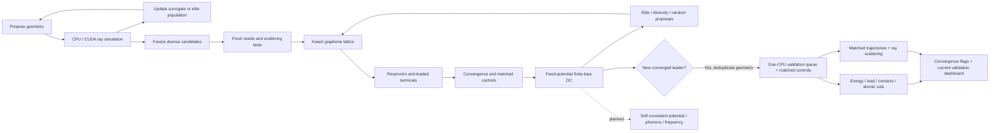

| Layer | Implemented method | Validation / evidence |
| --- | --- | --- |
| Geometry | Registered polygon families; immutable device specifications | Bounds, shape validity, frozen vertices and device fingerprints |
| Trajectories | Elastic ray transport, mixed specular/diffuse boundaries, exponential bulk free paths; CPU and CUDA | CPU/GPU agreement, particle conservation, reciprocity, symmetry, grazing-boundary regression |
| Search | ExtraTrees surrogate proposals, local mutation, elite recombination and global sampling | Equal evaluation budgets, independent repeats, frozen finalists and fresh-seed holdouts |
| Direct-DC search | Continuous elite, geometry-diversity and random arms; checkpointed candidates | Matched starting populations and proposal counts; independent score audit; automatic convergence gates |
| Lattice | Kwant honeycomb nearest-neighbor tight binding; four leads; explicit physical dimensions | Hermiticity, unitarity, current conservation, reciprocity, clean-ribbon transmission, energy-offset invariance |
| Reservoirs / load | Finite-temperature Landauer conductance; four-terminal resistor-load solution | Analytic network checks, gauge invariance, terminal current and power balance |
| Coverage | Energy, contact width, atomic alignment and load matrix | Nested energy grids; per-output acceptance; all failures retained |
| Quasistatic circuit | Current-provider interface, nonlinear load roots and sinusoidal cycle averaging | Analytic resistor/diode-bridge checks; DC power separated from ripple heating |

Kwant uses a **CPU sparse solver**. The RTX 5090 accelerates the trajectory search. The quantum stage currently models coherent, elastic transport with ideal leads; edge disorder, electrostatic feedback and finite-frequency circuit effects remain separate work items.

### How the search improves

1. **Generate and simulate.** Store geometry, provenance and finite-bias DC scores for every candidate.
2. **Choose parents in two ways.** The elite arm retains top scorers within each family and seed stream. The diversity arm retains the best performer in each geometric neighborhood, keeping distinct branches eligible for refinement.
3. **Keep exploring.** Guided arms pair mutations with fresh global samples. A random arm receives the same candidate count, and all arms start from the same population. Candidate counts and CPU cost are different budgets.
4. **Refine before reporting.** The two strongest screening candidates per arm receive denser energy grids and a separate phase-averaging check. Historical validated results remain available; failed checks stay visible.
5. **Compare completed rounds.** The worker runs continuously and checkpoints progress. Reports use only complete matched rounds. Operating-point and disorder holdouts are still needed before a device-performance claim.

**Feedback changes which proposals are explored; a direct-DC advantage over random search is not yet established.** The diversity archive uses blocked area and vertical reflection asymmetry, not literature novelty. The current search is evolutionary sampling within five parameterized families; it does not train a quantum surrogate or improve its physics automatically. Reinforcement learning and GANs are not implemented. Earlier trajectory studies used ExtraTrees and elite recombination; their evidence applies to the angular proxy. RANSAC is useful for robust curve fitting, not the optimizer used here.

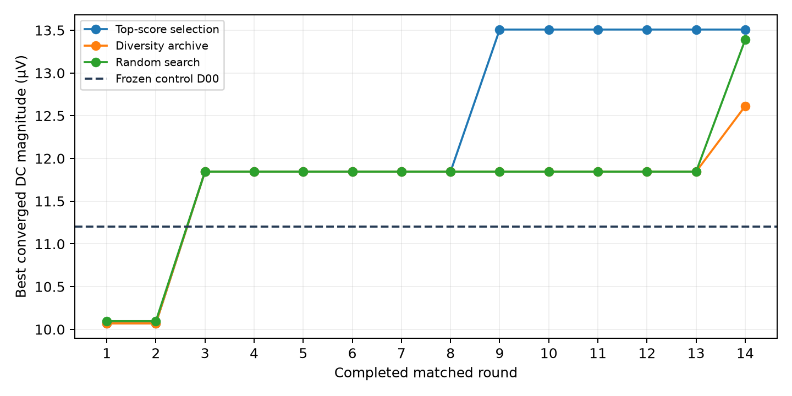

Current direct-DC progress: best converged result retained after each completed matched round. Flat sections mean no better converged design was found; exploration continues. [Earlier trajectory-proxy study](docs/REFINEMENT.md).

### What makes the next round worthwhile?

Trajectory-proxy search has beaten random selection under equal evaluation counts, and quantum transport
has identified a different promising family. The next decision is whether a
candidate improves **loaded DC output or detector performance** against matched
controls by more than numerical and disorder uncertainty. If that advantage
vanishes, redirect the search objective or geometry family. Further proxy gains
alone are not the success criterion.

## What remains to complete

| Status | Work item | Completion criterion |
| --- | --- | --- |
| Done | Classical transport and search | Checked CPU/GPU backends and equal-budget search evidence |
| Done | Coherent graphene lattice | Ribbon, conservation, reciprocity and gauge checks |
| Done | Linear reservoirs and loads | Checked terminal equations and power accounting |
| Done | First matched quantum coverage | All 15 frozen devices reported, including unresolved outputs |
| Partial | Output integration convergence | 31/35 flags resolved; four small D00 outputs need further quadrature/window checks |
| Open | Edge disorder, orientation and size scaling | Matched ensembles with uncertainty and stability of candidate comparisons |
| Open | Self-consistent nonlinear electrostatics / transport | Bias-dependent potential, gauge invariance, charge/current conservation and mesh convergence |
| Partial | Loaded AC-to-DC response | Finite-reservoir-bias provider connected and tested; self-consistent potential response still required |
| Open | Contacts, dynamics, noise and thermal limits | Application-specific circuit, frequency and loss models with validation |
| Open | Matched published-device benchmark | Reproduce reference trends before comparing searched designs |
| Partial | Quantum-informed search feedback | Continuous three-arm comparison implemented; statistical search advantage and untouched holdouts remain open |

These are engineering milestones with explicit checks. A stage is completed when its evidence passes, not when an API exists. [Detailed physics gates](docs/PHYSICS-ROADMAP.md) · [Software interfaces](docs/ARCHITECTURE.md).

## Why ballistic rectifiers matter

Graphene ballistic rectifiers offer a planar route to high-frequency detection and signal conversion without a conventional p–n junction barrier. Published terahertz detection motivates the investigation. Power conversion adds requirements for useful output under load, contact losses, current capacity and voltage handling; those requirements guide the later circuit stages.

### Published research and our position

Selected experimental reference points, not a complete ranking:

| Work | Demonstrated result | Conditions and comparison limits |
| --- | --- | --- |
| [Auton et al., 2016](https://www.nature.com/articles/ncomms11670) ([accepted manuscript](https://pure.manchester.ac.uk/ws/portalfiles/portal/33718005/CLEAN_Main_Text_Graphene_ballistic.pdf)) | Room-temperature graphene rectification; intrinsic voltage responsivity up to **23,000 V/W** and noise-equivalent power down to **0.64 pW/√Hz** | Low-frequency electrical excitation. Substrate parasitics limited measurements to 3 MHz; these sensitivity values are not a demonstrated THz result. |
| [Shi et al., 2026](https://onlinelibrary.wiley.com/doi/full/10.1002/smsc.202500654) | Antenna-coupled graphene ballistic detection at **3 THz** | Figure 3 reports sample B's maximum responsivity changing from **77 V/W at 4 K** to **6 V/W at 300 K**. The abstract separately lists 100 V/W and 20 pW/√Hz at room temperature; this apparent discrepancy needs clarification before using those headline values as a matched benchmark. |
| **This project** | Geometry search, coherent quantum transport and fixed-potential loaded DC simulations | Simulation-only; self-consistent electrical rectification and matched experimental-device benchmarking remain open. |

Responsivity (V/W) measures voltage sensitivity; efficiency measures useful DC power divided by AC input power. These are different targets. Our current contribution is the reproducible geometry-search and transport pipeline; a matched electrical comparison is an open milestone.

## Comparison with conventional rectifiers

| Use case | Conventional baseline | What our candidate must demonstrate |
| --- | --- | --- |
| Power conversion | MOSFET synchronous rectification reduces diode conduction loss.* | Useful DC efficiency at matched voltage, current, load and frequency, including control/contact losses |
| Weak RF / THz signals | Commercial zero-bias Schottky detectors already cover millimeter-wave and THz bands.** | Matched responsivity, noise, input coupling, dynamic range and response bandwidth |
| Geometry discovery | Optimized conventional and published ballistic layouts | Improvement under the same physical model and operating conditions |

\* [TI's synchronous-rectification overview](https://www.ti.com/product-category/power-management/synchronous-rectification.html). Illustrative conduction-only arithmetic: at 1 A, a 0.4 V diode dissipates 0.4 W; a 10 mΩ MOSFET dissipates 0.01 W. Gate drive, switching and other converter losses must be added. These are assumed values, not a product comparison.

\** [VDI's detector specifications](https://vadiodes.com/detectors-zbd/) list the standard WR1.0ZBD (750–1100 GHz) at typical 750 V/W and 27.1 pW/√Hz. The listed RF band is the carrier-frequency range, not the output modulation bandwidth; typical responsivity assumes optimal RF input power. These packaged-detector values cannot be ranked against low-frequency intrinsic graphene figures without matching conditions.

**The reported +4.8% compares our profile against our frozen bevel in the angular proxy. It is not an improvement over a paper or a conventional electrical rectifier.**

## Model definitions

In the trajectory screen, the square has normalized side length 2 and four contacts of width 0.6. The boundary model mixes specular and diffuse reflection; optional bulk scattering randomizes direction after exponentially distributed flight lengths. For injection angle θ, let s = sin θ and q = +1 for a bottom exit, −1 for a top exit, and zero otherwise:

$$
p_\beta(s)=\frac{1+\beta(1-2s^2)}{2(1+\beta/3)},\qquad
S=\left.\frac{\partial\langle q\rangle_\beta}{\partial\beta}\right|_0
=\left\langle q\left(\frac23-2s^2\right)\right\rangle_0.
$$

S is averaged over left/right injection. Its input perturbation is dimensionless; no voltage-to-angle conversion is assumed. The separate electrical target is

$$
\eta=\frac{P_{\mathrm{DC,load}}}{\langle P_{\mathrm{AC,input}}\rangle}.
$$

Quantum transport uses an explicit carbon lattice, energy-dependent scattering matrices and thermal reservoir occupations. The linear-response stage produces zero mean DC under symmetric AC. The finite-bias stage integrates shifted reservoir occupations and solves the output load through each cycle, producing a DC component while holding the internal device potential fixed. [Hamiltonian and terminal-model details](docs/ARCHITECTURE.md).

## Evidence archive

| Study | Report |
| --- | --- |
| Initial surrogate search and scattering | [Original results](results/2026-10-22/) |
| Geometry-family comparison | [Topology benchmark](docs/TOPOLOGY-BENCHMARK.md) |
| Local feedback-guided refinement | [Refinement](docs/REFINEMENT.md) |
| Broader geometry discovery | [98,304-evaluation study](results/2026-10-22-discovery/README.md) |
| First lattice verification | [Two-width checkpoint](results/2026-10-22-lattice/README.md) |
| First loaded terminal calculation | [Linear-load checkpoint](results/2026-10-22-linear-load/README.md) |
| Integration follow-up | [4097-point refinement](results/2026-10-22-convergence/README.md) |
| Matched quantum matrix | [Coverage results](results/2026-10-22-coverage/README.md) |
| Finite-bias baseline | [Loaded DC and energy/phase refinement](results/2026-10-22-finite-bias/README.md) |
| Independent DC audit | [Separate quadrature and load solver](results/2026-10-22-dc-audit/README.md) |
| Wider direct-DC search | [All 83 candidates and finalists](results/2026-10-22-dc-wide/README.md) |

## Run

Use Python 3.12 or newer in a virtual environment:

```sh
python -m venv .venv
# Activate .venv using your shell's activation command.
python -m pip install -r requirements.txt
python -m unittest discover -s tests
python simulate.py
```

GPU stages require a compatible NVIDIA GPU/driver and CuPy. The development machine used an RTX 5090 and `cupy-cuda13x[ctk]==14.2.0`; [CuPy's installation guide](https://docs.cupy.dev/en/stable/install.html) describes platform requirements. `requirements-gpu.txt` records the development environment, rather than a universal hardware requirement.

```sh
python -m pip install "cupy-cuda13x[ctk]==14.2.0"
python validate_gpu.py
python learn_search.py
python final_checks.py
python rf_screen.py
python robust_search.py
```

Run in that order: later stages consume earlier results. Outputs go to `runs/latest/`; set `BALLISTIC_OUTPUT_DIR` to a fresh directory for a new experiment. The learning search refuses to overwrite an existing learning log. Historical reports in the results snapshot retain their original prototype commands; use the commands above for this repository. GPU pool allocation is capped at 512 MiB; CUDA context/driver overhead is additional.

The refinement experiment runs independently from its committed anchor snapshot:

```sh
python validate_families.py
python -m ballistic_lab.experiments.refinement
python -m ballistic_lab.reporting.showcase runs/latest
```

Use the configured output directory in the last command if `BALLISTIC_OUTPUT_DIR` is set.

The optional quantum environment is specified in `environment-quantum.yml`. Run `python -m ballistic_lab.experiments.coverage` from the repository root to reproduce the frozen study in `runs/coverage`; existing manifests reject changes to source or plan. Use a fresh checkout/output for an independent reproduction. Render its published figures with `python -m ballistic_lab.reporting.coverage` after placing results in the published snapshot directory.

## Code organization and validation

The current continuous campaign runs in the Kwant environment:

```sh
python -m ballistic_lab.pipeline.dc_continuous
# In a separate process, publish completed rounds:
python -m ballistic_lab.reporting.dc_continuous
```

The worker continues between monitoring check-ins. It holds an exclusive lock and saves completed evaluations. Create `runs/dc-continuous/STOP` to stop after the current stage; remove it and rerun to resume. Source hashes reject incompatible resumes. The default campaign uses four CPU workers and the committed initial population. Configure BLAS for one thread per worker; see [operating details](docs/ARCHITECTURE.md#continuous-search-worker).

`ballistic_lab/` separates geometry, transport, metrics, search, pipeline contracts, validation, reporting and experiment modules. Immutable dataclasses carry configurations/results; `@geometry_family` and `@validation_check` register extensions. Root scripts are compatibility entry points. Source fingerprints bind validation receipts and frozen runs to their implementation.

CPU tests and formatting/lint checks run in CI. Optional Kwant tests run in the quantum environment; CUDA checks run on compatible local hardware. [Architecture and validation contracts](docs/ARCHITECTURE.md).

## License

[MIT](LICENSE). External publications remain under their respective licenses.
