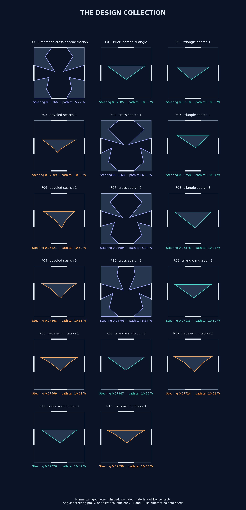

# Design catalog

Every frozen evaluation record is published below, including anchors and repeated geometries. The collection contains 17 distinct shapes.

## What the search found

The beveled mutation family is the clearest refinement result: R05, R09, and R13 all beat their common anchor R01 on fresh seeds. R09 has the highest training score among these repeats and also the highest observed nominal holdout score. It is a proxy-score leader, not a proven best physical rectifier.

R00 is the learned triangle anchor; R07 is the strongest training-selected triangle refinement. F04 is the strongest training-selected cross candidate in the family experiment. Cross layouts have shorter long-path tails but weaker steering in this screen, which makes them useful alternatives to retain.

The highlights are a retrospective presentation, not an additional independent validation. All finalists remain available, including unsuccessful refinements.

## Read the cards

Steering is the dimensionless angular-response derivative. Path tail is the 99th-percentile traveled distance divided by cavity width, averaged over input ports and seeds; it is not a measured delay or bandwidth. Every card uses mean free path/width = 1 and wall specularity = 0.8. F and R identify different experiments with different holdout seeds, so tiny cross-cohort differences should not be interpreted as improvements.

## Reuse the geometry

[Download the JSON catalog](catalog.json). Each record contains family parameters, explicit excluded-polygon vertices, scores, seed variability, path tails, and its source result file. Coordinates are normalized, not fabrication dimensions. The reference cross approximates a literature topology; it is not an exact published-device reconstruction. Geometry exports are MIT licensed.

Regenerate from the repository root with `python -m ballistic_lab.reporting.catalog`.

| ID | Candidate | Steering | Seed SD | Path tail / W | Source |
| --- | --- | ---: | ---: | ---: | --- |
| F00 | Reference cross approximation | 0.033659 | 0.000561 | 5.224 | [JSON](../results/2026-10-22-families/families-results.json) |
| F01 | Prior learned triangle | 0.073848 | 0.001446 | 10.395 | [JSON](../results/2026-10-22-families/families-results.json) |
| F02 | triangle search 1 | 0.065100 | 0.000857 | 10.628 | [JSON](../results/2026-10-22-families/families-results.json) |
| F03 | beveled search 1 | 0.070087 | 0.001115 | 10.893 | [JSON](../results/2026-10-22-families/families-results.json) |
| F04 | cross search 1 | 0.051685 | 0.001182 | 6.899 | [JSON](../results/2026-10-22-families/families-results.json) |
| F05 | triangle search 2 | 0.057576 | 0.001169 | 10.539 | [JSON](../results/2026-10-22-families/families-results.json) |
| F06 | beveled search 2 | 0.061214 | 0.000998 | 10.602 | [JSON](../results/2026-10-22-families/families-results.json) |
| F07 | cross search 2 | 0.046037 | 0.000964 | 5.935 | [JSON](../results/2026-10-22-families/families-results.json) |
| F08 | triangle search 3 | 0.063781 | 0.001514 | 10.245 | [JSON](../results/2026-10-22-families/families-results.json) |
| F09 | beveled search 3 | 0.073680 | 0.001382 | 10.609 | [JSON](../results/2026-10-22-families/families-results.json) |
| F10 | cross search 3 | 0.047046 | 0.000771 | 5.573 | [JSON](../results/2026-10-22-families/families-results.json) |
| R00 | Prior learned triangle | 0.072652 | 0.000753 | 10.338 | [JSON](../results/2026-10-22-refinement/refinement-results.json) |
| R01 | beveled search 3 | 0.073053 | 0.000910 | 10.684 | [JSON](../results/2026-10-22-refinement/refinement-results.json) |
| R02 | triangle global 1 | 0.072652 | 0.000753 | 10.338 | [JSON](../results/2026-10-22-refinement/refinement-results.json) |
| R03 | triangle mutation 1 | 0.071826 | 0.000747 | 10.390 | [JSON](../results/2026-10-22-refinement/refinement-results.json) |
| R04 | beveled global 1 | 0.073053 | 0.000910 | 10.684 | [JSON](../results/2026-10-22-refinement/refinement-results.json) |
| R05 | beveled mutation 1 | 0.075692 | 0.001210 | 10.613 | [JSON](../results/2026-10-22-refinement/refinement-results.json) |
| R06 | triangle global 2 | 0.072652 | 0.000753 | 10.338 | [JSON](../results/2026-10-22-refinement/refinement-results.json) |
| R07 | triangle mutation 2 | 0.073474 | 0.000612 | 10.349 | [JSON](../results/2026-10-22-refinement/refinement-results.json) |
| R08 | beveled global 2 | 0.073053 | 0.000910 | 10.684 | [JSON](../results/2026-10-22-refinement/refinement-results.json) |
| R09 | beveled mutation 2 | 0.077244 | 0.000473 | 10.510 | [JSON](../results/2026-10-22-refinement/refinement-results.json) |
| R10 | triangle global 3 | 0.072652 | 0.000753 | 10.338 | [JSON](../results/2026-10-22-refinement/refinement-results.json) |
| R11 | triangle mutation 3 | 0.070758 | 0.000885 | 10.494 | [JSON](../results/2026-10-22-refinement/refinement-results.json) |
| R12 | beveled global 3 | 0.073053 | 0.000910 | 10.684 | [JSON](../results/2026-10-22-refinement/refinement-results.json) |
| R13 | beveled mutation 3 | 0.075381 | 0.001220 | 10.627 | [JSON](../results/2026-10-22-refinement/refinement-results.json) |
