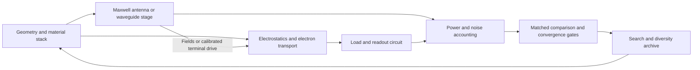

# Architecture and validation contracts

The research pipeline separates model definitions from experiment orchestration. New work belongs in `ballistic_lab/`; root scripts are compatibility command-line entry points.

| Module | Responsibility |
| --- | --- |
| `models.py` | Immutable dataclass configurations, candidate records, result contracts, and `TransportBackend` protocol |
| `geometry/registry.py` | `@geometry_family` registration with parameter dimensions and search bounds |
| `geometry/families.py` | Pure geometry construction; no CUDA or experiment I/O |
| `transport/cpu.py` | Independent NumPy trajectory implementation |
| `transport/gpu.py`, `rays.cu` | Batched CUDA implementation and readable kernel source |
| `transport/backend.py` | Typed adapter from low-level CUDA arrays to `TraceBatch` |
| `transport/quantum.py` | Optional coherent Kwant lattice stage and conservation gates |
| `transport/reservoirs.py` | Linear terminal conductance, thermal occupations, passive load and power balance |
| `experiments/linear_load.py` | Dense energy sweep and output-sensitive convergence gate; no nonlinear rectification |
| `metrics/angular.py` | Angular-response estimator against the backend protocol |
| `search/families.py` | Equal-budget candidate generation and evaluation of frozen candidates |
| `validation/registry.py` | `@validation_check` names executable validation contracts |
| `validation/families.py` | Independent, metamorphic, regression, and tolerance checks |
| `validation/receipts.py` | Source fingerprints and rejection of missing/stale validation |
| `reporting/families.py` | Figures produced from result records; no simulation or selection |
| `experiments/` | Run orchestration and earlier reproducible experiments |

`RayConfig`, `SearchPlan`, and `Candidate` make assumptions visible at function boundaries. `TraceBatch` and `AngularResponse` name outputs that were formerly anonymous tuple positions. The geometry and validation decorators register functions without changing their callable behavior. Type annotations describe interfaces; they are not a claim that the entire project has passed a static type checker.

## Adding a geometry

Define a pure factory with `@geometry_family(name, bounds)`. Keep contacts and outer domain consistent with the intended comparison. Add tests for valid polygons and particle conservation, then CPU/GPU and physical-invariant checks before searching. A new family must not gain extra simulation budget or silently change injection conditions.

## Adding a transport backend

### Physics-stage boundary

`pipeline/contracts.py` defines `PhysicsStage[Request, Result]`, separate from
the ray-only `TransportBackend`. Each solver has its own typed request and
result; a lattice solver must not fabricate ray trajectories to fit an interface.

`SquareDevice` snapshots obstacle vertices into immutable tuples, fixes the
square and centered-contact convention, and fingerprints geometry, physical
scale and `contact_width_fraction`. Identity schema v2 adds the contact fraction;
v1 hashes in historical snapshots retain their historical meaning. The ray
adapter rejects widths other than 0.3W instead of silently ignoring them.
Its optional `width_m` preserves normalized screening; physical solvers
must call `physical_width()` and reject unspecified scale. Geometry arrays handed
to solvers are copies. This contract checks dimensions and finite coordinates;
family validation remains responsible for polygon topology and nonintersection.

`pipeline/ray.py` is the first working stage adapter. `RayRequest` records ray
configuration and independent seed bases (including the second port's seed).
`RayResult` retains all per-seed observations, device identity, backend identity,
and Monte Carlo standard error. Its observable explicitly names angular response,
not power efficiency. The adapter calls the existing estimator without changing
its mathematics. It propagates solver failures instead of returning a score.
Existing search entry points retain their batched path for performance and exact
historical reproduction; the stage adapter is the boundary for staged evaluations.

Future stages receive the same device plus their own material and operating
configuration. Lattice transmission matrices, driven currents, and circuit power
budgets remain different result types. Promotion must name the observable and
comparison conditions explicitly; there is no universal cross-physics fitness.
Self-consistent electrostatics and transport belong inside one coupled stage,
with residuals and convergence failure in its result contract. Those solvers are
not implemented yet. Neither physical constants nor an assumed temperature are
silently supplied by the common device type.

The current adapter does not replace experiment-level source receipts: search
orchestration still requires the existing exact-source validation gate. Stage
results alone are not evidence of validated physics. Tests check exact estimator
parity, immutable geometry, mandatory physical scale, independent seeds, and
failure propagation before a further solver is integrated.

### Ray backend boundary

Implement `TransportBackend.trace(geometries, port, config, seed) -> TraceBatch`. The angular metric currently requires the existing uniform-contact and cosine-flux injection RNG contract. A different injection sampler requires a corresponding estimator; sharing a method signature does not make incompatible physics interchangeable.

## Required validation

- CPU-only tests check configuration rejection, polygon construction, particle conservation, an analytic angular-response case, and missing/stale validation receipts.
- GPU validation checks deterministic CPU agreement, mixed versus separate batching, stochastic bulk-scattering agreement, reciprocity, mirror reversal, the empty-cavity control, and numerical-tolerance sensitivity.
- A grazing-reflection regression pins the trajectory that formerly re-hit its own boundary and entered an excluded polygon. Reflected straight legs now exclude the previous flat segment; a bulk-scattering event clears that exclusion.
- A search requires a receipt for the exact current Python and CUDA source fingerprints. Changing source requires validation again. This is an accidental-staleness guard, not a cryptographic trust system.
- Candidates freeze before holdout evaluation. Failed or unresolved trajectories stop the run; they are never dropped from the denominator.

Run `python -m ruff check .`, `python -m ruff format --check .`, and `python -m unittest discover -s tests` locally or in CPU CI. GPU checks are run explicitly on a compatible NVIDIA machine; hosted CPU CI cannot substitute for them.

The modular refactor was replayed against the pre-refactor run: candidate parameters, every training score, and every holdout statistic were exactly equal. See the saved refactor receipt in the topology results directory.

## Quasistatic circuit interface

`transport/circuit.py` accepts a `TerminalCurrentModel`: four currents into the
L/R/T/B terminals for four applied voltages. The provider owns its transport and
self-consistency calculations and must fail if those fail. The circuit layer
solves the two output voltages with a resistor across T/B, checks terminal KCL,
local Jacobian conditioning, passivity and power balance, and integrates a
sinusoidal drive over a declared phase grid.

It reports DC voltage, DC load power, total resistor heating and ripple heating
separately. DC power is `mean(Vout)**2/R`; total heating is `mean(Vout**2)/R`.
A large AC signal therefore cannot silently become an efficiency claim. The
phase grid needs a refinement check, and the quasistatic model has no frequency
prediction or storage/filter capacitor. Models with multiple roots need branch
stability analysis; extra supplies require an extended power contract.

Independent tests cover a known resistor chain, a piecewise-linear diode bridge
with analytic output, cycle quadrature convergence, conservation failures and
floating/disconnected outputs. The bridge is a circuit oracle, not a graphene
result. The self-consistent graphene current provider remains to be implemented.

## Direct DC search and generated documentation

`search/dc_space.py` owns the seeded proposal policy and family bounds.
`experiments/dc_wide.py` evaluates those proposals through the shared finite-bias
current/circuit interfaces, freezes each batch before scoring, and refines the
automatic shortlist. Controls never enter the mutation parent pool.

`validation/dc_score.py` provides an independent numerical oracle: pair-current
integration and a different quadrature/load solver. `experiments/dc_audit.py`
also rebuilds the incumbent under an anonymous ID, checking that cached-control
handling does not change its score. This validates implementation within the
fixed-potential assumptions, not the missing electrostatic feedback.

`pipeline/dc_publish.py` accepts a completed run, archives its inputs without
overwriting a conflicting snapshot, and calls `reporting/dc_wide.py`. The
reporter applies convergence gates and ranks DC power; it generates the
finalist gallery, all-proposal plot, full table and README feature together.
There is no manually chosen hero geometry. Unresolved finalists stay visible.

`python -m ballistic_lab.pipeline.dc_workflow` runs audit → search → refinement
→ publication from fresh `runs/dc-audit` and `runs/dc-wide` directories. A
timestamped archive preserves earlier studies. `python -m
ballistic_lab.pipeline.dc_publish` publishes an already completed current run.
The workflow is a bounded explicit invocation, not a background job. Repeated
searches with unchanged seeds reproduce the same proposals; this does not
claim unbounded learning across invocations.

## Optional diversity-preserving search

`WideDCPlan(parent_strategy="diversity")` enables geometry-niche parent selection;
`elite` remains the baseline. Pass the plan to `experiments.dc_wide.main(plan)`
with a fresh output directory, as for other search runs. The manifest records it.

`search/diversity.py` rasterizes the polygon union at 96 x 96 and describes blocked
area fraction and top/bottom reflection mismatch. Fixed ten-bin axes define
neighborhoods separately within each family and repeat. Each neighborhood keeps
its highest screening DC-power candidate; mutation samples occupied neighborhoods
uniformly. Fresh global proposals and the existing finalist convergence gates remain.
These are geometry descriptors, not a claim of physical or literature novelty.

The retrospective `results/2026-10-22-dc-wide/diversity-replay.json` retains 50 of
80 candidates as eligible parents, versus 20 under top-two selection. This is an
archive replay, not a new transport simulation or evidence of superior search.

Next scheduled campaign: compare elite, diversity and random proposals under equal
budgets and matched seeds, retain historical validated incumbents, and report both
coverage and best converged DC power. Check descriptor bin/resolution sensitivity
before treating coverage as robust. Do not silently replace the baseline with this
experimental strategy or label screening archive members validated winners.

## Continuous search worker

`python -m ballistic_lab.pipeline.dc_continuous` runs back-to-back rounds using
four CPU workers in the isolated Kwant environment. It compares elite, diversity,
and random proposal arms from the same archived 40-candidate initial population.
Each arm receives 20 new proposals per round and two automatically selected
finalists for convergence refinement. These are equal candidate/refinement counts,
not necessarily equal CPU time or spectral-solve counts. Global proposals stay
matched across arms; mutations have a 2% parameter-range floor to avoid vanishing
steps during long campaigns. Geometry diversity remains experimental.

The worker checkpoints after each completed candidate, freezes proposed batches
before evaluation, and writes complete matched rounds to
`runs/dc-continuous/round-NNNNNN.json`. An OS lock prevents duplicate workers.
Create `runs/dc-continuous/STOP` for a graceful stop after the current stage;
remove it and rerun the command to resume. Source hashes prevent resuming a campaign
with changed physics/search code. Do not edit loaded solver/search code while the
worker is live. Gzip spectrum writes use atomic replacement; an interrupted energy
grid is recomputed, while completed grids are reused.

The 15-minute agent check-in supervises the continuous worker and publishes
completed snapshots; it is not the compute timer. Read `status.json`, process
liveness, `state.json`, and worker logs before starting anything. The worker itself
does not commit or push, and partial stages must not replace validated README
results. Historical controls remain in their immutable archives. The machine must
remain running for this local process to progress.

## Continuous leader validation

### Bounded winner-neighborhood experiment

`python -m local_lab.worker` independently freezes a completed-round leader and
24 local mutations. It uses one CPU and exits after screening and refinement.
Monitor `runs/winner-local/status.json`, results, logs and process liveness;
do not duplicate it. Its OS lock, source manifest and STOP/resume contract are
documented in [`local_lab/README.md`](../local_lab/README.md). Loaded local and
transport sources must remain unchanged. The continuous reporter publishes its
completed rows separately, without adding them to matched-arm counts or rankings.

### Continuous operating-condition checks

`python -m followup_lab.worker` is a separate one-CPU consumer of completed
search snapshots. It never writes search histories or modifies the selection
objective. The separately versioned `followup_lab/` orchestration package avoids
changing the already-running search source manifest; it uses the same transport
and circuit implementations rather than duplicating physics.

Each distinct converged leader is queued by a hash of its polygon coordinates.
The fixed synthetic D00 and triangle controls receive identical tests. Shared
winners across methods are deduplicated; previous leaders remain queued. The
current leader is prioritized ahead of older leaders after the controls.

Three Fermi energies (0.75, 0.9, 1.05 eV), three loads (1, 10, 100 kohm), and
nominal/wide-contact/atomic-offset conditions yield 27 DC cases per design.
Nested grids 257/513/1025 extend to 2049/4097, requiring two successive changes
within 1 nV + 1% and a 32-versus-64-phase check. Unresolved outputs remain marked.
Existing nominal spectra are reused only after checking geometry. New spectra
are checkpointed atomically. No quantum scattering or electrostatic feedback
is implied by these fixed-potential checks.

The independent CPU ray diagnostic uses 2048 trajectories per input, three
fixed fresh seeds, specularities 0.5/0.8/1 and mean-free-path/width ratios
0.5/1/2. Saved probabilities and first 16 paths per port drive the live plots.
This is classical equal-input steering, not DC power or the earlier angular
response derivative. It does not feed back into DC selection.

Inspect `runs/leader-validation/status.json`, `queue.json`, worker logs and
process liveness at each supervision check. Its OS lock prevents duplicates.
Create `runs/leader-validation/STOP` for a stop between contact conditions;
remove it to resume after diagnosis. A source manifest rejects changed code.
Never modify either worker's loaded code while it runs. Reporting is excluded
from worker source hashes and may be updated independently.

The existing continuous reporter also publishes completed validation cases,
matched trajectories, scattering and contact/energy charts. Pending conditions
remain explicit. Archived earlier studies retain their original figures.

The reporter derives candidate counts from completed matched snapshots and exports
the complete DC validation matrix as both a figure and CSV. Each new leader and
the D00 control also receive an independent numerical score check using pair
currents, Gaussian quadrature and a separate load solver. Receipts and exact input
spectra are published under the snapshot's `evidence/` directory. Cached audits
are keyed by input and implementation hashes. These checks test numerical
agreement within the fixed-potential model, not experimental device performance.

## Electronic and photonic stage composition

### Automated falsification queue

The separate `python -m edge_lab.worker` adds a one-CPU atomic-edge vacancy
ensemble with its own lock, source manifest, queue and 32-energy STOP checkpoints
under `runs/edge-sensitivity/`. Monitor its process, status and logs independently.
Do not edit loaded edge, verification or transport modules. See
[`edge_lab/README.md`](../edge_lab/README.md) for the pilot sampling and convergence
contract. The continuous reporter publishes completed receipts and unresolved cases;
the ensemble never changes search scoring.

`python -m verification_lab.worker` is a separate single-CPU consumer of completed
rounds. It replays D00, triangle-control and each observed overall leader on the
entire accepted energy grid, rebuilding rather than using search spectra as inputs.
Its own atomic checkpoints allow resume; results retain pass/fail/unresolved status.
It checks graph connectivity, fresh transmission/DC agreement and terminal-exchange
covariance. The latter tests circuit/readout conventions, not atomic reflection.

`runs/falsification/` contains an OS lock, source manifest, status, immutable inputs
and completed receipts. Create its `STOP` file to stop between 32-energy batches;
remove it and rerun to resume. `--once` drains one observed snapshot and exits.
Never start duplicates or edit its loaded verification/transport code. Exceptions
produce unresolved receipts that are not automatically retried; inspect the cause
before a new campaign. Selection/scoring are untouched. The continuous reporter
publishes only completed receipts matching the exact reported input row, retaining
pending labels for new leaders. Exact atomic reflection, edge ensembles and missing
device physics remain unresolved rather than inheriting numerical passes.

The existing `PhysicsStage[Request, Result]` protocol is the common execution
boundary. Search, immutable candidate identities, provenance, caching, convergence
receipts and report generation are reusable. Each solver retains its own physical
request/result types; an optical scattering matrix is not an electron transmission
matrix, even when both use similar numerical linear algebra.

This is an extension design, not a claim that Maxwell or coupled nonlinear
solvers are implemented. The live worker retains its existing objective.

The electromagnetic result must specify frequency in Hz, polarization, incident
power in W, port/reference-plane conventions, complex fields or terminal phasors,
and reflected, transmitted and absorbed powers. Peak/RMS phasor convention is
mandatory. A coupling adapter explicitly converts those outputs into the transport
stage's drive; it must not assume perfect antenna matching or interpret carrier
frequency as modulation bandwidth. Strong back-action requires iterative coupling
and a convergence residual, rather than a one-way cascade.

Electrical efficiency uses cycle-averaged input terminal power and useful DC load
power. Optical efficiency names incident versus absorbed input and includes any
bias supplies in total system accounting. Noise-equivalent power, voltage
responsivity and efficiency remain distinct observables. Reject unsupported
frequencies or missing coupling data instead of filling gaps with ideal values.

For each added solver, require an analytic/reference fixture, mesh convergence,
passivity/power balance where applicable, and an independently checked coupling
normalization. Only promote a candidate against a reference evaluated with the
same materials, physical scale, excitation and output load.

## Implemented extension building blocks

The isolated `physics_layers.poisson3d` now supports a 3D dielectric domain and
conservative mesh-aligned sheet deposition. All axes use explicit SI spacing;
charge on fixed-potential nodes is rejected. Analytic and mesh-refinement fixtures
plus reproducible field plots validate this subsolver. Actual device-stack mapping,
finite-bias graphene charge feedback are still required before campaign integration.
`physics_layers.site_mesh` now supplies conservative trilinear atom-to-grid charge
deposition and the adjoint potential interpolation; actual stack calibration and
mesh-dependent self-interaction treatment remain open. Existing 2D coordination
is unchanged.

[`physics_layers/`](../physics_layers/README.md) holds independently tested additions
outside the live campaign's source manifest: a planar variable-permittivity Poisson
solver, explicit terminal phasor power accounting, and passive optical energy-balance
checks. These are working building blocks, not an integrated device solver.
The extension also includes a verified Cartesian 2D Poisson solver with dielectric
face maps and internal electrodes. Mapping the actual graphene sheet and dielectric
stack, self-consistent charge/transport, Maxwell fields and
finite-frequency coupling remain the next stages. Their integration requires a new
validated campaign rather than changing the meaning of existing search results.

`physics_layers.self_consistent` now provides the charge/Poisson iteration
coordinator with explicit charge-provider contracts, damping, unmixed residuals
and failure propagation. Manufactured screening tests validate the coordinator;
the graphene local-charge provider and dielectric-stack mapping remain unimplemented.
This distinction prevents a converged numerical fixture from being promoted as
a self-consistent graphene result.

The opt-in `physics_layers.application` boundary now separates application targets
from solver execution. It preflights required stages and emits a shared selection/
reporting decision only after matched-model comparison and explicit metric targets.
See [application acceptance](../physics_layers/STAGES.md#application-acceptance-and-future-device-families).
This is not wired into the live fixed-potential campaign. Future neuromorphic
applications need time-dependent state/circuit models; shared orchestration does
not turn a static transport solver into a neuron model.

## Report disk retention

Continuous report publication shares identical immutable round/proposal JSON
files through filesystem hard links. Every historical path and byte remains
available, but repeated copies occupy storage once on this volume. Existing
copies can be drained with `python -m ballistic_lab.reporting.storage`.
The drain checks full byte equality, rejects conflicting histories, and replaces
only explicitly named immutable report records atomically. It never touches
live checkpoints, spectra, figures, recovery backups, or solver sources.

Do not edit archived history files in place: linked paths share their contents.
Git stores the same bytes normally; a fresh clone may materialize duplicates,
so run the drain after cloning. Filesystems must support hard links; failure
leaves the original target intact rather than silently deleting evidence.
This controls duplicate-report growth, not a hard total disk quota. Unique
round histories and spectra continue growing and should be measured during
monitoring. No scientific results are automatically discarded.

## Finite-bias pilot and campaign stop

The October 24 pivot intentionally stops the original search at checkpoint round
433 with its STOP sentinel retained. Do not treat this as a worker failure.
The isolated `physics_layers.bias_charge` adds equilibrium charge plus a
nonequilibrium injectivity correction with an explicit bound-occupation reference.
See [finite-bias pilot](../physics_layers/FINITE_BIAS.md) for assumptions and
verification. It is not integrated into historical scoring. The next experimental
steps are convergence and calibrated contact electrostatics, followed by dynamic
state/circuit models if pursuing neuromorphic behavior.

The user subsequently authorized a fresh campaign from round zero once the new
physics is integrated and checked. This authorization does not remove the old
campaign STOP or overwrite its history. Retain old controls and winners for
matched new-model comparisons; readiness still requires the integration and
benchmark checks described in the README.

### Storage audit

Run `python -m physics_layers.storage_audit` for a read-only snapshot of runs
and results. It counts logical lengths and unique file identities separately,
so archived hard links are not mistaken for duplicate occupied storage.
The October 24 check measured runs at 11.86 GB and results at 11.20 GB of
unique file lengths, versus 402.02 GB of logical result paths. Thus existing
archive deduplication avoids about 390.82 GB of duplicate file lengths.
These are decimal GB, not allocated filesystem blocks; free volume space was
948.45 GB. A temporary two-link fixture verified the counting. No results were
deleted. The existing immutable archive drain remains the cleanup mechanism.

### Geometry feedback current adapter

`physics_layers.geometry_feedback_model.GeometryFeedbackModel` connects an explicit
`SquareDevice` to the circuit current interface using geometry-dependent neutral
charge, cold-start charge/Poisson feedback and explicit evaluation/time/charge
budgets. Failed inner solves propagate; they cannot reuse a successful score.
A callback records completed feedback evaluations. The defaults match the small
loaded pilot (0.9 eV, 300 K, 1e-6 V feedback tolerance and the surrogate mesh).

Five focused tests cover empty-fixture equivalence, obstacle removal, invalid
voltages, budget/failure propagation and current ordering/recording. Adapter tests
mock expensive feedback and do not establish numerical parity of a full loaded
geometry solve. Full pilot replay and matched control/champion evaluation remain
required before fresh search scoring. This separate module does not change the
running zero-drive pilot or edge worker.

## General device-search extension

See [neuromorphic components and shared harness contracts](NEUROMORPHIC-ARCHITECTURE.md). The dependency-free `device_harness` archive is an experimental reusable layer, isolated from the live rectifier source manifest. It is not yet a replacement worker or a neuromorphic simulator.
