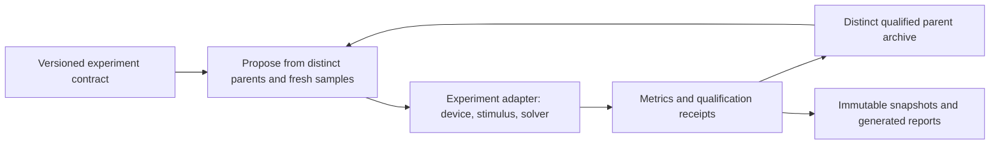

# Devices for learning: a reusable experiment architecture

The search should retain several distinct, useful designs and improve them continuously. The rectifier is the first experiment; memory, multiplication and nonlinear circuits need their own physics and acceptance criteria. Python implements orchestration today. Versioned records and explicit adapters keep solver languages and device types independent.

## Electrical components to search

| Component | Electrical experiment | Metrics and competing requirements |
| --- | --- | --- |
| Programmable weight cell | Program pulses followed by low-disturb read pulses | Conductance range and distinguishable levels, update symmetry, write energy, retention, endurance and read disturb |
| Weighted-current multiplier | Sweep input voltage across programmed conductances; differential pair for signed weights | Multiplication error, input range, noise, energy and sensitivity to parasitics |
| Current summing / integration node | Drive multiple branches into a loaded node or capacitor | Accumulation error, saturation, settling time, leakage and reset energy |
| Nonlinear activation / threshold element | Transfer sweeps and pulse trains with explicit reset | Threshold variability, transfer error, latency, hysteresis and energy |
| Volatile memory / dynamical element | Write, delay, read and recovery sequences | Fading-memory timescale, reproducibility, state separation and disturbance |

These are component targets, not a claim that spiking neurons are required for modern LLMs. Dense matrix products motivate weight storage, multiplication and accumulation. A practical accelerator also needs conversion, interconnect, control and digital operations; device energy alone is not system energy. Attention, normalization and nonlinear functions require explicit workload/circuit mapping before claiming LLM acceleration.

A first proposed experiment is a charge-storage node controlling a channel: define charge state q(t), capacitance, leakage and read coupling, then test pulse-dependent conductance and retention. The present static rectifier cannot demonstrate memory by itself. A charge/Poisson solver supplies electrostatics, not a complete time-evolution law.

## Shared machinery and experiment-owned physics

Reuse existing geometry factories where their parameterization fits, transport backends, circuit and Poisson solvers, source manifests, process locks, STOP/checkpoint behavior, lineage records and publication adapters. Do not duplicate these in a neuromorphic worker. The existing `SquareDevice` and `PhysicsStage` contracts remain appropriate for their specific solver boundaries; a general harness must not require every device to be a four-contact square.

| Shared contract | Adapter responsibility |
| --- | --- |
| Candidate identity and lineage | Geometry, materials, layer stack and parameter bounds |
| Evaluation identity and evidence location | Initial state, waveform, terminal conditions, temperature and model calibration |
| Qualification flag and ordered merit | Units, raw metrics, hard constraints, objective direction and numerical gates |
| Normalized pairwise distance | Geometry or electrical-behavior descriptor, normalization and version |
| Distinct-parent archive and deterministic selection | Which differences matter for this experiment |
| Saved records and generated publication | Device-specific figures and interpretation |

`device_harness` currently provides dependency-free evaluation records, an `Experiment` protocol and deterministic distinct-parent selection. The rectifier worker now uses its distinct-parent selector through a geometry-specific adapter. It does not implement a neuromorphic solver or a new scheduling loop. Extend these small contracts when a second real adapter demands it rather than introducing a universal simulator framework.

## Five distinct parents, one continuous history

`distinct_champions` ranks qualified records by experiment-defined merit, then retains up to five pairwise-separated candidates. A stronger near-neighbor wins its niche; an empty slot stays empty if no sufficiently distinct candidate exists. The overall highest-merit result remains first. This greedy selection is deterministic, not an optimal packing or Pareto algorithm.

The adapter supplies distance in [0, 1]. For rectifiers, etched-area difference is a useful starting descriptor. For memory devices, use versioned normalized behavior descriptors such as conductance range, retention and switching response alongside geometry. Fix descriptor normalization from the experiment contract; do not let population-dependent scaling silently change niches. Distinct appearance is not proof of distinct physics or literature novelty.

Persist the full evaluation history and rebuild the archive after restart. Keep the overall champion separately from parent allocation. Allocate offspring across available niches while retaining global exploration and local refinement. Candidate-count allocation is not equal CPU allocation. Benchmark archive selection against the single-parent baseline with identical seeds and evaluation accounting before claiming improved discovery.

The comparison ID must identify the objective and units, operating conditions, solver/source version, qualification gates and descriptor version. Results with a different ID cannot enter the same ranking. Each receipt links raw metrics, source hashes and convergence evidence. The initial API accepts this identifier from the adapter; it does not independently verify the receipt or generate its fingerprint. Persistent serialization, receipt validation and live-worker integration remain explicit integration work.

## Physics gates before promotion

1. Verify independent reference limits, charge/current conservation, passive energy accounting and reset/initial-state handling.
2. Converge time step, energy integration, spatial mesh, boundary extent and nonlinear iteration independently.
3. Specify the surrounding dielectric, gate, contacts and thermal environment. Two-dimensional carrier transport can coexist with three-dimensional electrostatics; neither removes the need to model stack boundaries.
4. Check variability, noise and fabrication perturbations across independent seeds. Separate screening approximations from qualified results.
5. Validate a loaded component circuit, including peripheral costs; only then evaluate workload-level accuracy and energy.

Keep unresolved assumptions visible. Numerical fixtures verify an implementation within chosen assumptions. Calibration and experimental validation require external data.

## References informing the component targets

- [Le Gallo et al., 64-core mixed-signal in-memory compute chip (2023)](https://www.nature.com/articles/s41928-023-01010-1): phase-change-memory inference hardware provides a concrete system context for analog weight computation.
- [Thousands of conductance levels in CMOS-integrated memristors (2023)](https://www.nature.com/articles/s41586-023-05759-5): motivates distinguishable programmed conductance levels as a device metric.
- [Open-loop programmable electrochemical memory arrays (2023)](https://www.nature.com/articles/s41467-023-41958-4): measures conductance updates, retention and multiplication; circuit functions outside the demonstrated synapse remain separate.

These papers guide experiment definitions; they do not validate our models or establish novelty for our designs.
