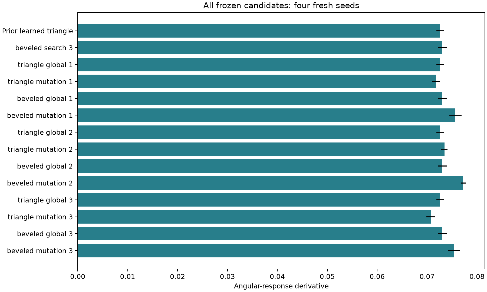

# Feedback-guided geometry refinement

This simulation compares local mutation with global random sampling. Both arms
inherit the same previously frozen anchor within each family. The triangle anchor
is the learned triangle; the bevel anchor is the prior family experiment's highest
training-score bevel. The choice precedes this experiment's evaluation.

## Protocol

- Two families, two methods, three repeats, 256 evaluations per arm: 3,072 total.
- Four batches of 64. Mutation uses 48 local proposals and 16 global proposals;
  its local radius shrinks from 20% to 5% of each parameter's allowed range.
- Local proposals are uniform within the intersection of the local box and global
  bounds, avoiding artificial concentrations from clipping.
- Each arm includes its inherited anchor in its first batch. Incumbents are kept
  by training score; the same training seed is reused within a repeat.
- Training: 8,192 rays per input, mean free path/width = 1, specularity = 0.8.
- Freeze all 12 selected candidates plus two anchors before holdout. No reselection.
- Holdout: four fresh seeds beginning at 270000, 65,536 rays per input,
  mean free path/width = 0.5, 1, 2; specularity = 0.8.
- Source-fingerprinted GPU validation passed before running.

## Results

At nominal scattering, the bevel anchor scored 0.073053. The three mutation
finalists scored 0.075692, 0.077244, and 0.075381: their mean is 0.076106,
or 4.18% above the anchor. Each finalist beat the anchor on each of the four paired
holdout seeds. Mean relative improvement was 6.21% at mean free path/width = 0.5
and 4.36% at 2. These comparisons use the angular-response proxy, not efficiency.

All global arms retained their inherited anchor. Triangle mutation produced
0.071826, 0.073474, and 0.070758 against its 0.072652 anchor: no consistent gain.
Training scores alone would have concealed those reversals.



Error bars are standard deviations across simulation seeds, not experimental
uncertainty or confidence intervals. Three search repeats do not establish a
general superiority of evolutionary methods. This is a bounded local mutation
baseline, not a GAN or a trained generator. It benefits from prior search anchors;
the 256-evaluation budget excludes the historical cost of finding those anchors
equally for both arms.

## Reproduce

```sh
python validate_families.py
python -m ballistic_lab.experiments.refinement
python -m ballistic_lab.reporting.showcase runs/latest
```

Set `BALLISTIC_OUTPUT_DIR` to an empty run directory and use that directory for
the plotting command. The [snapshot](../results/2026-10-22-refinement/) includes
all training proposals/scores, frozen candidates, validation results, and the
source-validation receipt. The trajectory illustration uses the declared triangle
anchor, the first 16 rays from each input, and seed 314159; no visual path selection.
