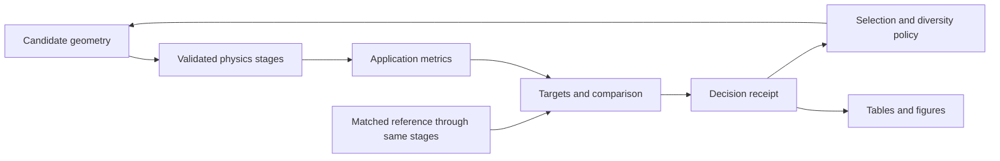

# Staged implementation and acceptance

`stages.run_stages` executes a dependency graph. Before any solver starts it
rejects missing dependencies, duplicate names and cycles. Each stage supplies
its source identity, configuration, assumptions and executable checks. A solver
exception or failed check prevents downstream execution. Completed-stage receipts
are retained on the failure; a failed stage supplies no accepted output.

Stages consume only their declared dependencies. Keep payloads immutable. The
manifest records run identity, sources, configuration and passed checks; its hash
is provenance, not a result checksum or a cache key. There is no automatic search
promotion and no claim that arbitrary user-supplied validators certify physics.

## Build sequence

| Stage | Implementation now | Acceptance before device claims |
| --- | --- | --- |
| Geometry, materials and domain | Existing SquareDevice; explicit run identities | Physical scale, dielectric/contact stack, etched-boundary interpretation |
| Transport screening | Existing ray/lattice and frozen-potential models | Conservation, equilibrium, reciprocity where applicable, energy/mesh refinement |
| Coupled charge and transport | Poisson solvers and charge iteration coordinator | Physical graphene charge, conservative mapping, reference charge, gauge consistency; convergence at each applied bias |
| Quasistatic circuit/readout | `dc_stage` wraps the existing load/cycle solver | KCL/passivity/power checks in circuit solver plus phase doubling; keep DC and ripple power separate |
| Scattering and robustness | Extension point | Matched disorder ensembles, contact/edge perturbations, physical phonon model; occupation temperature alone is insufficient |
| Electromagnetic drive | Phasor and power-budget contracts only | Dispersive Maxwell solver, mesh/port checks, calibrated coupling, back-action if relevant |
| Frequency/noise/system efficiency | Extension point | Dynamic transport and noise model, explicit incident/absorbed/bias power boundaries |

This is a dependency graph, not a requirement to feed ray scores into quantum
transport. Geometry/material preparation is shared. Coupled electrostatics and
transport form one stage with an internal iteration, not a cycle in the graph.
An electromagnetic drive is a separate branch joining transport through a
validated coupling adapter. Unsupported stages are omitted or required as missing
dependencies, never replaced by identity transforms or fabricated scores.

## Calling the implemented path

Construct an upstream `Stage` named `transport` whose evaluator returns a
`TerminalCurrentModel`. Its checks must validate that particular physical model;
record energy grid, temperature, reference and geometry settings in its
`configuration_json`. Its source identity must cover the implementation and checks.
Then construct `dc_stage(DCRequest(amplitude_v=0.01, load_ohm=10000),
current_stage="transport", source_identity=<circuit and adapter source digest>)`.
Pass both to `run_stages(RunIdentity(device, materials, operating_conditions), stages)`.

The DC result contains coarse and refined cycles. Use `.refined` only after the
run succeeds. The adapter checks phase doubling for DC voltage, useful DC power,
total load power, mean input and device power. A pair of grids agreeing is a
numerical check, not proof against all aliasing or physical-model error. Tighter
tolerances and additional refinements are needed where the waveform demands them.

The executable example is `tests/test_physics_stages.py`: a passive linear
four-terminal network passes the circuit stage and produces zero DC. Additional
tests inject refinement failure and inner-solver failure and verify downstream
work never executes. These fixtures do not model graphene.

Run `python -m unittest tests.test_physics_stages`. Integration into a new search
campaign requires explicit source manifests and matched baseline validation;
the currently running search remains on its existing model.

## Application acceptance and future device families

### Site charge and 3D field feedback

`site_feedback.solve_site_feedback` now connects a site-charge transport provider
to `SiteMeshMap` and `Poisson3DStage`. It deposits excess charge
`q_i = -e (n_i - n_ref,i)` and feeds the sampled potential back as an electron
onsite energy shift `U_i[eV] = -phi_i[V]`. The mesh may carry a separately declared
fixed background. References must be supplied explicitly to avoid double counting.
The provider returns occupations and currents at each potential; transmission
probabilities alone do not specify local charge. The wavefunction density route
is described in the [Kwant local-operator documentation](https://kwant-project.org/doc/latest/tutorial/operators).

Convergence requires both an unmixed full-grid voltage residual and an occupation
residual after another transport solve. The returned transport uses the returned
potential. Its charge differs from the last Poisson RHS by the recorded residual;
the result is not an exact fixed point. Inner solver errors propagate, and an
iteration limit raises with residual history. A failed run cannot feed a downstream
stage. `tests.test_site_feedback` exercises this path through `run_stages`.

Tests compare a wide-band resonant-level model against the separate Hartree-kernel
implementation, verify screening sign, charge/current conservation, global gauge
invariance and tighter iteration/quadrature tolerances. This establishes coupling
correctness for the reference backend, **not self-consistent graphene validation**.
The actual graphene-lead charge provider, bound-state occupations, full-band
integration, calibrated reference doping, electrode stack and mesh/domain studies
remain required. The point-charge deposition is mesh-regularized; taking its grid
spacing to zero is not a physical atomic self-interaction model.

`application.evaluate(identity, stages, application)` first requires every named
physics stage, then calls the existing validated graph runner. A final metric
stage returns immutable `Metrics` containing explicit values and units.
`application.compare(candidate, reference, application)` returns one serializable
decision for search selection and reporting. It rejects missing outputs, unit
mismatches, different materials/operating conditions, or different stage source,
configuration, assumption and validation contracts. Device identities may differ.
The candidate must meet every absolute target and strictly improve the declared
objective to beat the reference. The reference need not meet the target itself.

The versioned application owns metric requirements and objective direction;
solvers do not own a global fitness function. A screening result cannot silently
compete with a higher-fidelity result. Application versions and full requirement
definitions are included in decision receipts. Receipts identify provenance;
they do not authenticate payloads or make results safe to reuse as cached data.
Independent uncertainty margins and robustness ensembles must be defined by the
application's metric stages, not inferred from a tiny scalar improvement.

The acceptance boundary is implemented and tested with manufactured fixtures.
The live worker has not adopted it: integrating a new campaign still requires
actual solver adapters, completed physics, matched controls and a new manifest.
Persistent scheduling, cache validity and resume remain worker responsibilities.
Missing stages fail preflight rather than passing through placeholder solvers.

For future neuromorphic work, retain geometry, stage orchestration and provenance,
but supply a time-dependent device/circuit model with explicit state initialization,
input waveforms and observation intervals. Task metrics could then describe energy
per event, latency and task error. A static rectifier curve does not establish
memory, integration or spiking behavior. Those models and metrics are not yet
implemented. Photonic solvers likewise retain their own typed fields and ports.

Run `python -m unittest tests.test_application tests.test_physics_stages` for
acceptance, failure-propagation and circuit-stage integration checks.
