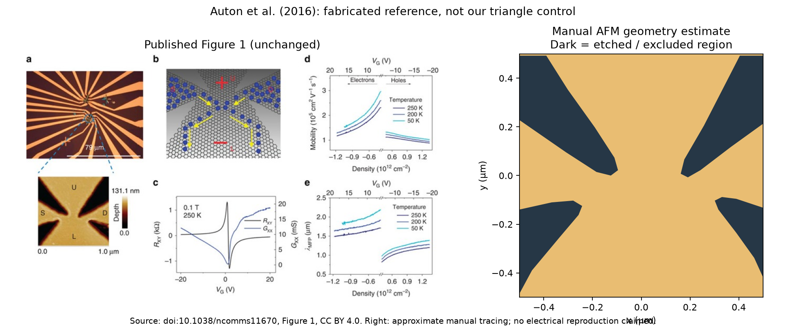

# AFM-derived geometry reference

A first manual reconstruction of the dark etched regions in Auton et al. Figure 1a. The four boundaries are traced independently; left/right symmetry is not imposed. Original pixel coordinates, source-image SHA-256, coordinate transform and polygons in the pipeline's normalized coordinate convention are stored in `geometry.json`.

The horizontal AFM axis gives approximately 1 µm across 136 pixels (7.35 nm/pixel). A proposed ±3-pixel boundary sensitivity envelope is therefore approximately ±22 nm; this is a modeling sensitivity range, not a measured confidence interval. AFM edge broadening, labels and limited image resolution prevent an exact lithographic reconstruction.

This reference is approximately 68 times wider than the current 14.76 nm quantum search domain. Scaling its shape down would test topology, not reproduce the paper's physical device. Contacts outside the AFM window, gate electrostatics, carrier density, edge scattering and excitation conditions still require matching before comparing electrical performance. No electrical score is assigned here.

Rebuild with `python references/auton-2016/build_reference.py` (NumPy and Matplotlib). The reference remains separate from the running campaign and its immutable synthetic controls. Next evaluation should sweep boundary uncertainty and match contact openings before comparing equal-scale transport; a full-size atomistic calculation needs a resource estimate first.

Source: Auton et al., *Graphene ballistic nano-rectifier with very high responsivity*, Nature Communications 7, 11670 (2016), https://doi.org/10.1038/ncomms11670. Figure reproduced unchanged; coordinate tracing and comparison layout added. The figure and derived tracing are provided under [CC BY 4.0](https://creativecommons.org/licenses/by/4.0/); see [full image attribution](../../docs/assets/literature/README.md).
