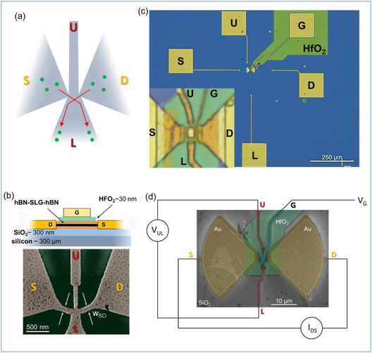

# Shi et al. (2026): matched-device benchmark

Lili Shi, Leonardo Viti, Kenji Watanabe, Takashi Taniguchi and Miriam Serena Vitiello, *Nanoscale Graphene-Based Ballistic Rectifiers for Detection of High Terahertz Frequency Optical Signals*, Small Science 6, e202500654 (29 March 2026). [Paper](https://doi.org/10.1002/smsc.202500654). Figure 1 reproduced unchanged under [CC BY 4.0](https://creativecommons.org/licenses/by/4.0/).

## Verified inputs

| Quantity | Published value / provenance |
| --- | --- |
| Source/drain constriction width | Sample A: 100 nm; sample B: 40 nm; section 1.1 |
| Illumination | 3 THz; bow-tie antenna; optical characterization |
| Channel | Monolayer graphene encapsulated in hBN |
| hBN | Bottom 40 nm, top 15 nm; Figure 1 caption |
| Gate dielectric | HfO2: 20 nm in caption and methods, about 30 nm in drawing; retain discrepancy |
| Temperature | Measurements span approximately 4–300 K |
| Geometry image | Figure 1b SEM, 500 nm scale bar; gate metal obscures some boundaries |

The authors' low-frequency conversion coefficient and optical responsivity are not a dimensionless power efficiency. The published geometry does not yet define a complete simulation mesh here. Unknown edge contours, contact extensions and operating-point mapping remain explicit. The SEM is insufficient to assign both samples exact polygons without assumptions.

## Reproduction gates

1. Recover the supplement and establish a parameterized four-terminal cross with 40/100 nm constrictions. Record measured dimensions separately from assumed flare angles, radii and hidden edges. Sweep uncertain boundaries rather than fitting a single shape to the desired score.
2. Compare identical physical scale, contacts, carrier density, temperature, excitation and load. Retain the existing synthetic controls as a separate campaign. Estimate atom count and solver resources before a full-size solve.
3. Validate equilibrium, current conservation, reciprocity, energy/phase/mesh convergence and boundary sensitivity. The current frozen-potential model is a preliminary comparison, not a recreation of driven electrostatics.
4. Add antenna/field coupling and frequency-dependent transport for the optical comparison. Carry antenna absorption, reflection, contact loss and receiver loading into the budget.

Status: source and dimensions inspected; device-matched transport and optical reproduction pending. The supplement download returned a browser-check page on this retrieval; no dimensions were inferred from that failed download.

## Quantities that must remain separate

- Voltage responsivity: output voltage / specified incident or absorbed power, in V/W.
- Noise-equivalent power: input power producing unit signal-to-noise in a specified bandwidth, in W/sqrt(Hz).
- Loaded conversion efficiency: useful DC load power / total specified input power, dimensionless.

A high-impedance output can have large voltage responsivity and deliver very little power. For a sinusoid, electrical input power must come from the cycle average of terminal voltage times terminal current, not voltage amplitude alone. Optical efficiency must name its incident/absorbed-power boundary and include any supplied bias power when claiming total efficiency.
