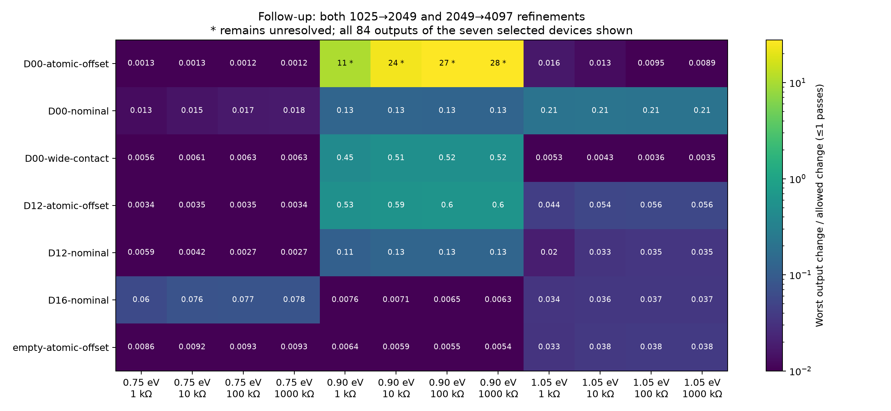

# Quantum integration follow-up — 2026-10-22

**31 of the 35 flagged outputs now pass. Four remain unresolved**, all at 0.90 eV in D00 with the alternative atomic cut. No previously passing output in the seven repeated device cases lost acceptance.

The latest combined status is **176/180 passing outputs**: 80/84 from this follow-up plus 96/96 from the eight untouched original device cases. These groups were tested at different grid densities; this is not a new uniform 4097-point study. The original 145/180 snapshot is preserved.

| Device case | Original passing outputs | Follow-up passing outputs |
| --- | ---: | ---: |
| D00-atomic-offset | 8/12 | 8/12 |
| D00-nominal | 4/12 | 12/12 |
| D00-wide-contact | 8/12 | 12/12 |
| D12-atomic-offset | 4/12 | 12/12 |
| D12-nominal | 8/12 | 12/12 |
| D16-nominal | 8/12 | 12/12 |
| empty-atomic-offset | 9/12 | 12/12 |

## Remaining unresolved outputs

| Load | Final signed output (µV) |
| --- | ---: |
| 1 kΩ | -0.047257* |
| 10 kΩ | -0.252872* |
| 100 kΩ | -0.447637* |
| 1000 kΩ | -0.484991* |

\* D00, alternative atomic cut, 0.90 eV; provisional 4097-point values. This is a small difference between terminal responses, so percentage error can remain large even as absolute changes shrink. Do not use these four outputs to promote a candidate.

## Protocol and evidence

[Protocol](../../docs/CONVERGENCE-PROTOCOL.md) committed at `9a2a841` before execution. Same physics and operating points as the coverage study. Reused 1025-point spectra and added 2049/4097 grids: **21,504 additional energy/device solves**. Acceptance requires both new refinements to change output by ≤1 nV + 1% of the finer value. This new criterion does not retroactively change the original verdict.

All seven cases completed. `manifest.json` records input checkpoint hashes and source hashes; each compressed record retains the 4097-point spectrum and 1025/2049/4097 load results. Checkpoints were verified against summaries, input hashes checked, and sample counts verified. The same isolated Kwant CPU environment and two-worker, one-BLAS-thread configuration were used as in [the coverage runtime record](../2026-10-22-coverage/runtime.json).

The renderer is `python -m ballistic_lab.reporting.convergence`. The computation is `python -m ballistic_lab.experiments.convergence`; it requires a fresh output directory and unchanged cached-physics sources.

D14 was not rerun because all its original outputs already passed. It remains a candidate for nonlinear and disorder tests, not a demonstrated rectifier advantage. Next integration work should investigate the remaining near-cancellation case with a different quadrature strategy and an energy-window check rather than relaxing tolerance.
