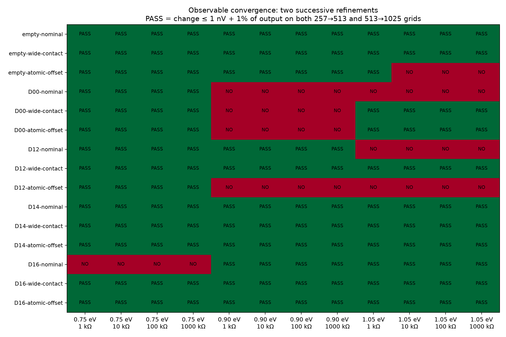

# Matched quantum coverage — 2026-10-22

Five frozen geometries, three matched contact/atomic-cut conditions, three Fermi energies and four loads. All 15 devices completed: **145/180 outputs pass**, **35 remain unresolved**, zero failed device solves. The protocol was committed as `4a09566` before simulation.

## Findings

- **Split islands D14 deserve further study.** All 36 outputs pass the frozen grid criterion. At 10 kΩ, signed output ranges from −148.14 to −64.78 µV for a 1 mV drive. D14 has the largest absolute final-grid output in each of the nine matched conditions. Some comparator values remain unresolved; this is not a universal or rectification ranking.
- **Shape rankings depend on the observable.** D12 led the frozen bevel in the classical angular proxy; D14 leads transverse linear voltage magnitude here. A diverse shortlist was worthwhile.
- **Atomic alignment matters even without an obstacle.** At 0.90 eV and 10 kΩ, the empty nominal device is near zero, while the alternative atomic cut gives −12.87 µV. Use the control from the same condition.
- **Numerical stability is output-specific.** D00 nominal at 0.90 eV gives 7.19 µV but remains unresolved; D12 gives 2.61 µV and now passes. Small differential outputs can require finer sampling than the conductance matrix.

These are signed linear-response voltages. Reversing the drive reverses them; a symmetric AC drive has zero average output. Reservoir temperature is 300 K; phonons, edge disorder and voltage-dependent electrostatics are not included.

## Nominal contacts: 10 kΩ loaded output

| Geometry | 0.75 eV (µV) | 0.90 eV (µV) | 1.05 eV (µV) | Passed outputs, all conditions/loads |
| --- | ---: | ---: | ---: | ---: |
| empty | -0.00 | 0.00 | 0.00 | 33/36 |
| D00 | 6.34 | 7.19* | 9.29* | 20/36 |
| D12 | -15.12 | 2.61 | -0.48* | 24/36 |
| D14 | -108.45 | -87.81 | -64.78 | 36/36 |
| D16 | -2.16* | -24.04 | 6.89 | 32/36 |

\* Unresolved under the two-refinement criterion. Displayed values are from the final 1025-point grid.

## Methods and reproduction

[Frozen protocol](../../docs/COVERAGE-PROTOCOL.md): width 14.76 nm; contacts 0.3W or 0.4W; lattice origin (0,0) or (0.25a,0.25a). Fermi energies 0.75, 0.90, 1.05 eV; loads 1, 10, 100, 1000 kΩ. Each device has 1025 unique energies over 0.42–1.38 eV, with nested 257/513-point subsets. Both successive output changes must be ≤1 nV + 1% of the finer output. A later stable step does not erase an earlier failure.

All 15,375 energy/device solves passed the 1e-7 scattering checks. Maximum residuals: unitarity 1.97e-9, current conservation 2.93e-10, reciprocity 6.40e-10 and equilibrium 2.93e-10. These establish solver consistency within this model.

`manifest.json` freezes geometry, parameters and source hashes. `runtime.json` records the CPU environment. Each `*.json.gz` stores the complete spectrum and all three load-refinement levels; `summary.json` omits spectra only. All checkpoint summaries were checked against their full records. Two CPU processes ran with one BLAS/OpenMP thread each.

The experiment is `ballistic_lab.experiments.coverage`; figures are generated by `ballistic_lab.reporting.coverage`. For exact source-hash reproduction, use the simulation commit above; reporting/docs were added after the run. The runner refuses to reuse a manifest after source changes.

## Next checks

1. Record a new refinement protocol for the 35 unresolved outputs, preserving this snapshot.
2. Challenge D14 alongside the other candidates using edge-disorder ensembles, orientation and physical-size variation.
3. Implement a specified self-consistent nonlinear potential and loaded AC drive before testing DC rectification.
4. Reproduce a published device under matched conditions before making electrical-performance comparisons.
