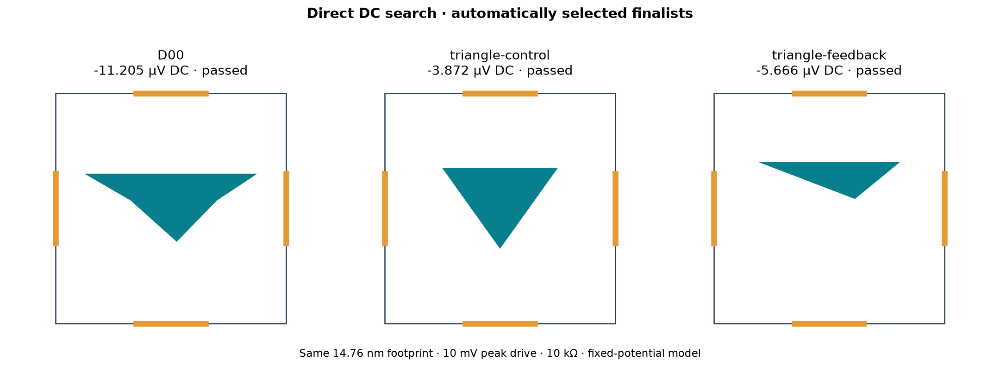

# Direct DC search pilot

Best converged candidate in this pilot: **D00**.



| Candidate | Origin | Screen DC (µV) | Refined DC (µV) | Status |
| --- | --- | ---: | ---: | --- |
| D00 | archived control | -11.4940 | -11.2053 | Passed |
| triangle-feedback | DC feedback from triangle-global-0 | -5.6809 | -5.6665 | Passed |
| profile-global-1 | global proposal | -5.0360 | — | Screen only |
| triangle-control | fixed control | -3.9789 | -3.8722 | Passed |
| triangle-global-0 | global proposal | +3.9472 | — | Screen only |
| triangle-global-1 | global proposal | +3.7447 | — | Screen only |
| radial-feedback | DC feedback from radial-global-0 | -3.5018 | — | Screen only |
| profile-feedback | DC feedback from profile-global-1 | -3.2946 | — | Screen only |
| D14 | archived control | -2.0664 | — | Screen only |
| islands-feedback | DC feedback from islands-global-1 | -1.3544 | — | Screen only |
| radial-global-0 | global proposal | -1.1826 | — | Screen only |
| profile-global-0 | global proposal | +1.0522 | — | Screen only |
| islands-global-1 | global proposal | +0.6993 | — | Screen only |
| radial-global-1 | global proposal | +0.4203 | — | Screen only |
| islands-global-0 | global proposal | +0.3806 | — | Screen only |

## Predeclared method

One seeded pilot: eight global proposals across triangle, profile, islands and radial families; one DC-selected parent per family produces one bounded mutation. Three controls (plain triangle, archived D00 bevel, archived D14 islands) give **15 candidates total**. Controls are not parents. This is a small exploratory search, not evidence of a global optimum or superiority of a search algorithm.

Objective: maximize the DC component power into 10 kΩ, using 10 mV peak sinusoidal balanced drive, 0.9 eV Fermi energy, 300 K reservoir occupations, nominal atomic origin, 14.76 nm width and 0.3-width contacts. The plain triangle is an explicit synthetic control (normalized width 1, height 0.7, centered, no skew), not a reconstruction of a paper.

Every candidate is screened at 257 energies and 32 phases. The top two by DC power plus the fixed triangle receive 513/1025-energy refinement. A candidate is promoted only if both successive DC-voltage changes meet 1 nV + 1% and 32→64 phases meet that same tolerance. An automatic follow-up applies to every unresolved selected finalist: 2049, then at most 4097 energies, stopping when both gates pass. Its separate manifest preserves the initial results and records this extension before refinement. Screen-only candidates remain unvalidated. Promotion ranks only validated finalists; it does not establish an exhaustive ranking over unrefined candidates. No candidate is manually selected for the README.

The reported DC is from the frozen-potential reservoir-bias model. It excludes charge-induced potential changes, scattering, frequency response and fabrication disorder. The objective is DC power at fixed voltage/load, not maximum efficiency or matched input power. Further operating-point and geometric robustness tests are required before feeding these results into a larger search.

## Artifacts and reproduction

`manifest.json` freezes initial geometry, seeds, selection policy and source hashes before simulation. `feedback-proposals.json` records the DC-selected mutations; `selection.json` records the entire screening order and chosen finalists. `summary.json` contains refinement levels and phase gates. Per-candidate gzip files preserve full spectra and device fingerprints.

```powershell
# In the isolated Kwant environment, with single-thread BLAS and a fresh output directory:
python -m ballistic_lab.experiments.dc_search
python -m ballistic_lab.experiments.dc_refine
# After archiving runs/dc-search into this results directory:
python -m ballistic_lab.reporting.dc_search
```

Kwant calculations run on CPU, with two workers. This pilot does not use the GPU ray score to rank candidates.
