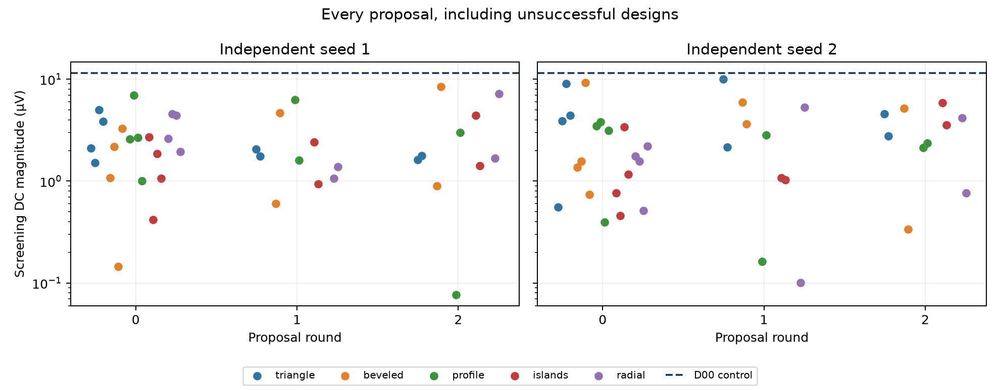

# Wider direct-DC search

Best converged candidate: **D00**. Best new design: **r1-triangle-g1-0**, 10.070 µV versus D00’s 11.205 µV (89.9% of its DC voltage).

**Feedback check:** 6/20 mutations improved their parent on the shared screening grid. Parents are selected by descending DC power, independent of voltage polarity. This run does not establish an advantage over equal-budget random search.




| Candidate | Family | Screen DC (µV) | Refined DC (µV) | DC power (pW)* | Status |
| --- | --- | ---: | ---: | ---: | --- |
| D00 | beveled | -11.4940 | -11.2053 | 0.01256 | Passed |
| r1-triangle-g1-0 | triangle | -10.0124 | -10.0700 | 0.01014 | Passed |
| r1-beveled-g0-2 | beveled | -9.2898 | -9.2409 | 0.00854 | Passed |
| r1-triangle-g0-2 | triangle | -9.0350 | — | — | Screen only |
| r0-beveled-g2-1 | beveled | -8.4639 | -8.3922 | 0.00704 | Passed |
| r0-radial-g2-1 | radial | -7.1886 | -7.1799 | 0.00516 | Passed |
| r0-profile-g0-1 | profile | -6.9714 | — | — | Screen only |
| r0-profile-g1-0 | profile | -6.3057 | — | — | Screen only |
| r1-beveled-g1-0 | beveled | -5.9239 | — | — | Screen only |
| r1-islands-g2-0 | islands | -5.8789 | — | — | Screen only |
| r1-radial-g1-1 | radial | +5.3246 | — | — | Screen only |
| r1-beveled-g2-0 | beveled | -5.1825 | — | — | Screen only |
| r0-triangle-g0-2 | triangle | -5.0215 | — | — | Screen only |
| r0-beveled-g1-1 | beveled | -4.6511 | — | — | Screen only |
| r1-triangle-g2-0 | triangle | -4.5498 | — | — | Screen only |
| r0-radial-g0-1 | radial | -4.5470 | — | — | Screen only |
| r0-islands-g2-0 | islands | +4.4347 | — | — | Screen only |
| r1-triangle-g0-3 | triangle | +4.4300 | — | — | Screen only |
| r0-radial-g0-2 | radial | +4.3983 | — | — | Screen only |
| r1-radial-g2-0 | radial | -4.1814 | — | — | Screen only |
| triangle-control | triangle | -3.9789 | -3.8722 | 0.00150 | Passed |
| r1-triangle-g0-1 | triangle | -3.8832 | — | — | Screen only |
| r0-triangle-g0-3 | triangle | -3.8399 | — | — | Screen only |
| r1-profile-g0-1 | profile | +3.8046 | — | — | Screen only |
| r1-beveled-g1-1 | beveled | -3.6587 | — | — | Screen only |
| r1-islands-g2-1 | islands | +3.5474 | — | — | Screen only |
| r1-profile-g0-0 | profile | +3.4913 | — | — | Screen only |
| r1-islands-g0-2 | islands | +3.4035 | — | — | Screen only |
| r0-beveled-g0-3 | beveled | +3.2814 | — | — | Screen only |
| r1-profile-g0-3 | profile | -3.1340 | — | — | Screen only |
| r0-profile-g2-1 | profile | -2.9935 | — | — | Screen only |
| r1-profile-g1-1 | profile | +2.8326 | — | — | Screen only |
| r1-triangle-g2-1 | triangle | -2.7810 | — | — | Screen only |
| r0-islands-g0-0 | islands | +2.7123 | — | — | Screen only |
| r0-profile-g0-2 | profile | +2.6737 | — | — | Screen only |
| r0-radial-g0-0 | radial | +2.6205 | — | — | Screen only |
| r0-profile-g0-0 | profile | +2.5999 | — | — | Screen only |
| r0-islands-g1-0 | islands | -2.4225 | — | — | Screen only |
| r1-profile-g2-1 | profile | +2.3606 | — | — | Screen only |
| r1-radial-g0-3 | radial | +2.2042 | — | — | Screen only |
| r0-beveled-g0-1 | beveled | +2.1692 | — | — | Screen only |
| r1-triangle-g1-1 | triangle | -2.1457 | — | — | Screen only |
| r1-profile-g2-0 | profile | -2.1370 | — | — | Screen only |
| r0-triangle-g0-0 | triangle | -2.1147 | — | — | Screen only |
| D14 | islands | -2.0664 | — | — | Screen only |
| r0-triangle-g1-0 | triangle | -2.0641 | — | — | Screen only |
| r0-radial-g0-3 | radial | +1.9393 | — | — | Screen only |
| r0-islands-g0-2 | islands | -1.8636 | — | — | Screen only |
| r0-triangle-g2-1 | triangle | +1.7752 | — | — | Screen only |
| r1-radial-g0-0 | radial | -1.7591 | — | — | Screen only |
| r0-triangle-g1-1 | triangle | -1.7565 | — | — | Screen only |
| r0-radial-g2-0 | radial | +1.6686 | — | — | Screen only |
| r0-triangle-g2-0 | triangle | +1.6280 | — | — | Screen only |
| r0-profile-g1-1 | profile | -1.6062 | — | — | Screen only |
| r1-radial-g0-1 | radial | -1.5608 | — | — | Screen only |
| r1-beveled-g0-1 | beveled | -1.5589 | — | — | Screen only |
| r0-triangle-g0-1 | triangle | -1.5122 | — | — | Screen only |
| r0-islands-g2-1 | islands | +1.4114 | — | — | Screen only |
| r0-radial-g1-1 | radial | -1.3769 | — | — | Screen only |
| r1-beveled-g0-0 | beveled | +1.3650 | — | — | Screen only |
| r1-islands-g0-3 | islands | -1.1602 | — | — | Screen only |
| r0-beveled-g0-0 | beveled | +1.0758 | — | — | Screen only |
| r1-islands-g1-0 | islands | +1.0706 | — | — | Screen only |
| r0-islands-g0-3 | islands | +1.0681 | — | — | Screen only |
| r0-radial-g1-0 | radial | +1.0614 | — | — | Screen only |
| r1-islands-g1-1 | islands | -1.0325 | — | — | Screen only |
| r0-profile-g0-3 | profile | +1.0049 | — | — | Screen only |
| r0-islands-g1-1 | islands | -0.9374 | — | — | Screen only |
| r0-beveled-g2-0 | beveled | -0.8974 | — | — | Screen only |
| r1-islands-g0-0 | islands | +0.7659 | — | — | Screen only |
| r1-radial-g2-1 | radial | -0.7612 | — | — | Screen only |
| r1-beveled-g0-3 | beveled | +0.7426 | — | — | Screen only |
| r0-beveled-g1-0 | beveled | +0.6043 | — | — | Screen only |
| r1-triangle-g0-0 | triangle | +0.5588 | — | — | Screen only |
| r1-radial-g0-2 | radial | +0.5128 | — | — | Screen only |
| r1-islands-g0-1 | islands | +0.4567 | — | — | Screen only |
| r0-islands-g0-1 | islands | +0.4205 | — | — | Screen only |
| r1-profile-g0-2 | profile | +0.3950 | — | — | Screen only |
| r1-beveled-g2-1 | beveled | +0.3386 | — | — | Screen only |
| r1-profile-g1-0 | profile | -0.1621 | — | — | Screen only |
| r0-beveled-g0-2 | beveled | -0.1458 | — | — | Screen only |
| r1-radial-g1-0 | radial | +0.1008 | — | — | Screen only |
| r0-profile-g2-0 | profile | +0.0769 | — | — | Screen only |

\* DC component power = mean(Vout)² / 10 kΩ. Signed output is B minus T; ranking is polarity-independent. Fixed 10 mV peak voltage does not imply equal input power. This is not a maximum-efficiency objective.

## Search and validation

**80 new designs plus three controls.** Two independently seeded runs each begin with four Latin-hypercube proposals in each of five families (triangle, bevel, profile, islands, radial). Each of two subsequent rounds adds one fresh global proposal and one mutation per family. Mutation parents come from the top two prior candidates in that same family and repeat; controls are excluded. Thus global exploration persists throughout. This is a bounded exploratory comparison, not a global optimum or an equal-budget proof that mutations outperform random search.

The pilot did not search the bevel family. This run includes it explicitly. D00, D14 and the plain synthetic triangle remain frozen controls; none is labeled as a reproduced published device. No candidate was chosen for its appearance.

All scores use the same nominal 14.76 nm width, 0.3-width contacts, 0.9 eV Fermi level, 300 K occupations, 10 mV peak balanced sinusoidal drive, and 10 kΩ output load. Screening uses 257 energies and 32 phases. The top two new candidates per repeat, plus D00 and the fixed triangle, receive automatic 513/1025/2049/4097 refinement, stopping when the last two changes each satisfy 1 nV + 1% of the finer DC magnitude. A separate 32/64 phase check must also pass. All unresolved and screen-only results remain visible. Selection is based on a coarse grid and may miss candidates that need denser integration.

The generator uses these gates to select the README result. “Best converged” refers to validated finalists in this run, not all possible shapes or operating conditions. New candidates need independent operating-point, edge, and size robustness tests before promotion to a device-performance claim.

## Scoring audit

The preceding [independent audit](../2026-10-22-dc-audit/README.md) uses reciprocal pair currents, Gaussian integration of piecewise-linear transmission, and a least-squares load solver instead of the production matrix/trapezoid/root implementation. It agrees with the three pilot finalists within 0.13 nV. A fresh anonymous rebuild of D00 reproduces the cached screening score; closed-form energy-linear transmission and ranking/mean-square checks pass. These checks test software within the frozen-potential model, not self-consistent electrostatics.

## Reproduction and artifacts

`manifest.json` records the plan, controls, source hashes and audit hash. `proposals-*.json` freezes every batch before evaluation; `selection.json` records the screening order and automatic shortlist. Full per-candidate spectra are archived as gzip JSON. The report is generated from these records.

```powershell
# Single-thread BLAS, isolated Kwant environment; four CPU workers:
python -m ballistic_lab.experiments.dc_audit
python -m ballistic_lab.experiments.dc_wide
# Archive a completed run and regenerate its charts, ranking and README:
python -m ballistic_lab.pipeline.dc_publish
# Or run the entire fresh workflow with a timestamped archive:
python -m ballistic_lab.pipeline.dc_workflow
```

Use fresh output directories. This run uses CPU quantum transport, not GPU trajectory scoring. Charge-induced potential response, phonons, finite-frequency dynamics, and fabrication disorder remain outside the model.
