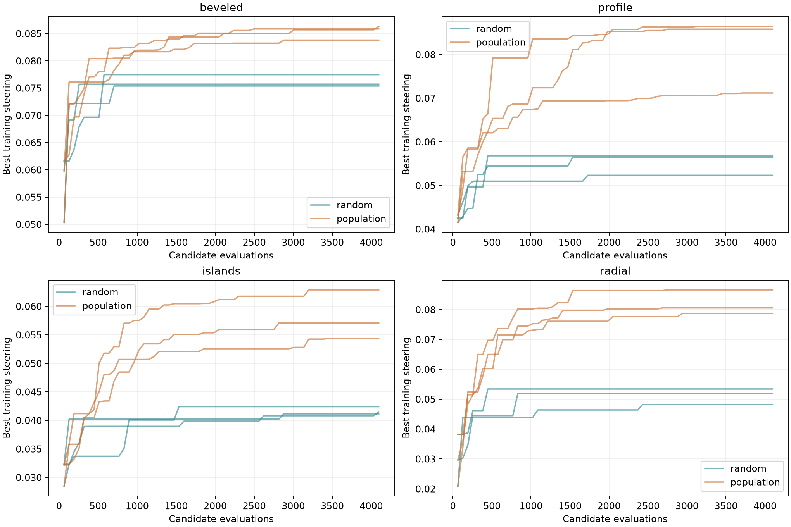

# Expanded geometry discovery

Every population finalist is shown, including losing families. Shaded polygons are excluded material. Coordinates are normalized, not a fabrication layout.

Each line is one repeat. Selection used training scores only. The table uses four fresh holdout seeds at mean free path/width = 1 and specularity = 0.8. Scores are angular derivatives, not electrical efficiency. Seed SD is Monte Carlo variability, not model or experimental uncertainty.

[Geometry exports](designs.json) include explicit vertices and all finalists. [Full compressed experiment](discovery-results.json.gz) includes every proposal, score, scattering condition, and normalized tolerance perturbation.

| ID | Candidate | Holdout score | Seed SD | Perturbed mean |
| --- | --- | ---: | ---: | ---: |
| D00 | Beveled refinement anchor | 0.076435 | 0.000987 | 0.079747 |
| D01 | beveled random 1 | 0.074928 | 0.000599 | 0.077762 |
| D02 | beveled population 1 | 0.079026 | 0.000665 | 0.081863 |
| D03 | profile random 1 | 0.053387 | 0.000675 | 0.056768 |
| D04 | profile population 1 | 0.079470 | 0.000351 | 0.082823 |
| D05 | islands random 1 | 0.039851 | 0.000824 | 0.039335 |
| D06 | islands population 1 | 0.048576 | 0.001750 | 0.050919 |
| D07 | radial random 1 | 0.045252 | 0.000316 | 0.047686 |
| D08 | radial population 1 | 0.072951 | 0.000720 | 0.075435 |
| D09 | beveled random 2 | 0.074151 | 0.000559 | 0.075725 |
| D10 | beveled population 2 | 0.079612 | 0.000903 | 0.083468 |
| D11 | profile random 2 | 0.055290 | 0.000768 | 0.056076 |
| D12 | profile population 2 | 0.080115 | 0.000754 | 0.082300 |
| D13 | islands random 2 | 0.039374 | 0.000904 | 0.040169 |
| D14 | islands population 2 | 0.050460 | 0.000847 | 0.053489 |
| D15 | radial random 2 | 0.045378 | 0.000933 | 0.047756 |
| D16 | radial population 2 | 0.075781 | 0.000139 | 0.079184 |
| D17 | beveled random 3 | 0.075678 | 0.000807 | 0.077014 |
| D18 | beveled population 3 | 0.078360 | 0.000782 | 0.081933 |
| D19 | profile random 3 | 0.051225 | 0.000314 | 0.051762 |
| D20 | profile population 3 | 0.063661 | 0.000431 | 0.065248 |
| D21 | islands random 3 | 0.039149 | 0.001035 | 0.041263 |
| D22 | islands population 3 | 0.046794 | 0.001518 | 0.047107 |
| D23 | radial random 3 | 0.052106 | 0.001269 | 0.054842 |
| D24 | radial population 3 | 0.074932 | 0.000971 | 0.078733 |
