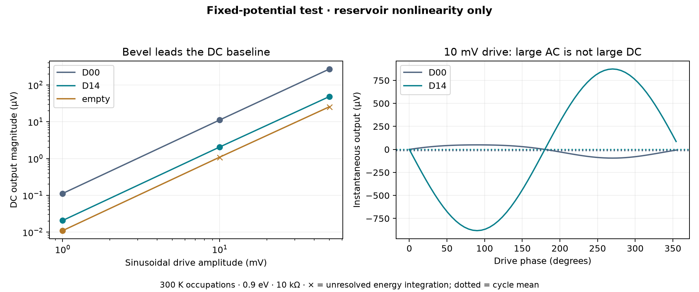

# First finite-bias DC baseline

**The bevel beats the islands in this fixed-potential rectification test.** A larger linear transverse signal did not predict a larger DC output. This is a useful negative result for choosing the search objective.



| Peak sinusoidal drive | D00 bevel mean output | D14 islands mean output | Empty control mean output |
| --- | ---: | ---: | ---: |
| 1 mV | -0.1122 µV | -0.02066 µV | +0.01095 µV |
| 10 mV | -11.21 µV | -2.062 µV | +1.092 µV* |
| 50 mV | -272.8 µV | -48.68 µV | +25.68 µV* |

All cases: nominal 14.76 nm graphene device, 0.3-width contacts, Fermi energy 0.9 eV, 300 K reservoir occupations, balanced L/R drive, 10 kΩ resistor across B/T. Signed output is B minus T. No phonons or smoothing capacitor.

\* Empty-control integration remains unresolved at 10 and 50 mV. Do not subtract these estimates as a calibrated background. An atomically discretized empty square with different lead orientations is not an exact fourfold-symmetric electrical control.

## What is being modeled

We integrate the archived, energy-dependent scattering matrix against finite-bias Fermi occupations:

$$ I_i = \frac{2e^2}{h}\int dE_{\rm eV}\sum_j [N_i\delta_{ij}-T_{ij}(E)]f(E-\mu_j),\qquad \mu_j=E_F+V_j-V_{\rm ref}. $$

The Hamiltonian and transmission remain fixed. This isolates reservoir-population nonlinearity under a pinned scattering potential. It is **not** a self-consistent graphene device prediction. The distinction between changing occupations and changing electrical potential is illustrated in the [Tkwant bias tutorial](https://tkwant.kwant-project.org/doc/dev/tutorial/chem_vs_elec_bias.html). Charge-induced potential changes, screening, contact band shifts, and dielectric/gate geometry remain to be calculated.

The nonlinear circuit solver finds both output potentials at each phase. DC power is mean(Vout)²/R; total resistor heating also includes AC ripple. At 50 mV, D00 gives **7.44 pW DC component from 136 nW mean input** (0.00546%); D14 gives **0.237 pW from 133 nW** (0.000178%). These are model component ratios, not measured device efficiencies or optimized power-conversion results. Neither supports a high-efficiency claim.

## Validation and convergence

- Three nested energy grids: D00 1025/2049/4097; D14 and empty 257/513/1025, all spanning 0.42–1.38 eV.
- DC passes only if both successive refinements change it by at most 1 nV + 1% of the finer magnitude. D00 and D14 pass at all three amplitudes; the empty control passes only at 1 mV.
- Independent 32/64-phase comparison passes at all nine points. This checks quasistatic integration, not frequency response.
- Every reservoir must remain inside the spectrum with a 12 kBT margin. Current conservation, output KCL, local root uniqueness, passivity and power balance are checked.
- Unit tests cover zero equilibrium current, joint voltage/reference translation, the independent linear-response limit, zero DC for an energy-independent spectrum, output-terminal exchange, small-signal quadratic scaling, and rejection of invalid spectra/windows.

Raw cycles, both energy-refinement changes and phase changes are in [summary.json](summary.json). [manifest.json](manifest.json) records input and physics-source SHA256 hashes and conditions. Existing spectra are reused; no new quantum solves were required. No optimization was performed on these results.

## Reproduce

From the repository root, with a fresh `runs/finite-bias` directory absent:

```powershell
python -m unittest discover -s tests
python -m ballistic_lab.experiments.finite_bias
python -m ballistic_lab.reporting.finite_bias
```

The experiment writes fresh results to `runs/finite-bias`; the reporting command renders the published snapshot. Next: specify a physical dielectric/contact geometry and solve charge and potential self-consistently before using DC performance to drive geometry optimization.
