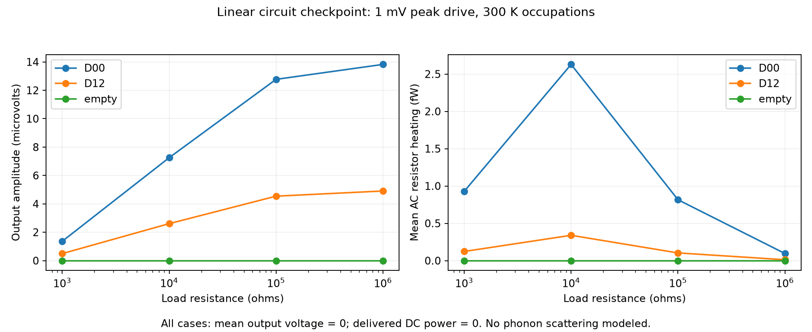

# Linear reservoir and load checkpoint

This adds electrical terminals, thermal reservoir averaging and a passive load
to the coherent lattice stage. **It does not implement nonlinear rectification.**
The zero-DC result under symmetric excitation is an acceptance test of this
linear model, not evidence that a physical nonlinear device cannot rectify.

## Conditions and equations

14.76 nm nominal cavity; unchanged atomic geometry and lead model from the
[lattice checkpoint](../2026-10-22-lattice/README.md). Empty control, D00 beveled
anchor and D12 profile. Fermi energy 0.9 eV; reservoirs at 300 K. This temperature
changes occupations only: no phonons, dephasing or temperature-dependent material
parameters are modeled. Spin degeneracy is explicitly two; valley structure is
already in the honeycomb Hamiltonian and is not multiplied again.

With transmission indexed by outgoing then incoming lead, including reflection,

$$G_{ij}=\frac{2e^2}{h}\int (N_i\delta_{ij}-T_{ij}(E))
\left(-\frac{\partial f}{\partial E}\right)dE,\qquad I=GV.$$

The left/right terminals are held at +/-0.5 mV. A resistor connects bottom to
top; their voltages follow Kirchhoff's laws. Loads: 1, 10, 100 and 1000 kilohms.
Positive terminal current flows into the device. The solver checks
`input power = device/reservoir-network dissipation + load power`; that device
term is an aggregate electrical balance, not a spatial heat-deposition model.

For a 1 mV peak sinusoidal differential drive, these are output amplitudes.
Mean resistor heating is half the static peak-power value. Mean output voltage
and the DC component's power are zero. No frequency is assigned: the circuit is
linear and quasistatic, without capacitance or electromagnetic propagation.

## Results and numerical limits


These curves show all 257 computed energies for each of three geometries,
without smoothing. Sharp structures explain why nine-point screening curves
were insufficient. The shaded window is EF +/-2kBT; actual thermal integration
uses the full recorded window. Panel C is single-contact injection, whereas
panel D solves balanced left/right drive and a load. They are different
observables, so their rankings need not agree. More points are needed to
converge narrow features, not merely to make the figure look smooth.

| Geometry | Output at 10 kilohms, microvolts | Change from coarser grid | Conductance-matrix change |
| --- | ---: | ---: | ---: |
| Empty | approximately zero | numerical roundoff | 0.050% |
| D00 bevel | 7.25 | 0.354 microvolts (4.9%) | 0.311% |
| D12 profile | 2.61 | 0.0673 microvolts (2.6%) | 0.215% |

**D00 and D12 are provisional and not eligible for promotion.** Their small
transverse voltage is a difference between larger currents, making it more
sensitive to integration error than the full matrix. The output convergence
gate is `change <= 1 nV + 1% of output magnitude` at every load. The published
JSON records each pass/fail, coarse voltage and absolute change. No device is
declared an efficiency winner from these results.

The energy grid has 257 points over 0.57–1.23 eV, compared with its 129-point
subgrid. Integrated Fermi-derivative weight is 0.99999428, without renormalizing
away missing tails. The window exceeds +/-12 kBT, and both grids resolve the
thermal kernel. Narrow transmission features still require further refinement;
a resolved thermal kernel alone does not guarantee a resolved output voltage.



The empty device's single-contact directional imbalance in the earlier plot
does not become a differential output under balanced left/right drive. This is
why a transport steering picture is insufficient to establish a useful circuit.

## Validation and reproduction

Tests cover the conductance quantum, voltage-reference invariance, a constant
channel's thermal integral, rejection of coarse grids and disconnected outputs,
an analytical series-resistor network, power conservation, and zero symmetric-drive
DC. An optional integration test compares the terminal matrix directly against
Kwant's `SMatrix.conductance_matrix()`; it passed in the Kwant environment.

```text
python -m unittest discover -s tests -p test_reservoirs.py
python -m unittest discover -s tests -p test_quantum.py
python -m ballistic_lab.experiments.linear_load
python -m ballistic_lab.reporting.linear_load
python -m ballistic_lab.reporting.spectra
```

Run the experiment in the isolated quantum environment. Existing run files are
never overwritten. The three JSON files retain all 771 energy/geometry samples,
their conservation checks and terminal calculations. Additional output-convergence
fields in this snapshot were computed from those same spectra, without rerunning
or changing the transport samples. The renderer reads this published snapshot.

Next: converge the small output differences, vary contacts/atomic edges, and
implement a physically specified voltage-dependent electrostatic/transport loop.
Only then can nonlinear response and loaded DC power be assessed.

References: [Kwant terminal conductance API](https://www.kwant-project.org/doc/latest/reference/generated/kwant.solvers.common.SMatrix),
[finite-temperature occupation averaging](https://docs.quantumatk.com/tutorials/graphene_nanoribbon_device/graphene_nanoribbon_device.html).
