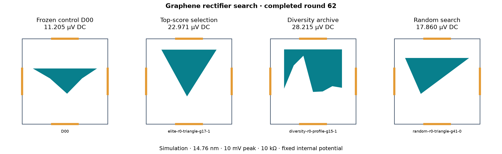
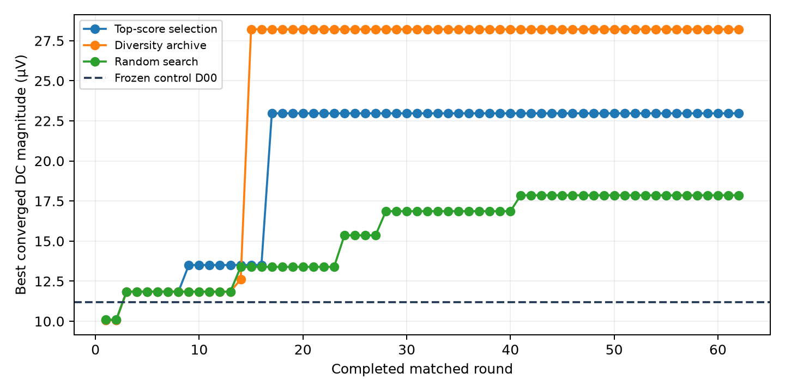

# Continuous DC search — completed round 62

| Method | Best converged design | DC magnitude (µV) | DC power (pW) |
| --- | --- | ---: | ---: |
| Frozen control D00 | D00 | 11.205 | 0.01256 |
| Top-score selection | elite-r0-triangle-g17-1 | 22.971 | 0.05277 |
| Diversity archive | diversity-r0-profile-g15-1 | 28.215 | 0.07961 |
| Random search | random-r0-triangle-g41-0 | 17.860 | 0.03190 |

Each method starts from the same 40 archived candidates and receives 20 new proposals per round: **1280 candidate evaluations per method** through this snapshot. The initial population is shared, and some proposals match across methods; counts are not counts of unique geometries. Controls do not become parents. Two seed streams contribute to each method, but finalists are selected across both, so this is not yet a per-seed statistical comparison.

Each round refines the two strongest screening candidates per method, retaining previous results. Both energy-grid and phase checks must pass for this table. The grids are 257/513/1025, extended to 2049/4097 as needed; the last two DC changes must each satisfy 1 nV + 1% of the finer magnitude. Phase averaging compares 32 and 64 samples with the same tolerance. Equal proposal and finalist-count budgets do not imply equal CPU time or quantum-solver work. Near ties do not establish a superior method.

## What the feedback does

Top-score selection chooses mutation parents from the best two in each family and seed stream. Diversity selection keeps the best screening performer in each geometry neighborhood and samples those neighborhoods uniformly. Its descriptors are blocked area and top/bottom reflection mismatch on a 96×96 raster, with ten bins per axis. Random search replaces the mutation slot with a fresh random candidate. All three retain matched fresh global proposals. Five geometry families are available; this cannot discover arbitrary topologies outside those parameterizations.

All historical candidates remain in the checkpoint. Diversity preserves eligibility to reproduce; it is not a literature novelty detector. The global winner remains performance-ranked after convergence checks. These methods do not train a neural model or learn missing physics. The archive descriptors and search benefits still need sensitivity and repeat testing.

## Physics and evidence

Four-terminal coherent graphene transport at 0.9 eV Fermi level and 300 K reservoir occupations, with balanced 10 mV peak sinusoidal input and a 10 kΩ output load. DC power is mean(Vout)²/R, excluding ripple heating. The device internal potential is fixed. Charge response, phonons, disorder, noise and frequency limits are not included. D00 is our synthetic bevel control, not a reproduced experimental paper device.

`round-*.json` contains complete per-method histories, candidate polygons, screening/refinement metrics and convergence flags. `*-proposals.json` records frozen proposal batches. `source.json` records the running implementation hashes. Full spectra remain checkpointed locally in `runs/dc-continuous/spectra`; these report snapshots archive metrics and geometry rather than duplicating all spectra on each round. Historical controls and their spectra are in [the wider search archive](../../2026-10-22-dc-wide/README.md).

Regenerate with `python -m ballistic_lab.reporting.dc_continuous`. The reporter reads only completed matched rounds and leaves live worker state untouched.
