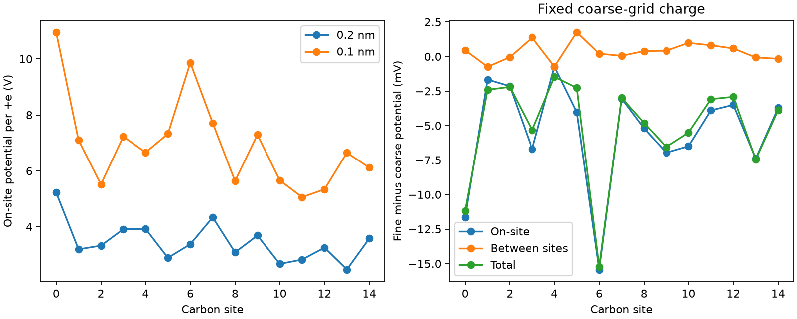

# Electrostatic response decomposition

At identical atom positions and grounded box dimensions, refine the grid from
0.2 to 0.1 nm and deposit +e at each carbon site in turn. The sampled potential
forms the response matrix K (volts per positive elementary charge).

The on-site diagonal increases by **2.083–6.481 V/e**. The largest absolute
between-site change is **0.744 V/e**. This supports investigating finite atomic
charge extent before interpreting local feedback potentials quantitatively.
It does not justify deleting the diagonal or choosing an arbitrary fitted value.

The right panel holds the coarse solution's excess charge fixed and decomposes
its potential change into diagonal and off-diagonal contributions. The nonlinear
transport solution redistributes charge, so these are not an additive causal
attribution of the fully re-solved 3.59 mV shift.

Checks executed: unit deposited charge, response reciprocity, positive
semidefiniteness within 1e-10 V/e roundoff, and reproduction of the saved coarse
potential from its actual reference-subtracted occupations within 1e-8 V.
Strict positive definiteness was not assumed: coarse atom-to-grid mapping may
have unresolved charge directions. No inverse of K is used.

[Complete matrices and provenance](result.json). Reproduce with
`python -m physics_layers.kernel_audit`. This is a numerical diagnostic,
not an orbital calibration or a claim of physical validation. The next test
should hold a specified finite charge distribution fixed while refining the grid.
