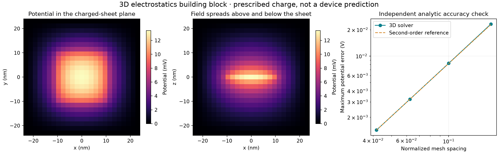

# 3D electrostatics verification

Left: potential of a prescribed positive square sheet patch. Center: vertical cross-section showing fringing. All six box faces are grounded; relative permittivity is 4, spacing is 2 nm, sheet density is 0.1 mC/m². Finite box size affects this illustration. Right: a separate manufactured sine solution on an unequal-spacing 3D mesh converges at second order.

This verifies a field building block, not graphene transport or a winning design. The actual dielectric/contact stack, atomistic charge mapping, reference charge and self-consistent transport closure remain pending. Rebuild with `python -m physics_layers.electrostatic_demo`. Raw fields, convergence values and source hashes are stored alongside this image.
