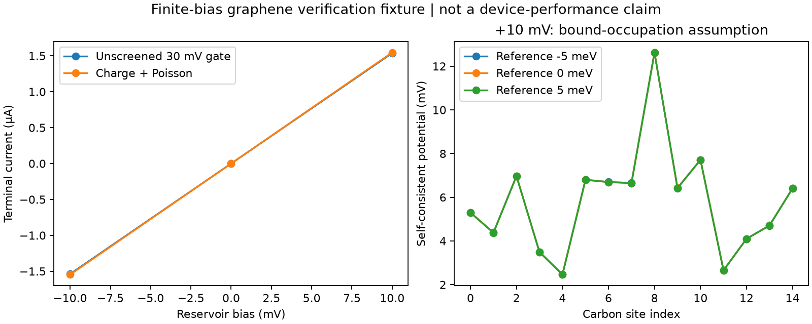

# Finite-bias graphene feedback pilot

Five completed verification cases, 15 carbon sites, two ideal leads, 300 K,
2.5 eV Fermi energy, 30 mV dielectric gate box (relative permittivity 4).
This high-energy miniature fixture is not the searched rectifier or a calibrated device.

At +10 mV reservoir bias, the unscreened gate gives **1.5373030 µA**;
charge/Poisson feedback gives **1.5463068 µA**,
a **0.5857%** change. The screened site potentials span
**2.4656–12.6238 mV**.
Changing the explicit bound-state reference by ±5 meV gives a current spread
of **1.2304 pA**. This does not establish that the bound-state model is physically correct.
Reverse bias yields nearly opposite current; this pilot does not demonstrate useful rectification.

[Raw cases and provenance](result.json) · [Tighter quadrature check](convergence.json) ·
[Method, assumptions and next experiment](../../../physics_layers/FINITE_BIAS.md)

Nine unit tests passed across bias charge, equilibrium charge and accelerated
Poisson feedback. The unit tests include independent full-band chain integration,
gauge covariance and explicit isolated-bound-state occupation. All five coupled
solves passed their final unmixed potential/occupation residual checks.
Mesh, contact-stack and dynamic-state validation remain open.
