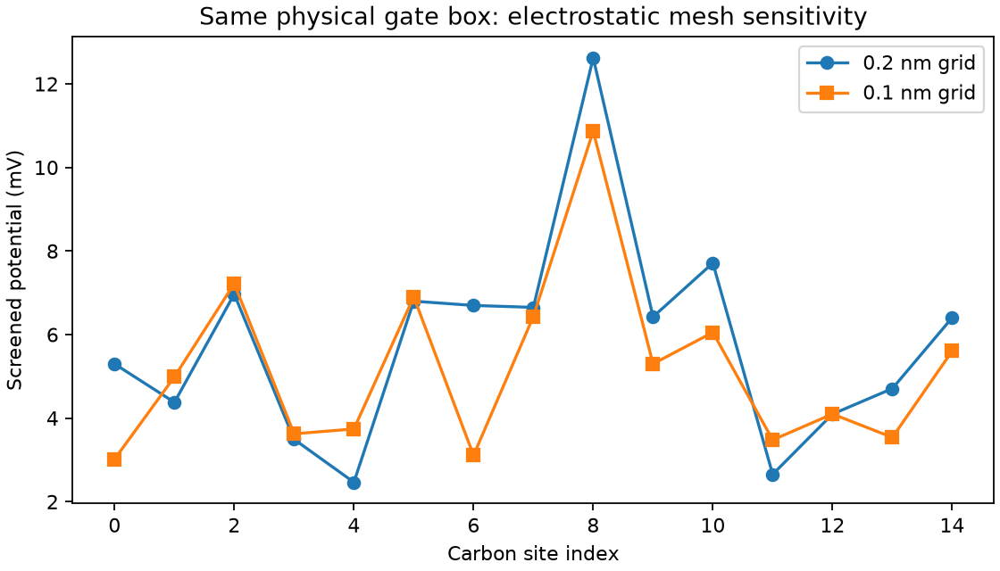

# Electrostatic mesh sensitivity

The same 15-site graphene fixture, atom positions and physical gate-box extents
were solved at 0.1 nm spacing, compared with the prior 0.2 nm grid. Both use
300 K, EF 2.5 eV, +10 mV reservoir bias, 30 mV gate and dielectric constant 4.

Current changes by **0.00660%**, but the maximum
site-potential change is **3.5879 mV**.
The fine-grid current is **1.5464088 µA**.
The final unmixed potential residual is 4.93e-13 V.

**Local electrostatics is not yet mesh-independent.** A small current change does
not establish charge-model convergence. Trilinear point-charge deposition changes
the effective on-site electrostatic interaction as the mesh is refined. The
comparison exposes sensitivity but does not isolate its cause or prove an
asymptotic limit from only two grids. A finite orbital charge distribution or a
justified self-interaction treatment, with further refinement, is needed before
using these potentials for a quantitative storage-state model.

[Receipt and source hashes](result.json) · [Baseline](../finite-bias-feedback/README.md)

Reproduce with `python -m physics_layers.finite_bias_mesh` in the Kwant runtime.
The runner asserts identical physical box extents, retains exact atom positions,
and uses the existing full-grid Poisson/occupation residual checks. This is a
numerical verification study, not physical validation or a new device claim.
