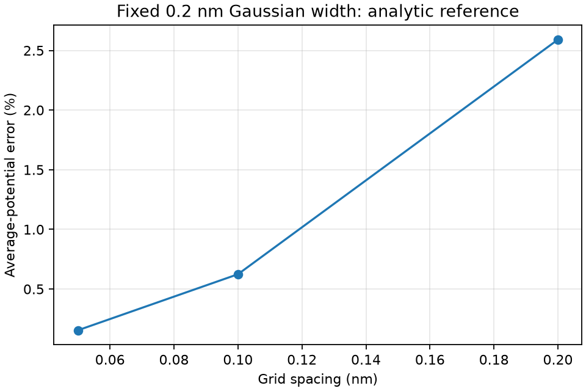

# Fixed finite-charge convergence

A spherical Gaussian with fixed standard deviation 0.2 nm and total charge +e
is solved in relative permittivity 4. The 2.4 nm box uses the analytic free-space
Gaussian potential on its boundary, rather than conducting-gate boundaries.
Charge tails omitted at boundary nodes are below 2.1e-8 of total charge.

The charge-weighted mean potential has analytic value
q/(4*pi*epsilon*sqrt(pi)*sigma) = **1.01551625 V**. This follows by averaging
the Gaussian potential over the same Gaussian density (their relative-coordinate
variance is 2*sigma^2). Electrostatic energy is q times this mean divided by two.
Deposition and potential averaging use the same density weights.

| Grid spacing | Average-potential error |
| --- | ---: |
| 0.2 nm | 2.59115% |
| 0.1 nm | 0.62420% |
| 0.05 nm | 0.15472% |

Error falls by approximately four on each halving, consistent with second-order
convergence. Unit charge, decreasing error and finest error below 1% are checked
by assertions in the runner. This verifies finite-charge numerical treatment;
it does not calibrate a carbon orbital or justify replacing the current graphene
charge distribution by this chosen Gaussian. No campaign physics was changed.

[Receipt](result.json). Reproduce: `python -m physics_layers.finite_charge_demo`.
Next: a conservative finite-width site mapping with adjoint averaging, followed
by width sensitivity and physical orbital/contact calibration.
