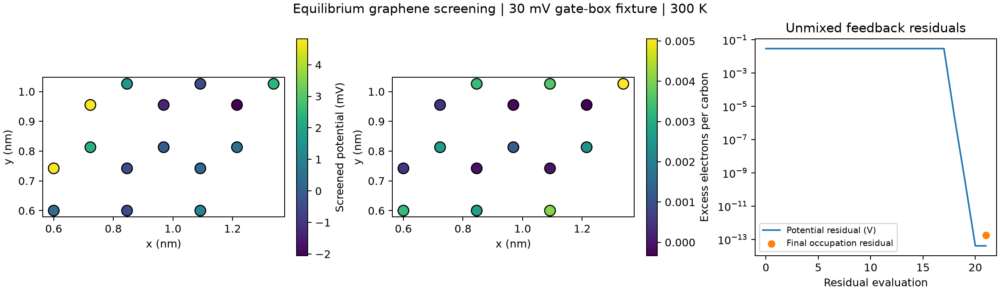

# Equilibrium graphene screening



A 15-site nearest-neighbor graphene ribbon, with ideal semi-infinite leads at a
common chemical potential, is coupled to a 3D dielectric box. The enclosing
boundary is held at 30 mV, the relative permittivity is 4, mesh spacing is 0.2 nm,
and temperature is 300 K. One electron per carbon is the neutral reference.

The converged site potentials range from **−2.056 to +4.826 mV**. Charge feedback
strongly screens the applied boundary potential. The calculation required 21
root-function evaluations followed by a full-grid verification. The plateau in
the residual plot includes finite-difference Jacobian evaluations; it is not a
time trace or physical relaxation curve. Final potential and occupation residuals
are below 1e-12 V and 1e-12 electrons/site, respectively. These algebraic residuals
do not include mesh/model error. Tightening charge/root tolerances is covered by
the regression test; physical mesh and dielectric-stack convergence remain open.

The equilibrium charge includes bound states through a finite-temperature
Matsubara sum, using principal-layer surface decimation and isolated-device tail
subtraction. Two successive pole doublings must pass. A hybrid root solve in site
space uses the same linear Poisson operator as the final full-grid verification.
Failed fixed-mixing and Anderson trials were not accepted as results.

This is a small Hartree verification fixture, **not a simulated rectifier winner**.
It does not establish finite-bias bound-state occupations, calibrated contacts,
edge chemistry, exchange, phonons, high-frequency response or useful efficiency.
The live search still uses its original fixed-potential model.

Reproduce in the Kwant runtime:

```powershell
python -m physics_layers.graphene_feedback_demo
python -m unittest tests.test_equilibrium_charge tests.test_site_acceleration
```

[Numerical data and source hashes](result.json) ·
[Implementation and acceptance limits](../../../physics_layers/STAGES.md#equilibrium-graphene-charge-with-bound-states)
