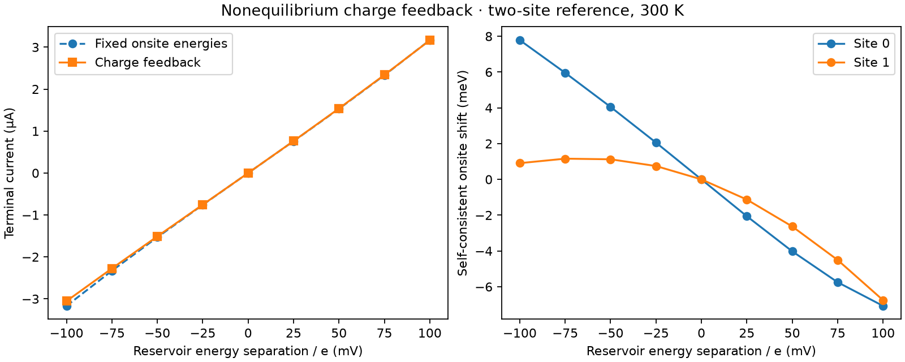

# Two-site nonequilibrium charge-feedback check

Nine bias points at 300 K passed tighter integration and self-consistency checks.
Maximum current change under refinement: 1.47 pA. At -100 mV, current magnitude
changes from 3.168 to 3.054 µA when feedback is included (about 3.6%); at +100 mV,
it changes from 3.168 to 3.163 µA. Local onsite energies shift by up to about 8 meV.

These are results for an explicitly chosen two-site verification model, not the
graphene search winner or a published device. They demonstrate a functioning
nonequilibrium charge/current feedback path. The interaction matrix and wide-band
contacts remain approximations; no efficiency or literature-superiority claim follows.

`results.json` records inputs, equilibrium reference occupations, source hashes,
per-bias charges, currents and residual histories. Regenerate with
`python -m physics_layers.negf_demo`.

[Equations, validation and remaining integration](../../../physics_layers/NEGF_REFERENCE.md).
