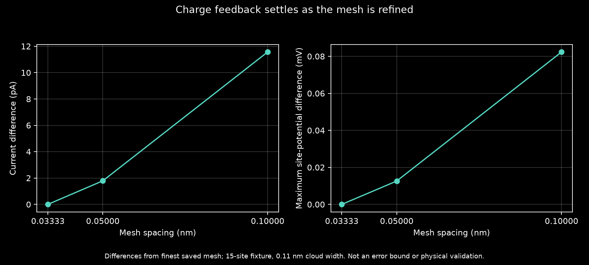

# Third-mesh charge-feedback check



Refining the electrostatic spacing from **0.05 to 0.03333 nm** changes lead-0 current by **−1.787 pA (−0.0001156%)** and site potential by at most **0.01263 mV**. The preceding 0.10-to-0.05 nm step changed current by −9.778 pA and potential by at most 0.06977 mV.

| Mesh spacing (nm) | Lead-0 current (µA) |
|---|---:|
| 0.10 | 1.545974453 |
| 0.05 | 1.545964675 |
| 0.03333 | 1.545962888 |

The current decreases monotonically across these three meshes, with a smaller change on the last step. Refinement ratios differ (2, then 1.5); the smaller change alone does not establish an asymptotic order or rigorous error bound.

This retains the 15-site graphene verification fixture, 0.11 nm Gaussian charge width with five-sigma support, physical box, dielectric 4, 30 mV boundary, 300 K, chemical potentials 2.505/2.495 eV, neutral background and bound-occupation reference. The comparison verifies matching coordinates and physics_layers source hashes, finer spacing and identical box dimensions. Final recomputed residuals are 5.245e-13 V in potential and 1.323e-13 in occupation.

This is numerical mesh-sensitivity evidence, not physical calibration, a new rectifier design or a novelty claim. Energy integration has not been independently tightened. Source hashes cover physics_layers only, not external dependencies or ballistic_lab transport. The live evolutionary search retains its fixed-potential scoring.

Reproduce in the Kwant environment with single-thread BLAS and fresh output paths:

```powershell
python -m physics_layers.finite_width_feedback --sigma-nm 0.11 --factors 6 --output results/physics-reference/width-sensitivity-011-third
python -m ballistic_lab.reporting.compare_width_mesh results/physics-reference/width-sensitivity-011-fine/result.json results/physics-reference/width-sensitivity-011-third/result.json results/physics-reference/width-sensitivity-011-third/comparison.json
python -m ballistic_lab.reporting.plot_width_mesh results/physics-reference/width-sensitivity-011/result.json results/physics-reference/width-sensitivity-011-fine/result.json results/physics-reference/width-sensitivity-011-third/result.json --output results/physics-reference/width-sensitivity-011-third/mesh.png
```

[Previous two meshes](../width-sensitivity-011-fine/README.md) · [Raw result](result.json) · [Comparison and input hashes](comparison.json)
